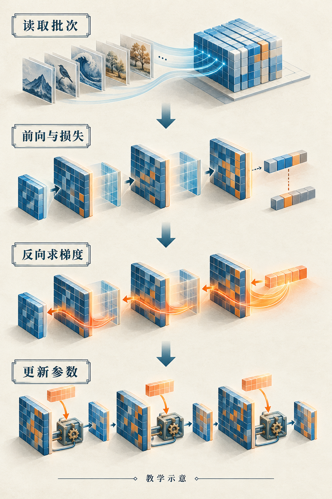

# 第1章　一次训练迭代发生了什么

一段训练程序看上去很短：把数据交给模型，计算损失，调用反向传播，再更新参数。几行代码背后，CPU 在准备批次，GPU 在执行矩阵乘法与归约，显存里同时存着参数、激活、梯度和优化器状态。理解这一轮循环，是理解后面硬件、算子与集群的共同入口。

## 从一个可观察的任务开始

设想训练一个小型文字模型：给它“今天的天气很”，希望它预测下一个字。文字先被分词器变成整数编号；一个批次可以装下多段文字。模型把编号查表变成向量，经过多层计算，为词表中每个候选给出分数，再由损失函数评价正确答案得到的概率。

这里有三种容易混在一起的对象。**参数**是训练要调整的数，例如词嵌入表和线性层权重；**激活**是一次前向执行产生的中间结果，例如某层的输出；**梯度**描述损失对某个量的局部变化率。参数通常跨很多次迭代存在，激活随当前输入改变，梯度则在反向传播时生成。三者的生命周期不同，因此显存管理不能只数模型参数。

本书用批大小 $B$、序列长度 $S$、隐藏宽度 $D$ 描述文字模型。假设 $B=8,S=256,D=512$，一份隐藏激活就有 $8\times256\times512=1,048,576$ 个元素。若每元素占 2 字节，这一份约为 2 MiB。一个层内部可能需要多份不同形状的激活，多层训练也可能同时保留它们。这已经说明，“参数很小”与“训练显存很小”没有必然关系。




*图 1-1｜AI 教学示意。一次更新包含读取批次、前向与损失、反向求梯度和参数更新。图中的矩阵与机制是概念场景；它没有画出所有临时状态和通信。*


## 前向传播：把参数用于当前输入

先看更小的线性预测：

$$
\hat y=xw+b,\qquad L=(\hat y-y)^2.
$$

当输入 $x=2$、目标 $y=5$、参数 $w=1,b=0$ 时，预测为 2，损失为 9。前向传播只是在当前参数下计算这些数，没有发生学习。大型模型只是把这一过程扩展为许多有依赖关系的算子：矩阵乘法、逐元素运算、归一化、注意力、查表等。

算子是数学与软件接口层面的操作，一个算子可能由一个或多个 GPU 内核实现，也可能与邻近算子融合。读者此时只需记住：Python 中的一行表达式，与 GPU 上的一次执行并不总是一一对应。

训练模式也值得单独认识。`model.train()` 使 Dropout、BatchNorm 等模块进入训练行为，它本身不会计算梯度；是否记录自动求导，由梯度模式和张量的求导属性共同决定。反过来，`model.eval()` 也不会自动关闭梯度。[1] 做验证时通常需要同时切换模块行为，并使用适当的无梯度上下文。

## 反向传播：沿依赖关系分配责任

前向计算知道损失是多少，反向计算要知道各参数应该怎样动。对上述例子：

$$
\frac{\partial L}{\partial w}=2(\hat y-y)x=-12,\qquad
\frac{\partial L}{\partial b}=2(\hat y-y)=-6.
$$

负梯度表示：在当前位置，让参数稍微增大，可以使损失降低。这里的“稍微”很重要，导数是局部信息，不保证任意大的改动都有效。

自动求导系统在前向执行时建立求导依赖，并按反向规则组合这些局部变化率。它并不是把整个程序展开成一个巨大公式后再做符号求导。某些反向规则需要前向的输入或输出，因此训练会保存必要的中间张量；后面讨论的重计算，正是在“保存它”与“需要时重算”之间做交换。[2]

在 GPU 上，反向也会执行实际内核。一个线性层的前向包含矩阵乘法，其输入梯度与权重梯度通常也包含矩阵乘法。把所有训练成本都归到前向 FLOPs，会漏掉相当一部分工作；但“反向永远精确等于前向两倍”同样不可靠，具体比例取决于算子和需要哪些梯度。

## 更新参数：梯度还不是新参数

最简单的随机梯度下降按 $w\leftarrow w-\eta g$ 更新参数。取学习率 $\eta=0.1$，例子的参数会变为 $w=2.2,b=0.6$。新预测为 5，新损失恰好为 0；这是为便于手算选择的例子，实际训练没有如此整齐。

AdamW 等优化器还会维护历史状态，改变如何利用梯度。这些状态也是实实在在的显存和内存负担。每轮获得新批次，只是在当前噪声与当前参数附近取得一个估计，训练效果要看许多步累积的趋势，而非要求每一步损失都下降。

PyTorch 的基本循环可以写成下面这样。它使用 CPU 即可执行，目的在于观察训练语义，不是测量 GPU 性能。[3]

```python
import torch

torch.manual_seed(0)
model = torch.nn.Linear(1, 1)
optimizer = torch.optim.SGD(model.parameters(), lr=0.05)
x = torch.tensor([[1.0], [2.0], [3.0], [4.0]])
y = 2 * x + 1

for step in range(100):
    optimizer.zero_grad(set_to_none=True)
    prediction = model(x)
    loss = torch.nn.functional.mse_loss(prediction, y)
    loss.backward()
    optimizer.step()
print(float(loss.detach()))
```

`zero_grad` 明确划出本轮梯度的边界，`backward` 计算并累积梯度，`step` 才调整参数。特意跨多个小批次保留梯度，可以实现梯度累积；不小心忘记清理，则可能得到与预期不同的更新。

## 时间线比“GPU 利用率”更能说明问题

一次迭代还有准备输入、设备搬运、启动内核、同步与记录指标。若 CPU 花很久读数据，GPU 可能等不到任务；若算子很小，启动与调度可能占大头；若访问显存远多于计算，峰值矩阵算力也未必派上用场。在多卡上，还会出现梯度同步等通信。

因此观察训练时，先把时间拆成“数据准备、前向、反向、更新、通信或同步”等阶段。阶段可以重叠，不能总把各自的测量简单相加。尤其 GPU 经常异步执行，Python 函数返回只表示工作已经提交，未必表示设备已经完成。后面会用事件计时与 Profiler 观察真实时间线。

读完本章，可以先做一个小观察：把上面的 `backward()` 注释掉，参数是否仍会按损失学习？再保留反向、注释 `step()`，比较参数是否改变。两个实验分别隔离“得到梯度”与“使用梯度”，帮助我们在更复杂的训练栈中保持清楚的边界。

## 一个批次，并不等于看完全部数据

批次（batch）决定本次用多少样本估计梯度，迭代步（step）强调一次循环或参数更新，轮次（epoch）则通常表示遍历一遍训练数据。使用梯度累积后，一次参数更新可能跨多个微批次；某些日志把微批次也计作 step，必须先核查含义。假设固定数据集有 1000 个样本，批大小为 100 且不丢尾批，一轮含 10 个批次；如果累积两个批次才更新一次，这一轮只有 5 次参数更新。样本数、批次数和更新数会同时影响日志解释。

这也解释了为什么比较两个训练方案不能只说“都跑一千步”。它们可能看到了不同数量的数据，使用不同的有效批大小，甚至采用不同的序列长度。全书实验会同时记录输入规模、更新次数和数据处理量，使性能与学习效果具有可比较的边界。

工程中的 `examples/01-training-cpu.py` 提供纯 Python 的单样本计算，读者可以在未安装 PyTorch 时先观察前向、梯度、有限差分和参数更新。它用于核对本章手算数值，不是完整模型训练框架。

## 本章参考

[1] PyTorch，Module.train / Module.eval 与梯度模式，官方 API 与说明：<https://docs.pytorch.org/docs/stable/generated/torch.nn.Module.html>。

[2] PyTorch，Autograd mechanics：<https://docs.pytorch.org/docs/stable/notes/autograd.html>。

[3] PyTorch Tutorials，Optimizing Model Parameters：<https://docs.pytorch.org/tutorials/beginner/basics/optimization_tutorial.html>。
