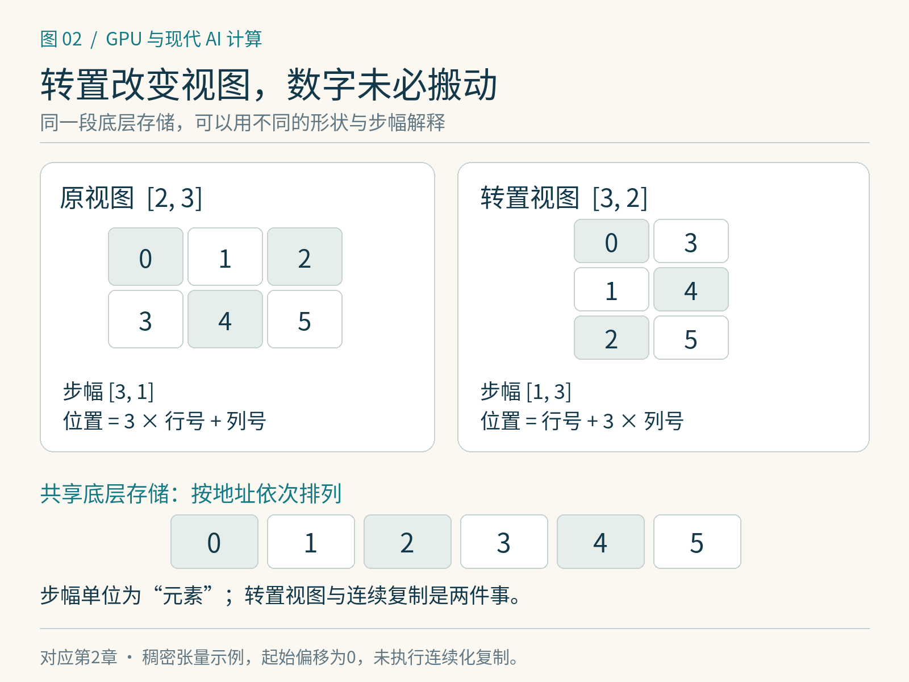

# 第2章　张量、布局与矩阵运算

同样写成 `A @ B`，有时计算很快，有时却多出一次数据复制。差别可能不在公式，而在数字如何摆放。学习算子之前，需要同时看见张量的数学形状与它在存储中的表示。

## 形状是在说明每个轴的意义

本书把张量理解为带形状的数值集合。标量没有轴，向量有一个轴，矩阵有两个轴；图像和文字批次往往有更多轴。对文字模型，`[B, S, D]` 分别表示批次、序列位置和特征。对图像，常见形状有 `[N, C, H, W]` 与 `[N, H, W, C]`；符号相同的四个维度，排列不同就会改变访问方式。

形状首先是正确性约束。若输入 $X\in\mathbb{R}^{B S\times D}$，权重 $W\in\mathbb{R}^{D\times F}$，则输出为 $Y=XW\in\mathbb{R}^{B S\times F}$。每个输出元素是一个长度 $D$ 的内积；结果有 $BSF$ 个元素。按一次乘法、一次加法分别记一个浮点操作，常用的近似计算量是 $2BSDF$ FLOPs，忽略边缘项。这是工作量估算，不是耗时承诺。

例如 $B=8,S=256,D=512,F=2048$，计算量约为 $4.29\times10^9$ FLOPs。换一块标称算力很高的 GPU，仍要考虑数据类型、矩阵尺寸、库的选择与内存访问，不能直接把这个数除以宣传峰值就当实际耗时。




*图 2-1｜原创精确图解。同一段存储可以用不同形状和步长读取。上方原视图与转置视图共享下方六个元素，转置没有移动这些数。*


## 存储是线性的，张量可以有多种视图

一个普通稠密张量通常由底层存储和形状、步幅、起始偏移等元数据共同描述。**步幅**（stride）说明沿某个轴前进一步，在存储中要跨过多少个元素；本章的步幅单位都是元素，换成字节还要乘以元素大小。[1]

考虑顺序存放 `0,1,2,3,4,5` 的一段存储，把它看成形状 `[2,3]` 的矩阵：第一行是 0、1、2，第二行是 3、4、5。其步幅是 `[3,1]`，索引 `[i,j]` 对应位置 $3i+j$。转置后形状成为 `[3,2]`，步幅成为 `[1,3]`：索引的解释改变了，数字本身未必移动。

这正是**视图**的意义：用不同元数据观察同一段数据。视图可以减少分配与搬运，也可能把后续算子变成不规则访问。原张量与视图若共享存储，修改一方还可能影响另一方；共享存储是程序语义的一部分，不只是性能细节。[2]

下面的 CPU 示例可直接执行：

```python
import torch

x = torch.arange(6).reshape(2, 3)
y = x.transpose(0, 1)
print(x.shape, x.stride())  # [2, 3], (3, 1)
print(y.shape, y.stride())  # [3, 2], (1, 3)
print(y.is_contiguous())
z = y.contiguous()
print(z.shape, z.stride())
```

这里 `contiguous()` 在需要时构造目标内存格式下的连续表示；若已经满足要求，则可以直接返回原张量。不要把它理解成免费的“优化按钮”：复制数据会花时间，占用空间，也可能只是把一次代价从后面的库调用移到这里。

## reshape 与 transpose 在做不同的事

`transpose` 或 `permute` 改变轴之间的对应关系，`reshape` 改变如何把元素分成各个轴。二者不能按“反正形状相同”互换。把 `[2,3]` 改成 `[3,2]`，与交换两轴得到的数值排列不同。

PyTorch 的 `view` 需要新形状与原有步幅满足兼容条件；`reshape` 在可行时返回视图，否则可能复制。代码不应依赖 `reshape` 必然共享或必然不共享存储。[3] 写算子时，最好明确接口接受哪些步幅，而不是只检查 `shape`。只为连续张量写的寻址公式，遇到转置输入可能输出错误，甚至越界。

广播也与存储有关。把长度 $D$ 的偏置加到 `[B,S,D]` 上，数学上相当于每个位置都加一遍偏置，但通常不必真的复制出 $BS$ 份偏置。某些广播视图通过零步幅反复引用同一位置；读取很方便，对这种别名视图做原位写入则需要格外谨慎。

## 布局如何影响 GPU 工作

GPU 的相邻执行通道若读取相邻地址，硬件往往能以较少的内存事务满足访问；若每个通道都跨很远，可能读取许多没用到的数据。具体事务大小与合并规则随架构和访问类型变化，但“观察一组线程共同访问了哪些地址”比“单个线程写了几次 load”更有解释力。[4]

矩阵乘法还需要复用。计算一块输出时，同一块输入会服务多个输出元素。如果输入布局与内核分块不匹配，程序可能先做转置、打包或片上重排。这样的变换可以值得：多花一次准备成本，换来主体计算更高效；但小矩阵或只用一次的数据未必能摊薄代价。

现代矩阵内核往往同时存在多个层次的布局：用户看到的张量布局、显存中的打包布局、共享内存中的布局，以及分散到各线程寄存器中的片段布局。不能因为数学上是同一个矩阵，就假设硬件始终按自然行列顺序持有它。后面进入 Tensor Core、CuTe DSL 与 Triton 时，布局会从背景知识变成直接的编程对象。

## 给算子写一份输入契约

准备实现 RMSNorm 或矩阵乘法之前，先写清数据类型、维度范围、步幅、设备、对齐要求以及是否允许输入输出别名。再决定遇到不满足条件的输入时，是报错、复制到支持的布局，还是选择另一条实现路径。这个顺序可以防止“只在自己的一组测试上快”的内核被误当作通用算子。

本章的观察练习是对同一个转置张量分别记录形状、步幅和连续性，然后将其复制为连续张量，再验证数值一致。先理解“数值相同、表示不同”，后面的性能分析才有明确对象。没有 GPU 也能完成这个实验；它观察的是存储语义，不提供 GPU 性能结论。

## 元素数、字节数与实际占用

形状相乘得到元素数，再乘每元素字节数，得到一份普通稠密数值表示的逻辑大小。例如 `[8,256,512]` 有 1048576 个元素，FP32 为 4 MiB，BF16 为 2 MiB。但张量视图可能与其他张量共享同一段存储，切片也可能只引用大存储的一小部分。直接把所有张量的逻辑字节相加，会重复计算共享存储；只计算切片的元素数，又可能低估它保留的底层大块分配。

量化张量还可能携带缩放因子、零点或打包元数据，稀疏张量则需要索引等附加结构。因此“每个权重四位”描述有效载荷，并不保证实际总占用恰好是参数量的一半字节。布局、表示与分配三个层次在显存账本中需要分别处理，第 12 章会进一步使用它们。

工程中的 `examples/02-layout-cpu.py` 不依赖第三方库，用一段列表和两种步幅展示相同原理。先手算转置结果，再执行脚本核对；最后先将底层存储改为 `storage = list(range(7))`，再用 `materialize(storage, (2, 3), (3, 1), offset=1)` 观察起始偏移的作用。此时访问索引为 1 到 6，仍在存储范围内。它只验证寻址关系，既不模拟设备缓存，也不能用脚本运行时间推断真实张量库的优劣。

## 本章参考

[1] PyTorch，torch.Tensor 与 stride：<https://docs.pytorch.org/docs/stable/tensors.html>。

[2] PyTorch，Tensor Views：<https://docs.pytorch.org/docs/stable/tensor_view.html>。

[3] PyTorch，torch.Tensor.view：<https://docs.pytorch.org/docs/stable/generated/torch.Tensor.view.html>。

[4] NVIDIA，CUDA C++ Best Practices Guide，Memory Optimizations：<https://docs.nvidia.com/cuda/cuda-c-best-practices-guide/index.html#memory-optimizations>。
