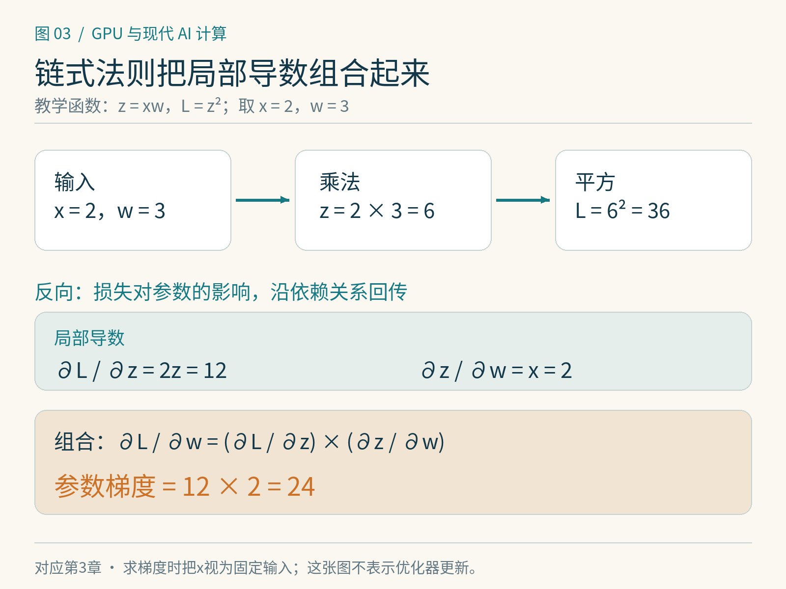

# 第3章　自动求导、反向传播与优化器

训练时调用 `loss.backward()`，看起来像按下一个总开关。它真正完成的是：沿着已经发生的计算，组合局部导数，把损失对参数的影响积累起来。理解这个过程，也就能理解训练为什么保存激活、融合算子为什么要考虑反向、某些原位修改为什么会报错。

## 梯度是局部变化率

设 $z=xw$，$L=z^2$。如果 $x=2,w=3$，则 $z=6,L=36$。链式法则把“参数变化对损失的影响”分成两段：

$$
\frac{\partial L}{\partial w}
=\frac{\partial L}{\partial z}\frac{\partial z}{\partial w}
=2z\cdot x=24.
$$

中间结果 $z$ 在反向计算中再次出现，输入 $x$ 也要参与。这解释了为什么反向往往不能只拿最终损失开工：它需要足够的前向信息。不同算子的导数需要不同内容，框架会按规则保存所需张量。存储空间、计算量和实现方式就在这里发生联系。[1]

梯度的大小依赖单位和损失定义。把一个批次的损失从求和改成平均，参数梯度通常会跟着缩放；学习率不变时，实际更新幅度就变了。跨微批次累积梯度时，必须保持期望的损失归一化，而不能只把 `backward()` 多调用几次。




*图 3-1｜原创精确图解。局部导数组合成参数梯度：z=xw、L=z²、x=2、w=3时，∂L/∂w=12×2=24。反向传播沿已发生的计算关系组织这些乘积。*


## 反向模式为什么适合神经网络

一个模型可能有大量参数，训练目标通常是一个标量损失。反向模式从标量损失出发，将上游梯度逐层向后传递，因而适合“输入维度大、输出维度小”的求导问题。它通常计算向量—雅可比积，而不显式形成每一层完整的雅可比矩阵。[2]

以 $Y=XW$ 为例，若上游梯度为 $G=\partial L/\partial Y$，则：

$$
\frac{\partial L}{\partial X}=GW^{\mathsf T},\qquad
\frac{\partial L}{\partial W}=X^{\mathsf T}G.
$$

公式同时告诉我们三件事：输入梯度需要权重，权重梯度需要输入，反向也能利用矩阵乘法内核。如果输入不需要梯度，可以省去对应分支；如果只训练一小部分参数，仍可能需要穿过冻结层把梯度传给更早的可训练部分。冻结参数不等于整层所有计算都自动消失。

## 动态求导图不是模型结构图

PyTorch 在梯度模式下记录实际执行的操作，得到本轮的求导依赖。Python 条件分支选择不同，实际记录的路径也可能不同；下一轮还可以重新建立图。模型类的层列表描述组织方式，求导图描述本轮执行过哪些可微运算，二者不能完全等同。[1]

叶子张量通常是用户直接创建、需要求导的参数，反向后其 `.grad` 会被累积。中间张量的梯度默认不为用户保留，并不代表这些梯度没有被计算。下面的例子使用 CPU 即可执行：

```python
import torch

x = torch.tensor(2.0)
w = torch.tensor(3.0, requires_grad=True)
z = x * w
loss = z.square()
loss.backward()
print(w.grad.item())  # 24.0
```

如果重新构造同样的前向并再次反向，而不清理 `w.grad`，其值会累积。对同一张已经释放必要缓存的图重复反向，则可能报错；`retain_graph=True` 是保留图的工具，不应成为处理错误的默认办法，否则会延长张量生命周期并占用更多内存。

## 关闭梯度、切换模式与切断路径

`torch.no_grad()` 适用于不需要记录反向的计算，例如许多验证过程或参数更新；`detach()` 得到与原张量共享数据但切断求导关系的张量。它们改变求导行为，不能随意加在训练路径上，否则想要的梯度也会消失。`inference_mode` 进一步减少一些维护开销，同时有更严格的使用约束，应按官方说明使用。[3]

另一个常见问题是原位修改。若反向需要的张量在前向后被改写，保存的值就不再对应当时的计算。框架会进行版本检查，在许多这类情况下报错；绕过检查强行写入，并不是修好了求导。正确做法是识别谁还需要原值，改用非原位操作，或重新设计保存策略。

当我们手写算子时，正确的前向只是起点。还要提供正确的反向、检查不同输入形状和数据类型，并注意数值稳定性。有限差分梯度检查可以帮助发现公式错误，但低精度和不光滑点会影响检查方式，不能拿一次通过代替完整验证。

## 优化器把梯度变成参数变化

SGD 使用当前梯度；带动量的 SGD 还保存变化方向的历史。Adam 为每个参数维护一阶与二阶矩估计，分别反映梯度的平滑趋势与量级，再据此调整更新。AdamW 将权重衰减与梯度自适应缩放分开处理，这与简单把 L2 项加入所有情况下的损失并不完全等价。[4]

这些方法都需要明确学习率与状态。初始化阶段、恢复训练以及切换精度时，如果只保存参数、不保存优化器状态，接下来的轨迹往往不会与连续训练相同。对于每个拥有状态的参数元素，状态也有相应存储；大型训练的显存预算必须把它们算进去。

优化器融合则把多个逐元素更新步骤合并，减少中间读写和启动开销。它能改变执行效率，但不应该悄悄改变训练语义。比较两个实现时，需要确认偏置修正、epsilon 放置、权重衰减方式、状态精度以及步数计数等是否一致。

## 观察梯度，先建立因果关系

练习时，可以为一个小模型记录参数范数、梯度范数、更新范数和损失。将学习率设为零，梯度仍然存在，但参数更新应消失；切断某一支路的求导关系，其更早的可训练参数可能不再获得梯度。这样的观察比只看最终准确率更容易定位错误。

后面遇到重计算、分片梯度或自定义反向时，我们始终追踪同一件事：当前损失通过哪条路径影响哪个参数，所需数值在何时、何地存在。把这条线追清楚，自动求导就从黑盒变成可以检查的执行过程。

## 用有限差分交叉检查一个梯度

对可微的标量函数，可以用中心差分近似导数：令参数分别增加和减少一个小量 $h$，计算 $[L(w+h)-L(w-h)]/(2h)$。在本章的平方例子中，取双精度计算和适当的 $h$，结果应接近解析值 24。这个检查独立于自动求导规则，适合发现手写反向中的符号、维度或缩放错误。

但 $h$ 不是越小越好：过大时近似不够局部，过小时相减可能放大浮点舍入误差。含随机行为的函数还需固定随机状态，含分段不可微点的函数需避开或按定义解释。实际检查大型算子时，通常选小规模、较高精度的输入，并分别检查每个可求导输入，而不会构造全模型的巨大雅可比矩阵。

## 本章参考

[1] PyTorch，Autograd mechanics：<https://docs.pytorch.org/docs/stable/notes/autograd.html>。

[2] PyTorch，A Gentle Introduction to torch.autograd：<https://docs.pytorch.org/tutorials/beginner/blitz/autograd_tutorial.html>。

[3] PyTorch，Locally disabling gradient computation：<https://docs.pytorch.org/docs/stable/notes/autograd.html#locally-disabling-gradient-computation>。

[4] Ilya Loshchilov、Frank Hutter，Decoupled Weight Decay Regularization，2017／ICLR 2019：<https://arxiv.org/abs/1711.05101>；PyTorch AdamW：<https://docs.pytorch.org/docs/stable/generated/torch.optim.AdamW.html>。
