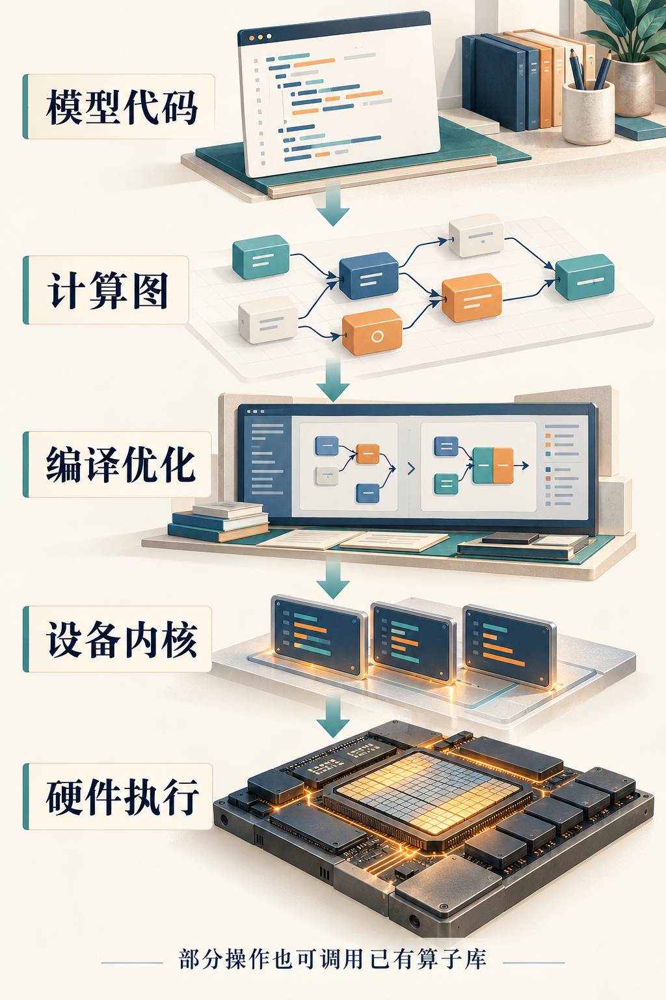

# 第4章　从 Python 到 GPU 执行的完整路径

运行 `y = x @ w` 时，Python 并没有逐个计算矩阵元素。它描述任务，框架挑选实现，运行时提交工作，GPU 执行内核。把这些层次分开，才能理解为什么安装驱动与安装工具包不同、为什么首次调用慢、为什么一个算子可能对应多个内核。

## 先区分接口、实现与机器指令

**算子**是具有输入、输出和语义的操作，例如矩阵乘法或归约求和。**内核**是提交给设备的一段程序，由许多执行实例共同处理数据。**机器指令**则是芯片实际执行的指令。一个内核包含许多指令，一个算子也可能启动多个内核。

例如 `softmax(x)` 数学上是沿某个维度进行一次归一化。实现却可以分成求最大值、减最大值、指数、求和、除法，也可以把这些步骤融合进一个内核。反过来，一个很大的归约也可能需要多轮内核配合，先生成局部结果，再合并。因此，数 Python 调用次数，不能直接得出设备启动次数。

框架的高级模块处于更上一层。一个 Transformer 层会展开出许多算子；编译器还可能重排和融合其中一部分。我们分析性能时，要说明观察的是模块、算子、内核还是指令，否则“这一层很慢”的结论很难转成改进措施。

*图 4-1｜AI 教学示意。模型代码经过图表示与编译优化，可以生成设备内核，也可以调用已有算子库。这是主路径示意；实际程序还可能有图断裂、CPU执行与多种后端。*

## 一次 Eager 调用怎样找到实现

PyTorch 的即时执行路径中，Python 绑定进入算子接口，再由分派机制根据张量的设备、布局和当前功能状态等选择实现。自动求导、自动混合精度、张量子类等都可能参与分派；它不是只看“CPU 还是 GPU”就结束。[1]

GPU 实现可能直接调用手写内核，也可能调用 cuBLAS、cuDNN 等库；AMD 环境有相应 ROCm 库。成熟数学库对特定类型和形状可能有多种算法，会根据约束选择实现，有时还需要临时工作空间。用户看到同一算子，换形状后走到不同算法，是很正常的事。

某些调用只改变元数据，例如满足条件的视图操作，可以没有 GPU 计算内核。另一些调用会分配输出或临时缓冲区，即使公式看起来很简单，也要进行资源管理。Profiler 中既要看设备计算，也要看 CPU 端调度与分配，才不容易漏掉关键部分。

## 编译路径在中间加入了什么

使用图编译时，框架尝试捕获一段计算，将其转换为更适合优化的表示。编译器分析依赖、形状和布局，选择哪些操作可以融合，哪些交给现成库，哪些生成新内核。最终仍需要提交设备工作，只是实现的组织方式变了。

这解释了首次调用常见的额外成本：除了运行，还可能涉及图捕获、代码生成、编译、加载或自动调优。后续调用若能复用已有结果，成本就不同。若输入形状或守卫条件变化，还可能重新编译。比较性能时，必须区分冷启动、稳定执行以及实际输入分布下的整体表现。

编译器也不能凭空消除所有依赖。读取一个 GPU 结果来决定 Python 分支，可能要求把数据交回 CPU；不受支持的操作可能切开捕获区域。第 16 章会具体观察这些情况，这里先建立位置感：编译器位于模型表达与设备执行之间，它的优化空间受程序语义和后端能力约束。

## 驱动、运行时与编译工具包

以 NVIDIA 为例，驱动提供操作系统与 GPU 之间所需的设备支持及相关接口；CUDA 运行时提供常见的内存、流和内核启动接口；CUDA Toolkit 包含编译器、开发头文件与工具等。预构建框架包可能携带所需的用户态依赖，因而“运行框架”不总要求另外安装完整 Toolkit；编译自定义扩展则可能需要相应开发组件。

兼容性需要分别查驱动、运行时、框架构建与目标 GPU，不能只看到机器上某个 `nvcc` 版本就断言整个环境一致。AMD、Apple 等生态的组件名称与分层有所不同，但同样要区分设备驱动、计算 API、编译工具和框架后端。

CUDA 设备代码可以经历不同编译阶段。PTX 是虚拟指令集表示，cubin 包含面向物理 GPU 的设备二进制；程序可以携带对应目标的代码，也可能在加载时由驱动进行适当的即时编译或处理。[2] 因而“源码用了 CUDA”并不等于“产物能在任意 CUDA GPU 上直接运行”，目标架构与代码携带方式仍然重要。

## 提交完成与执行完成是两个时刻

GPU 常以异步方式处理任务。CPU 将内核提交到流中后，可以继续执行主机代码；同一流中的依赖顺序得到保证，不同流之间则需要按数据关系显式建立必要同步。[3]

设 CPU 花 20 微秒提交一次任务，而 GPU 花 200 微秒执行。只用主机时钟围住提交调用，可能主要测到前者；在后面读取结果时，又突然遇到等待。这样会误以为“读取特别慢、计算特别快”，实际上只是等待被记到了不同位置。

设备事件可以在指定流上标记时间点，Profiler 则能同时展示 CPU 与 GPU 时间线。对真实端到端延迟，仍可能需要主机计时与明确的同步边界。不同测量回答不同问题，不能把所有计时都统一成一个数字。

频繁调用 `.item()` 将设备上的标量变成 Python 数字，常会要求等待相关结果；每一步打印损失就可能改变流水线。调试时这些同步可以帮助定位问题，性能测量时则要知道它们存在。跨流代码还需保证对象生命周期，不能只建立执行依赖却让底层存储过早被复用。[4]

## 用一张执行账单定位问题

遇到慢程序，可以沿调用路径逐层问：模型实际执行了什么？框架选了哪些算子？编译器有没有重复编译或额外复制？设备启动了哪些内核？CPU 是否及时提交？GPU 是否在等数据或通信？这样的顺序把“GPU 不够快”拆成可检查的具体假设。

本章建议观察一个简单矩阵运算的首次与重复调用，再用正确同步边界比较。没有 GPU 时，也可以先在 CPU 上区分 Python 开销与张量运算开销。观察结果属于所用设备、版本和形状，不应外推为所有训练的固定规律。

为了让记录可复查，实验笔记应同时保存框架版本、后端构建信息、设备型号、输入形状和计时边界。安装成功只能说明一条调用路径能够工作，不能证明自定义编译、低精度矩阵库和多卡通信都已具备；这些能力应分别用对应任务确认。

## 本章参考

[1] PyTorch DevLog，How Does the Dispatcher Work?，2026：<https://docs.pytorch.org/devlogs/dispatcher/2026-04-16-how-does-the-dispatcher-work/>。

[2] NVIDIA，CUDA Programming Guide，The CUDA platform：<https://docs.nvidia.com/cuda/cuda-programming-guide/01-introduction/cuda-platform.html>；Understanding PTX：<https://developer.nvidia.com/blog/understanding-ptx-the-assembly-language-of-cuda-gpu-computing/>。

[3] NVIDIA，CUDA Programming Guide，Asynchronous Execution：<https://docs.nvidia.com/cuda/cuda-programming-guide/02-basics/asynchronous-execution.html>。

[4] PyTorch，CUDA semantics：<https://docs.pytorch.org/docs/stable/notes/cuda.html>。
