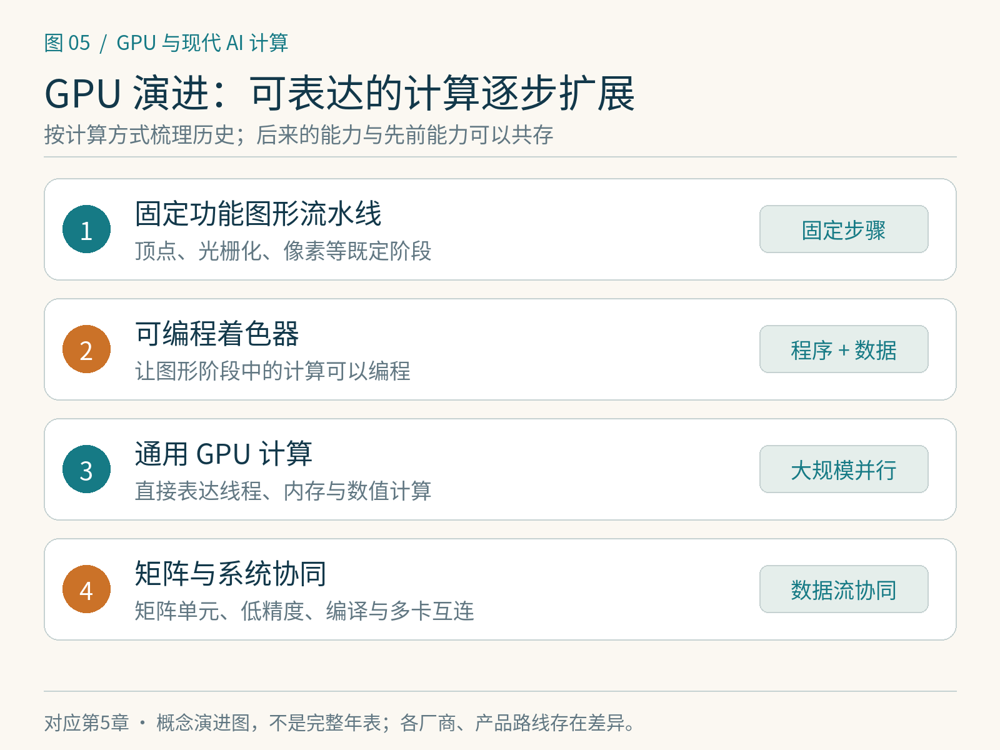

# 第5章　从图形处理到通用计算

GPU 的名字里有“图形”，现代训练机房里却常常没有显示器。这不是偶然改用，而是图形任务中形成的并行处理方式，恰好能够服务许多其他计算。本章只保留有助于理解今天硬件的历史：每一步变化解决了什么问题，又留下哪些编程特点。

## 图像天然包含大量相似工作

绘制一帧三维场景，需要处理许多顶点、三角形和像素。不同像素的颜色计算往往有相似步骤，适合让大量执行通道同时工作。早期图形硬件以固定功能流水线加速特定步骤；随着可编程着色器发展，程序员能描述越来越多处理逻辑。

“可编程”并不意味着任何程序都同样合适。图形吞吐量通常比单个操作的最短响应更重要，数据流也倾向包含大量并行元素。这促使硬件把资源用于并行算术与高吞吐存储访问。CPU 则要处理操作系统、复杂控制流、低延迟任务和各种程序，不会只为同一种吞吐模式设计。现代 CPU 与 GPU 都很复杂，这是一种任务取向的比较，不能简化为“CPU 没有并行、GPU 没有控制能力”。

*图 5-1｜原创精确图解。GPU的发展扩大了可表达的计算范围。各阶段不是互相替代的严格年代边界，传统图形工作与现代矩阵计算仍然并存。*

## 从着色器借道，到直接表达计算

通用 GPU 计算的早期尝试常把数据装进图形资源，把计算写成着色程序，再将结果读回。这证明图形硬件可以做科学计算，但程序结构要迁就图形接口。统一着色器架构把不同着色阶段的可编程资源进一步统一，通用计算平台则让开发者能够直接表达线程、内存和计算任务。

NVIDIA 在 2006 年公布 CUDA，随后推进开发环境与编程模型，使 GPU 计算不必经由图形 API 来表达。[1] 这不是 GPU 科学计算的唯一来源，也不是通用并行编程的起点；它的重要性在于把硬件能力、语言工具、运行时和库组织成开发者可以持续使用的体系。

这一变化留下两个延续至今的特点：一是程序需要暴露足够多可并行工作，二是开发工具与库对硬件价值非常关键。只有理论算力，没有合适编译器、数值库和分析工具，应用很难把算力兑现成稳定收益。

## 从并行标量运算，到矩阵专用路径

许多科学任务需要大规模相同运算，深度学习进一步带来了密集矩阵乘法、卷积与反向传播。矩阵计算包含规则的数据复用关系，使专门的乘加路径能够提供更高吞吐。NVIDIA 的 Tensor Core、AMD 的矩阵指令与相关执行资源，都应放在“利用常见运算结构提高效率”的背景下理解。

专用矩阵路径不会替代全部 GPU 计算。模型仍需要归约、索引、激活函数、随机数、优化器更新和通信。有的运算受显存带宽限制，有的受控制流或访问不规则限制。即使矩阵峰值大幅提升，整个训练也不会自动等比例加速。

数值格式随之成为软硬件共同设计的问题。更小格式可以减少数据量，矩阵单元也可能以更高吞吐处理它们；模型却需要控制误差与保持收敛。混合精度、缩放与累加精度因此成为训练算法的一部分。第 8 章讲格式与硬件，第 13 章再从训练稳定性进入具体配方。

## 为什么今天要读架构，而非背显卡年表

现代硬件变化不只是核心数量增加。显存容量与带宽、异步搬运、矩阵执行路径、片上资源、互连和封装都会改变最合适的算法。例如减少显存往返的 Attention 实现，收益来自算法与存储层级协作；多 GPU 训练的收益，又受到通信拓扑与状态分片影响。

本书会用 Ampere、Hopper、Blackwell 等作为 NVIDIA 架构案例，但同一个架构家族内，数据中心与消费产品也可能存在明显差异。Blackwell 调优文档专门讨论了矩阵计算、存储层级与设备特性；其能力必须对照具体计算能力与型号核实。[2] AMD 的 CDNA 与 RDNA 也服务不同取向，不能把一家厂商的一张参数表套到整个产品家族。

因此，历史章节不会给出一长串“某代比某代更强”的排名。读每一代案例时，只提取它解决的问题：怎样供给数据、怎样复用片上数据、怎样提高矩阵吞吐、怎样连接多芯片。硬件名称更新后，这些问题仍然有用。

## GPU 正在成为系统的一部分

在个人电脑中，GPU 可以通过 PCIe 连接 CPU，并使用自己的显存；在部分 SoC 和紧耦合系统中，CPU 与 GPU 的内存组织和互连方式又不同。统一地址或共享物理内存改善了编程体验，但不能据此假设所有位置的访问速度相同。大型训练更进一步依赖多 GPU 互连、网卡、交换机、存储、供电和散热。

这意味着比较硬件需要从工作负载出发。小模型交互推理关心响应与可用内存，大批量训练关心吞吐、数值支持与扩展效率，稀疏或不规则任务又有其他限制。一个设备在某项峰值规格上领先，不足以决定它对所有应用都更合适。

GPU 也不是唯一的加速路线。TPU、NPU 和其他专用加速器可以在更受约束的运算、编译或数据流设计上取舍。第 36 章会把这些路线放回同一系统问题中比较，避免用“通用”或“专用”两个词直接作优劣判断。

## 读规格时先问三个问题

第一，规格对应什么数据类型、什么运算，是否依赖结构化稀疏等条件？第二，任务需要搬多少数据，能否让计算单元持续得到供给？第三，软件是否能在这块硬件上表达并高效执行目标工作？这三个问题比记住某个峰值数字更接近真实使用。

本章的观察练习可以选两份官方规格：一份桌面 GPU，一份训练加速器。先不比较价格，只把显存类型、容量、互连、支持精度和软件支持列出来，再判断它们各自在为哪类任务作取舍。这里不要求购买设备，也不根据规格臆造实际性能。

这里还要区分设备、产品与系统三个命名层次：GPU 芯片的架构名称，配有特定内存和功耗配置的板卡型号，以及由 CPU、多个 GPU 和互连组成的整机或机架名称。看到一个新名字时，先判断它属于哪层，才能避免把系统总带宽写成单芯片能力。

## 本章参考

[1] NVIDIA，CUDA Refresher: Reviewing the Origins of GPU Computing：<https://developer.nvidia.com/blog/cuda-refresher-reviewing-the-origins-of-gpu-computing/>；企业历史中的 CUDA 时间点：<https://www.nvidia.com/en-us/about-nvidia/corporate-timeline/>。

[2] NVIDIA，Blackwell Tuning Guide：<https://docs.nvidia.com/cuda/blackwell-tuning-guide/index.html>。

[3] AMD，GPU specifications：<https://rocm.docs.amd.com/en/latest/reference/gpu-arch-specs.html>。
