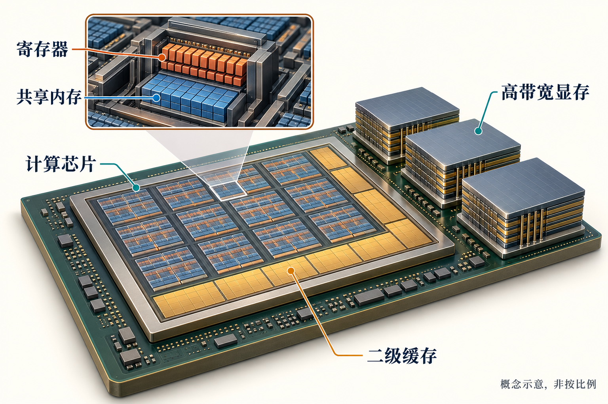

# 第7章　寄存器、共享内存、缓存与 HBM

设想一次矩阵乘法已经排好了数万个线程，计算单元却仍在等待。问题可能不在乘法本身，而在下一组数字还没有送到。GPU 的存储系统由容量、带宽、延迟、共享范围各不相同的层级组成。写高效算子，首先要知道一个数在哪里、由谁搬运、可以重复使用多少次。

## 一份数据的几个落脚点

全局内存是内核访问设备大容量存储时最常见的逻辑空间。在数据中心 GPU 上，它通常由封装附近的 HBM 提供；许多消费 GPU 则使用 GDDR。HBM 是高带宽内存技术，不是所有显存的通用名称。访问全局内存的操作可能命中缓存，因此“读全局内存”也不等于每次都去 HBM。[1]

L2 缓存通常服务整颗 GPU 的多个计算单元，L1 缓存更靠近各个 SM。它们由硬件按访问模式维护。程序员可以利用局部性改善命中率，但不能把缓存容量当成每个线程独享的暂存空间。某些 NVIDIA 架构中，共享内存和 L1 使用同一片物理资源，容量划分有硬件和运行时约束。[1]

共享内存是显式管理的片上存储。线程块把一批数据搬进去，块内线程便能反复使用。AMD 对应的常见术语是 LDS。它适合协作，但协作需要明确的同步；一个线程写完，不代表另一个线程已能安全读取。支持线程块集群的部分新架构还能提供分布式共享内存，这种能力必须按具体计算能力与编程接口确认。[1]

寄存器保存线程频繁使用的标量、地址和中间结果。寄存器文件属于片上资源，编译器为各线程分配使用份额。代码中的“局部变量”却不保证放在寄存器里：数组寻址、变量数量或寄存器压力可能导致数据进入局部内存空间，后者通常由设备内存承载，并可能经过缓存。这就是为什么增加几个累加器有时能减少加载，有时又会因溢出而变慢。[2]

| 层级 | 谁主要管理 | 常见用途 | 需要付出的代价 |
|---|---|---|---|
| 寄存器 | 编译器与线程 | 累加器、地址、临时值 | 用量大时限制并发或发生溢出 |
| 共享内存／LDS | 内核显式管理 | 块内复用、交换数据 | 容量、同步与访问冲突 |
| L1／L2 缓存 | 硬件 | 缓解重复设备内存访问 | 命中率与竞争难以完全控制 |
| HBM／GDDR | 分配器与内核 | 参数、激活、大型张量 | 搬运距离与带宽成本 |

这张表表达的是角色差异，不能据此给所有架构套用同一组延迟数字。

*图 7-1｜AI 教学示意。寄存器与共享内存在计算单元附近，二级缓存位于芯片范围，高带宽显存在封装上。区域、面积和层数仅作概念示意，不是某型号实物剖面。*

## 分块为什么改变了搬运量

考虑一个教学模型：计算一个 `32×32` 输出块，沿 K 维处理长度为32的一段。朴素写法让每个输出元素分别读取32个 A 元素和32个 B 元素，共请求 `32×32×64=65536` 个输入元素。若把 `32×32` 的 A、B 子块各加载一次，再供全部输出复用，只需搬入2048个输入元素。逻辑加载量相差32倍。

这是对“没有缓存复用的朴素模型”与“理想块内复用模型”的比较，不是实际带宽或加速比。真实硬件中的缓存、合并访问和寄存器复用会改变流量；装载、同步与边界处理也有成本。但它说明了分块的目的：把昂贵的数据移动变成便宜的局部使用，而不只是把矩阵切小。[2]

若输入为 FP16，这两个子块共需4096字节共享内存；若采用双缓冲，下一块装载与当前块计算交替进行，缓冲区约增至8192字节。更大的块通常提高复用率，却也占用更多共享内存与寄存器。一个 SM 能同时容纳的线程块因此可能减少。优化需要在复用、并发和流水线之间取平衡。

## 连续地址与访问冲突

当一组线程访问相邻、适当对齐的地址时，硬件有机会把它们合并为较少的内存事务。如果每个线程相隔很远取一个数，实际搬进来的缓存行或事务中便可能只有少量数据有用。张量转置本身只改步幅时不搬数据，但后续算子看到的访问模式已经改变。

共享内存也不是任意访问都一样快。它被组织成多个存储体，多个线程请求同一存储体的不同地址时可能发生 bank conflict。填充矩阵的一行、改变线程映射或使用交错布局，都可能改善访问；具体规则依架构和指令而变，不能把某个“加一列”的技巧当成所有内核的通用答案。[2]

现代矩阵内核还会使用专门的矩阵装载与异步搬运机制，把数据送往计算指令要求的布局。这时数学上相邻的数，未必以读者熟悉的行主序分布在各线程寄存器里。后面的 GEMM 章节会把逻辑矩阵、共享内存布局与线程持有的片段分开画出。

## 一次可以自己做的观察

选择一个足够大的向量加法，记录输入输出总字节量与耗时，估算有效带宽；再把向量缩小，观察结果。小张量可能主要受启动开销或缓存影响，大张量更接近设备内存带宽约束。两者不能混在一起当作 HBM 带宽测试。

分析一个矩阵算子时，按顺序问：哪些张量真正经过设备内存，哪些数据有重复读取，同一份数据在片上活多久，增加缓冲区后是否挤掉了其他线程块。学会追踪这些问题，便能读懂许多优化的共同结构。这里尚未在指定 GPU 上执行带宽实验；数值例子都是用于理解存储复用的计算模型。

## 带宽足够时，为什么还会等待

带宽描述单位时间可以搬运多少数据，延迟描述一次请求多久得到响应。GPU常用大量在途请求与可调度线程掩盖延迟：一组线程等待数据时，另一组有条件继续工作。但如果所有线程都依赖同一条很长的地址链，或者算子并行度太小，即使理论带宽很高，硬件也未必有足够请求把链路填满。

以逐项读取下一位置的指针追踪为例，下一地址依赖上一次读取结果，请求难以并行；连续扫描一个大数组则有大量独立访问。两者访问同一种显存，却可能表现完全不同。因此，带宽优化与延迟优化不能混为一谈。增加线程有时能帮助隐藏等待，有时却只是让更多线程竞争同一份缓存与带宽。

还要区分显存容量与片上资源。模型能装进HBM，并不说明一个内核可以无限增加线程块；每块申请的寄存器与共享内存会决定同一个SM上允许同时驻留多少工作。这里的“驻留”也不保证每个周期都有有用指令：分支、依赖、访存等待都可能让已驻留线程暂时无法执行。

看Profiler时，可以把问题缩小为三个候选：数据请求不够多、请求很多但搬运效率低、数据已到却受计算依赖限制。比较内存事务量、有效吞吐与执行停顿，比只盯着一个利用率百分比更接近原因。具体指标名称应以目标GPU的分析工具为准。

## 本章参考

[1] NVIDIA. [CUDA Programming Guide: Programming Model](https://docs.nvidia.com/cuda/cuda-programming-guide/01-introduction/programming-model.html)，存储与硬件层级、线程块集群。核验：2026-10-25。

[2] NVIDIA. [CUDA C++ Best Practices Guide](https://docs.nvidia.com/cuda/cuda-c-best-practices-guide/index.html)，设备内存、寄存器压力、共享内存与合并访问。具体容量和指令限制应查目标架构文档。
