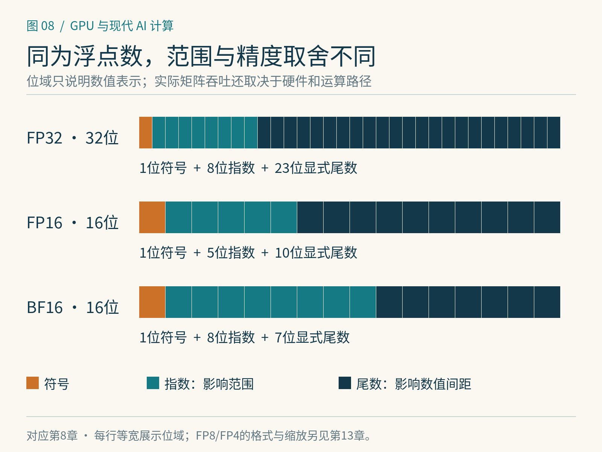

# 第8章　矩阵计算单元与数值格式

GPU 的普通算术单元可以完成乘法与加法，而现代 AI 芯片还配置了面向矩阵运算的专用执行路径。NVIDIA 称其中一类单元为 Tensor Core，AMD 使用 Matrix Core 等术语。它们的共同目标，是把规则的数据块送进高度并行的乘加结构。理解这件事，需要同时看运算形状、数据格式和误差。

## 从一个点积到一块矩阵

一个输出元素可写为 `c = Σ a[k]b[k]`。普通标量实现把这些乘加逐项展开；矩阵乘累加指令则协同处理一个小矩阵块，形式是 `D=A×B+C`。块中的数据和结果可能分散在多个线程持有的寄存器或专用存储中，必须按硬件规定合作。[1]

因此，矩阵单元并不意味着“一个线程拥有一整块矩阵”。它还需要指令支持的数据类型、形状、布局与对齐。编译器、算子库和 DSL 会帮助完成映射。某些形状不合适、数据量太小或额外转换成本太高的任务，即使能使用矩阵指令，也未必更快。

以数学定义计算，`M×K` 与 `K×N` 的稠密矩阵乘法通常记作约 `2MKN` 次浮点运算：一次乘法和一次加法各记一次。`4096³` GEMM 约为1374亿次运算。这里采用计算性能中常见的 FLOP 口径，忽略边界上少一次加法的差别。芯片宣传的每秒运算次数，只有在精度、稀疏性与计数口径一致时才适合比较。

*图 8-1｜原创精确图解。等宽的16位格式可以有不同指数和尾数分配。图中尾数指显式尾数字段，隐含有效位和特殊数值规则还需结合具体格式理解。*

## 位数节省了什么，牺牲了什么

浮点数用符号、指数和尾数表达数值。指数主要影响动态范围，尾数主要影响相邻可表示数之间的间距。FP16 与 BF16 都占16位，却并不具有相同的数值特性。FP16 有5位指数、10位显式尾数；BF16 有8位指数、7位显式尾数。BF16 保留与 FP32 相近的指数范围，代价是更粗的有效数值间距。[2]

| 格式或类别 | 需要理解的特点 | 训练中常见的关注点 |
|---|---|---|
| FP32 | 32位通用浮点格式 | 参考计算、累加、敏感状态 |
| FP16 | 范围较窄、尾数较多 | 小梯度与溢出，可能需要损失缩放 |
| BF16 | 指数范围较大、尾数较少 | 舍入误差与累加策略 |
| TF32 | 矩阵计算路径中的精度选择 | 输入仍可存为FP32，内部乘法精度改变 |
| FP8及块缩放格式 | 更紧凑，需明确格式与缩放 | 异常值、缩放粒度、训练配方 |
| FP4及块缩放格式 | 极少数值级别，元数据很重要 | 转换成本、误差传播与收敛验证 |

TF32 特别容易被误解。启用相关矩阵路径，并不等于把模型全部存成一种“10位张量”。它影响的是某些 FP32 运算内部使用的计算精度，实际行为还取决于框架设置、库版本和目标硬件。[3]

## 输入、累加与输出可以不同

“使用 FP16 训练”往往只是一个简称。一次矩阵乘法可以使用 FP16 输入、更高精度的累加，最后把输出转回较低精度；参数副本、优化器状态与梯度也可能分别采用不同格式。必须把各部分拆开，才能判断内存和误差。

为什么累加值得单独处理？假设求和包含大量很小的项，当前总和已经很大。在低精度表示中，小增量可能小于可表示的间隔，加入后结果不变。用更高精度累加，可以减轻这类信息丢失，但最终输出转换仍会舍入。归约顺序改变时，浮点结果也可能变化；这不自动说明某个实现出错。

低位格式通常还借助缩放。例如先用比例尺把一组实数映射到有限可表示范围，计算后再还原量级。整张量共用一个尺度简单，但少数异常值可能迫使大多数普通值挤进狭窄区域；按块缩放可以改善局部适应性，却要保存尺度、执行转换并满足硬件布局。原始位数下降，不代表总存储量严格按相同比例下降。[2]

## 现代能力必须落到具体架构

Ampere、Hopper、数据中心 Blackwell、RTX Blackwell 和 Blackwell Ultra 之间，矩阵指令、精度、吞吐与存储机制都有差别。AMD 的 CDNA 各代也在扩展矩阵运算能力。不能看到“支持 FP4”便认定某个训练配方和全部算子都可直接运行。

截至本书核验日期，CUTLASS 官方资料已经列出面向新架构的分块缩放运算与初始 Rubin 支持。它说明软件接口正在随硬件演进；“支持已加入”与“应用已经稳定获得收益”仍是两个需要分别验证的结论。[1] 实践中应依次检查硬件、编译目标、库内核、框架接口和数值配方。

## 看懂一张算力表

读取规格时，先圈出精度、是否结构化稀疏、是否包含缩放条件、单设备还是整机。结构化稀疏的峰值依赖规定的零值模式；任意矩阵中有很多零，并不保证触发同一硬件加速。对于带宽受限的任务，矩阵峰值再高也可能闲置。

可以给同一 GEMM 保存三类结果：运行时间、与高精度参考的误差、实际输入输出字节量。随后改变矩阵形状与精度。如果某种格式只在大矩阵上快，原因可能是转换和启动成本得到了摊薄。如果误差增加，必须继续观察端到端训练曲线；单次矩阵误差可控，并不能替代收敛验证。

## 一个缩放误差的直观例子

设一组数大多位于−1到1，却有一个值达到100。如果用同一有限精度网格覆盖全部范围，普通数附近的刻度可能过粗。把这组数据分成几个块，各块单独选比例尺，就有机会让绝大多数块保留更细的局部刻度。代价是异常值所在块仍需容纳它，而且比例尺本身也有表示误差。

这个例子只说明缩放的几何关系，不代表任一种FP8或FP4格式都采用均匀整数网格。真正的浮点格点随指数改变，标准、块大小和尺度格式也会改变误差。做实验时必须写出格式全名，不能把不同厂商的“4位浮点”当作可直接互换的数组。

同样的误差还会因位置而产生不同后果。若一层激活稍有扰动，后续归一化可能减轻或放大其影响；若优化器状态长期累积细小更新，反复舍入又可能改变学习轨迹。因此，有些训练方案只降低大矩阵乘法的输入精度，保留其他状态和敏感运算的精度。这种选择是系统设计的一部分。

还有一类性能损失来自形状浪费：内核为了适配硬件计算块，对边界进行掩码或填充。一个有效维度很小的矩阵仍可能占用完整计算块，而大矩阵通常更容易摊薄边界成本。比较精度收益时，应同时记录M、N、K，而不能只写“同一个模型、同一块卡”。

## 本章参考

[1] NVIDIA. [CUTLASS Overview](https://docs.nvidia.com/cutlass/latest/overview.html)，矩阵乘累加、支持类型与2026年10月更新。核验：2026-10-25。

[2] NVIDIA. [Using FP8 and FP4 with Transformer Engine](https://docs.nvidia.com/deeplearning/transformer-engine/examples/fp8_primer.html)，缩放与低精度计算。具体训练方法见第13章。

[3] PyTorch. [Numerical accuracy](https://docs.pytorch.org/docs/stable/notes/numerical_accuracy.html)，浮点误差和TF32计算；设置接口依安装版本确认。
