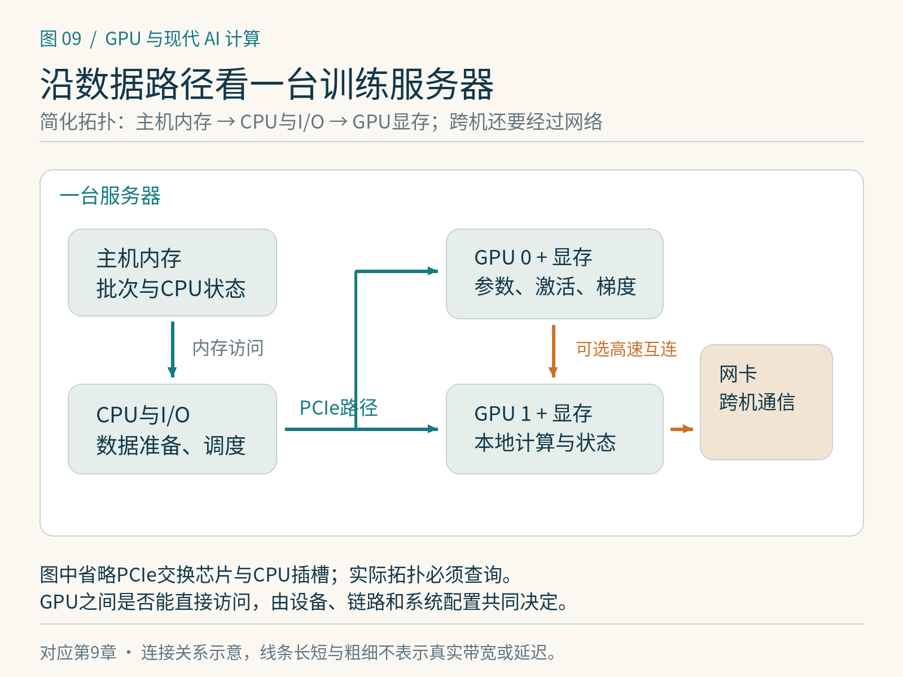

# 第9章　封装、Chiplet、CPU 与 GPU 互连

一颗 GPU 可以很快，一台训练服务器仍可能被数据搬运拖住。参数要经过存储系统，批次由 CPU 准备，张量跨越主机与设备，梯度还可能发往其他 GPU。观察系统时，应沿着这条真实路径逐段检查，而不是把所有连接统称为“带宽”。

## 从裸片到服务器

裸片是制造完成的一块芯片硅片；封装为它提供供电、信号连接、机械保护和散热接口。现代计算封装可能包含多块计算或 I/O 裸片，旁边还连接多组 HBM。Chiplet 指把系统拆成多个可组合的小芯片，通过封装内互连接起来。它可以让不同功能采用适合的制造工艺，也能扩大单个封装可集成的资源，但同时增加跨裸片通信与设计复杂性。

HBM 将多层存储裸片堆叠，借助很宽的连接提供高带宽。计算裸片、HBM 和中介层之间的关系属于封装尺度；PCIe 插卡、服务器主板与机架网络又属于不同尺度。读产品图片时先辨认尺度，才能知道箭头究竟代表片内互连、封装内链路还是机间通信。[1]

AMD 的 CDNA 路线提供了一个具体参照：计算资源、I/O、缓存与 HBM 通过先进封装及 Infinity Fabric 组织起来。MI350系列官方资料说明其使用 CDNA4 和 HBM3E。NVIDIA 数据中心 Blackwell 则采用多计算裸片设计。两者都说明“大GPU”越来越需要以封装和系统的视角理解，但它们暴露给程序的结构和优化规则并不相同。[1][2]

*图 9-1｜原创精确图解。主机内存、GPU显存和网卡形成不同的数据路径。图中PCIe交换芯片与CPU插槽等实现细节被简化，跨GPU直接访问也需要系统支持。*

## CPU 没有退出训练

CPU 负责进程启动、文件系统访问、分词与解码、数据分发、算子调度和部分通信工作。如果 CPU 侧每准备一个批次耗时40毫秒，GPU 计算只需15毫秒，单独提高 GPU 峰值算力不会把训练吞吐成比例提高。

CPU 与 GPU 之间常用 PCIe 连接。实际路径可能经过 PCIe 交换芯片，也可能跨 CPU 插槽之间的互连。如果 GPU 靠近 CPU0，而数据缓冲区位于 CPU1 的内存，访问可能要多走一段路。NUMA，即非统一内存访问，描述的正是不同处理单元访问不同内存位置的成本差异。进程绑定、内存分配位置和数据线程布局因此会影响结果。

专门的 CPU—GPU 一致性互连改善了另一类场景。Grace Hopper 和 Grace Blackwell 系统使用 NVLink-C2C，将 CPU 与 GPU 以缓存一致性的方式连接；软件能更方便地访问不同位置的数据。[3] 但统一地址或一致性不等于所有内存一样快。远端内存仍有链路、延迟与带宽成本，程序仍应关注数据最终放在哪里。

## 同一台机器里的 GPU 也不一定等距

有的服务器让多张 GPU 通过 PCIe 交换结构通信；有的增加 NVLink、NVLink Switch 或 AMD Infinity Fabric；有的只有部分 GPU 对之间存在高速直连。拓扑就是这些设备和链路的连接方式。

假设一个任务频繁在四张 GPU 间交换中间结果，恰好选中了跨越低带宽路径的一组设备，通信便可能主导时间。另一个任务只在迭代末尾同步较小的梯度，对拓扑可能没那么敏感。GPU 数量相同，不能推出可用通信能力相同。[4]

读取链路带宽时，还要问它是单方向、双方向之和，单链路、单设备合计，还是整机交换容量。一个标为每秒若干 TB 的系统总量，不能直接代入某对 GPU 传输一个张量的时间公式。All-Reduce 等集合通信还受算法、并发和拓扑共同影响。

## 一笔搬运账

设一个教学系统需要把1 GiB数据从主机送入GPU，假设实测有效单向带宽为25 GB/s，忽略启动与排队，则传输时间下界约为 `1,073,741,824 / 25,000,000,000 ≈ 43毫秒`。这里 GiB 按2的幂计，GB/s按十进制计。25 GB/s只是计算假设，不代表某一代PCIe或某台机器的保证速度。

如果每批都重复上传这1 GiB，而GPU计算仅20毫秒，即使完美重叠，稳态批次间隔也很难低于43毫秒。若把可复用数据保留在设备上，或者先在主机压缩、再在GPU解码，成本结构可能改变，但必须同时计算额外处理开销。

同样的推理适用于优化器卸载和跨卡张量搬运：省出的显存可能以更长的传输时间作为交换。一个方案解决“能否运行”，另一个指标决定“是否划算”。

## 散热、供电与持续性能

模块的额定功耗、机柜供电和冷却方式决定能否持续承载负载。短基准可能尚未进入热稳态，长训练则可能受功耗限制、温度或共享资源影响。因此环境记录应包含功耗设置、并发任务与运行时长，不能只保存设备型号。

动手观察时，先用厂商工具查看设备和拓扑，再把CPU、内存、存储、网卡和GPU的位置画在一张图上。随后选择最常经过的一条路径，测量大块复制、批次准备或跨卡通信。每次只改变一个因素，例如进程绑核或GPU组合，才能解释变化来源。

## 统一内存、共享地址与共享容量

“CPU和GPU能访问同一个指针”是地址与访问机制的问题；“它们共享同一组物理内存芯片”是硬件结构的问题；“程序可以把超出显存的数据放到主机内存”则是容量管理问题。这三件事可能同时存在，也可能只存在其中一部分。[3]

例如，独立GPU通过统一内存机制访问主机数据时，可能发生按页迁移或远端访问。如果工作集频繁在CPU和GPU之间来回使用，数据位置反复变化就可能产生额外搬运。统一接口减少了程序员显式复制的工作，但不会自动消除这些流量。看见程序不再调用复制函数，也不能认定没有数据移动。

因此，使用卸载或超额分配方案时，要同时观察运行是否成功、页迁移与链路流量、整步训练时间。把一个原本无法运行的模型跑起来非常有价值，但它的吞吐应与相同容量条件下的其他方案比较，而不是用显存占用更低就宣称总体更快。

对购置或租用系统的判断，也应从工作负载反推：数据已经在本地、单卡计算为主的任务，对机间网络要求可能有限；频繁交换专家token的MoE或大规模张量并行，对互连更加敏感。具体选择要用目标模型的通信模式检验，不能由一张峰值规格表代替。

一次实际验收可以保留两个配置：只运行目标任务，以及同时运行预期的数据读取或邻近任务。若后者吞吐下降，应继续检查共享PCIe上行、CPU内存或网络，而不能立刻归因于GPU计算变慢。系统容量和可持续吞吐都必须在接近使用场景的条件下观察。

## 本章参考

[1] AMD. [AMD CDNA Architecture](https://www.amd.com/en/technologies/cdna.html)；[CDNA4 Architecture White Paper](https://www.amd.com/content/dam/amd/en/documents/instinct-tech-docs/white-papers/amd-cdna-4-architecture-whitepaper.pdf)。核验：2026-10-25。

[2] NVIDIA. [Blackwell Architecture Technical Overview](https://resources.nvidia.com/en-us-blackwell-architecture)，数据中心Blackwell封装与系统结构。

[3] NVIDIA. [NVLink-C2C](https://www.nvidia.com/en-us/data-center/nvlink-c2c/)；[Grace Performance Tuning Guide](https://docs.nvidia.com/dccpu/grace-perf-tuning-guide/index.html)，一致性互连与NUMA位置。

[4] NVIDIA. [CUDA Programming Guide: Programming Systems with Multiple GPUs](https://docs.nvidia.com/cuda/cuda-programming-guide/03-advanced/multi-gpu-systems.html)，多设备访问与拓扑；AMD系统应对应查阅ROCm资料。
