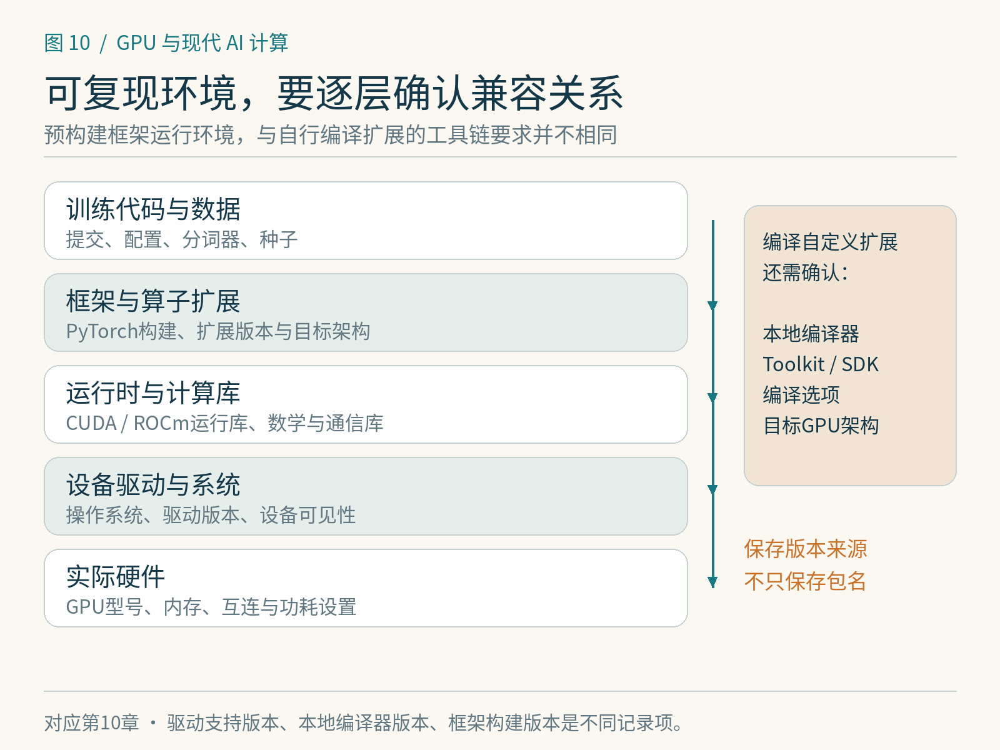

# 第10章　搭建可复现训练环境

一段训练代码在昨天的机器上正常，今天换个环境却变慢或失败，常见原因是“环境”没有被当作实验的一部分。GPU型号只是其中一项。驱动、框架构建、运行库、编译器、算子扩展和输入数据共同决定程序的行为。

## 先画清软件层次

操作系统通过驱动管理硬件，框架通常依赖某个GPU运行时及配套库，自定义扩展还可能需要本地编译工具链。使用预构建PyTorch包时，所需的许多运行时库可由该发行包及其依赖提供；仅运行这些包与自行编译CUDA扩展，对本机Toolkit的要求不同。驱动报告支持的CUDA版本、本地`nvcc`版本、PyTorch构建所用CUDA版本也不是同一个值。[1]

容器打包了大量用户态依赖，但仍依赖宿主机提供设备、驱动和兼容接口。把代码放进容器，不会自动解决所有版本问题。AMD ROCm也需要核对GPU型号、系统、驱动与框架构建的支持组合。兼容性应查安装时的官方矩阵，而非从“另一台相似设备能跑”推断。

实践中选一个已被框架官方支持的组合，保存精确版本和安装来源，然后再增加扩展。不要先安装许多工具再猜是哪一层产生冲突。GPU扩展若经过本地编译，还应记录目标架构、编译选项和对应源码提交。




*图 10-1｜原创精确图解。从硬件和驱动向上逐层核对运行时、框架与训练代码。某一层能安装，不代表全部目标算子和通信路径已经匹配。*


## 一个足够小的起点

本书的CPU入门示例不要求GPU，可以先验证Python和张量运算。进入GPU实验后，第一步应完成“分配张量—计算—取回结果—核对”的短路径，再运行完整训练。一个设备被枚举出来，并不保证后续矩阵内核、通信库和扩展都可用。

```python
# 可运行示例：需安装与设备匹配的 PyTorch。
import torch

device = "cuda" if torch.cuda.is_available() else "cpu"
x = torch.arange(8, dtype=torch.float32, device=device)
y = x.square().sum()
assert y.cpu().item() == 140.0
print(torch.__version__, device, y.cpu().item())
```

在ROCm构建中，PyTorch仍大量沿用`torch.cuda`命名，因此这段代码里的名字不等于硬件一定来自NVIDIA。Apple MPS使用另一套设备接口，后文会单独说明。[2] 这个小程序是功能检查，不是性能基准。

## 固定随机种子解决了哪一部分

随机初始化、批次打乱、Dropout和数据增强都可能使用随机数。固定种子能让特定随机数生成器从可控状态开始，但它不能保证换硬件、换库版本、换执行顺序后逐位相同。并行归约和非确定性算法也可能引入差异。[3]

```python
# 教学设置：确定性选项可能降低性能或触发不支持操作的报错。
import random
import torch

random.seed(2026)
torch.manual_seed(2026)
torch.use_deterministic_algorithms(True)
```

若程序使用NumPy或独立生成器，也要管理它们的状态；多进程数据加载则需要处理worker和采样器的随机性。恢复训练时只恢复模型参数，通常不足以接续同一条训练轨迹：还涉及优化器、调度器、随机数状态与数据进度。

应先决定自己追求哪种复现：同一环境下逐位相同、允许误差范围内数值一致，还是多次训练的统计表现相近。三种目标所需成本不同。对于低精度训练或大规模分布式任务，记录误差阈值和实验次数比一句“可复现”更有解释力。

## 保存一份实验身份证

每次正式结果至少应关联代码提交、配置、数据版本、软件环境、设备、精度、计时边界和随机种子。数据版本不仅是文件名，还包括分词器、过滤规则、训练验证划分与预处理方式。张量形状、批大小和序列长度则是性能结果不可缺的上下文。

| 记录对象 | 为什么影响结果 |
|---|---|
| 框架与扩展版本 | 编译策略、内核选择和API可能变化 |
| GPU与驱动、功耗限制 | 支持能力、时钟和持续吞吐不同 |
| 精度与确定性设置 | 运算路径、数值误差和速度不同 |
| 输入形状与数据版本 | 计算量、padding与训练目标不同 |
| 预热与计时方法 | 编译、缓存和异步执行改变耗时 |

项目附带的`examples/10-environment.py`生成一个JSON报告，记录当前Python、PyTorch和可见设备信息。它会明确输出“未安装”或“无可用GPU”，不会替缺失环境猜测版本。保存环境报告是辅助，依赖锁定与安装说明仍需单独维护。

## 正确性检查先于速度比较

先固定一个小批次，检查输出是否有限、形状是否正确、损失是否能下降，再逐步开启编译、混合精度和自定义算子。一次加入多个优化，失败后很难定位原因。保留一个较慢但可信的参考实现，能帮助判断是数值差异、模型逻辑还是执行环境出了问题。

首次迭代可能含上下文初始化、即时编译和算法选择，不能拿它与另一实现的热运行比较。反过来，若产品关心冷启动，就必须把这些成本单独测出来。记录环境的最终目的，是让别人能解释并重做实验，而不是拥有一串看起来详细的版本号。

## 为实验建立分层验证

建议保存三个大小不同的检查入口。第一个是环境探针，只枚举版本和设备，便于快速发现驱动或包缺失。第二个是功能样例，以很小输入执行前向、反向和一次更新，并核对有限值与损失变化。第三个才是性能实验，使用稳定形状、规定预热与多次重复。三者失败的含义不同，分开后能少走很多弯路。

实际调试中，还可先关闭额外扩展、使用框架原生实现建立基线。若原生实现也失败，应先处理环境或输入；若只有扩展失败，再检查扩展的编译目标、依赖和接口。因为异步执行，错误可能在后续同步点才显现；诊断时让执行更易定位与正式计时是不同模式，不能把调试模式的耗时作为正常性能。

多人协作时，环境说明还应回答“哪些结果已经验证”。可以标注CPU功能通过、GPU运行待验证、分布式测试待指定集群，而不要把语法检查、导入成功和完成训练都写成一个通过。这样的记录让接手的人知道从哪一级继续，而不必重新猜测。

本章环境探针在基础环境中已执行，显示没有安装PyTorch。成书验证随后建立独立CPU环境，使用PyTorch 2.14.1+cpu实际运行了小型训练与编译实验，详见贯穿实验附录；该环境仍无GPU，不能据此报告GPU功能或吞吐。读者应把自己运行后的环境报告连同配置保存，再进行后续比较。

## 本章参考

[1] PyTorch. [Start Locally](https://pytorch.org/get-started/locally/)；NVIDIA. [CUDA Compatibility](https://docs.nvidia.com/deploy/cuda-compatibility/)，安装组合与驱动兼容。核验：2026-10-25。

[2] PyTorch. [HIP (ROCm) semantics](https://docs.pytorch.org/docs/stable/notes/hip.html)，沿用CUDA接口名称的兼容设计。

[3] PyTorch. [Reproducibility](https://docs.pytorch.org/docs/stable/notes/randomness.html)；[torch.use_deterministic_algorithms](https://docs.pytorch.org/docs/stable/generated/torch.use_deterministic_algorithms.html)，随机性、确定性与适用边界。
