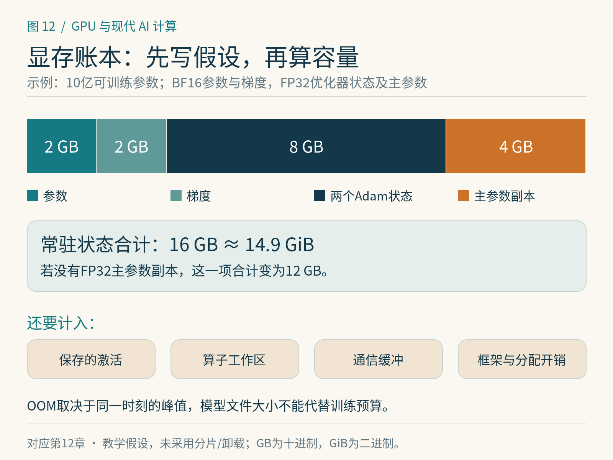

# 第12章　显存账本与 OOM

“模型有多少参数”只能回答显存问题的一部分。训练时，参数需要梯度和优化器状态，前向产生的中间结果还要留给反向，算子和通信也需要临时空间。OOM，即内存不足，发生在某个时刻的一次具体申请失败时；它不由模型文件大小单独决定。

## 先给常驻状态记账

设一个教学模型有10亿个可训练参数，参数用BF16保存，梯度也用BF16；AdamW的一阶、二阶状态各用FP32，另外假设实现维护一份FP32主参数。按每参数计，参数2字节、梯度2字节、两个状态8字节、主参数4字节，共16字节。10亿参数约16 GB，即约14.9 GiB。

这不是所有混合精度训练的固定公式。有的实现不保留独立主参数，有的梯度或优化器状态采用不同精度，有的使用分片、量化或卸载。正确方法是把实际对象逐项列出来，再按元素数与每元素字节数计算。若删除上述主参数假设，总量便变成12 GB。优化器状态还可能在第一次`step()`时才创建，所以“前向能跑”并不说明完整迭代能跑。

| 状态 | 本例每参数字节数 | 10亿参数的十进制容量 |
|---|---:|---:|
| BF16参数 | 2 | 2 GB |
| BF16梯度 | 2 | 2 GB |
| FP32一阶与二阶状态 | 8 | 8 GB |
| 假设存在的FP32主参数 | 4 | 4 GB |
| 合计 | 16 | 16 GB |

表中还没有计入激活、临时工作区、通信缓冲和框架开销。项目的`examples/12-memory-budget.py`提供可修改假设的计算器，用于推导，不会自动推断真实训练实现。

*图 12-1｜原创精确图解。这是10亿参数的教学假设：BF16参数/梯度，两个FP32 Adam状态和FP32主参数副本，常驻共16 GB约14.9 GiB。激活与缓冲尚未计入；实现可能没有主副本。*

## 激活与序列长度

设某层保存一个`[B,S,H]`激活，其中微批大小B=4，序列长度S=2048，隐藏维H=2048，格式为BF16。一个这样的张量占 `4×2048×2048×2=32 MiB`。若24层每层只保留一份，就已达768 MiB；真实Transformer还会保存多个中间结果，具体数量由算子实现和自动求导需求决定。

朴素注意力若显式保存`[B,头数,S,S]`矩阵，序列长度翻倍会让这一项变为四倍。若B=4、头数16、S=2048、元素为2字节，一份矩阵就是512 MiB。FlashAttention等算法通过重组计算避免完整物化这类大矩阵，但不意味着整个模型的激活开销都消失。[1]

同样的参数量，在短序列分类、长上下文训练和多分辨率视觉任务中，峰值显存可能差别很大。因此容量预算应附带微批大小、序列长度和具体实现。

## 峰值发生在时间线上

前向逐层产生激活，反向逐步消费与释放它们，同时生成梯度；优化器更新又可能申请额外临时张量。有的矩阵库会选择需要较大工作区的算法，分布式执行还可能预取下一组参数并保留通信缓冲。峰值是这些对象生命周期重叠后的结果。

一种常见错误是把每个阶段分别测出的最大值相加，得到过大的预算；另一种是只看训练结束时的占用，漏掉瞬间峰值。正确做法是在完整迭代的时间轴上记录分配与释放，判断哪些对象同时存活。[2]

自定义代码也可能无意延长生命周期。例如把每一步的`loss`张量直接放进列表，可能连同计算图一起保留；若只为日志，可保存脱离计算图的标量。类似地，保留输出张量引用、反复使用`retain_graph=True`、缓存带梯度的中间值，都值得检查。

## allocated 与 reserved 为什么不同

PyTorch通常使用缓存分配器。`memory_allocated()`描述当前张量占用的相关显存，`memory_reserved()`描述分配器管理的总量，其中包含可复用但暂时未使用的空间。设备管理工具还会看到上下文及框架外分配，所以数字不必完全一致。[3]

`empty_cache()`能释放未使用的缓存块，让其他进程利用这些空间；它不能释放仍被活张量引用的内存，也不能让本来需要的参数和激活凭空消失。每步调用还可能增加分配开销。看到reserved大于allocated，不应立即断言泄漏；需要观察二者是否稳定、是否受形状变化和内存碎片影响。[3]

内存快照有助于找到一次申请失败前后的对象。PyTorch快照主要观察由其分配器管理的显存，某些通信库或扩展直接申请的空间可能不可见。[2] 诊断必须将快照、设备总占用与其他进程一起看。

## 有顺序地处理 OOM

先在固定小输入上复现，记录失败发生于前向、反向还是优化器更新。查看是否有其他进程，随后测量完整迭代峰值，核对账本。若占用随步数持续增长，优先检查引用和计算图；若稳定但越过容量，再讨论减少微批、重计算、分片或卸载。

减少微批通常直接降低部分激活，但不减少完整参数与优化器状态。梯度累积可在多个微批之间形成较大的有效批量，却也要正确缩放损失并处理更新频率。重计算用额外计算换取较少保存的激活；分片把状态分到多卡，但会增加通信。它们解决的是不同账目，选择前应知道主要开销在哪里。

最后留出余量。动态形状、编译缓存、算法工作区和并发任务都可能让边界配置不稳定。一张卡上“恰好跑通一次”的设置，尚不足以成为可持续训练配置。

## 用一个峰值检查最初的估算

假设一张24 GiB设备中，常驻训练状态按本例占14.9 GiB，框架和其他常驻对象暂计1 GiB，激活峰值估计6 GiB，算子临时空间估计1.5 GiB，总计23.4 GiB。数字看似低于容量，却只剩约0.6 GiB余量。任何未统计的缓冲、形状波动或分配对齐都可能造成失败。

此时先比较缩小微批前后的峰值。如果峰值明显下降，激活值得进一步优化；如果变化很小，常驻状态、优化器或工作区可能更重要。再观察第一次更新是否突然增高，便可检验“状态延迟创建”的猜测。这样，账本从一次纸上加法变成了可被测量修正的模型。

若采用分布式分片，也不能把原账本机械除以GPU数。只有实际分片的状态才被均摊；某些阶段还会临时聚合完整参数或保存额外副本。每卡显存取决于并行策略、预取、桶大小和执行时间线，第30章将沿着这些状态的生命周期展开。

容量估算还应与训练目标一致。只训练适配器时，可训练参数少，优化器状态随之减少，但基础模型参数仍需保存，前后向仍会产生激活。把适配器参数量当成整个微调任务的显存需求，会低估主要部分。任何“每参数多少字节”的经验值，都应先问它计的是哪一组参数。

## 本章参考

[1] Dao et al. [FlashAttention: Fast and Memory-Efficient Exact Attention with IO-Awareness](https://arxiv.org/abs/2205.14135)，避免物化完整注意力矩阵的算法依据。

[2] PyTorch. [Understanding CUDA Memory Usage](https://docs.pytorch.org/docs/stable/torch_cuda_memory)，快照、OOM与分配器观察范围。核验：2026-10-25。

[3] PyTorch. [CUDA semantics: Memory management](https://docs.pytorch.org/docs/stable/notes/cuda.html#memory-management)，allocated、reserved与缓存释放。
