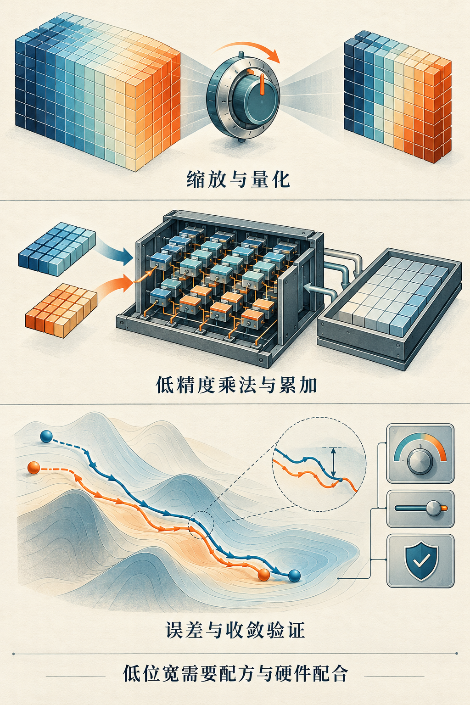

# 第13章　混合精度、FP8 与 FP4

训练一个模型时，权重、激活、梯度和优化器状态不必使用同一种数值格式。它们的变化范围、保存时间和误差敏感性不同。把适合的部分改用较短格式，可以减少搬运的数据，也可能使用吞吐量更高的矩阵计算指令；把关键部分保留在较高精度，则是为了维持更新的可靠性。理解混合精度，首先要把这两件事连在一起。

## 从一次无法保留的小更新开始

假设某个参数当前是 1，优化器希望把它减去 0.0001。如果存储格式在 1 附近的相邻可表示数间距大于这个变化，写回后参数仍可能是 1。一次小更新丢失未必立即损坏训练，但连续丢失就可能改变学习过程。另一个方向是数值过大溢出，或很小的梯度落到可表示范围之外。较短格式同时面对精度和范围约束。

浮点数通过符号、指数和有效数字编码数值。指数位影响可覆盖的数量级，有效数字位影响同一数量级里能分得多细。因此 BF16 与 FP16 虽然都占两个字节，也不能互换成同一个数学概念。BF16 的指数范围接近 FP32，有效数字更少；FP16 的有效数字更多，范围较窄。适合哪一个取决于算子、数据分布与硬件，而不是名称里的数字大小。[1]




*图 13-1｜AI 教学示意。低精度包括缩放、量化、乘法和累加，也需要误差与收敛验证。图中的尺度和轨迹是概念表达，没有指定某种FP4编码或训练成绩。*


## 混合的是整条计算路径

以线性层 `Y=XW` 为例，需要分别询问：X 和 W 怎样保存、怎样量化，矩阵乘法使用什么输入格式，中间乘积如何累加，Y 以什么格式写回，以及反向和参数更新如何进行。低精度输入并不意味着所有中间计算都使用低精度。很多实现采用更高精度累加，但具体路径必须看对应指令与库，不能从张量 dtype 单独推出。

PyTorch 的 autocast 按算子策略选择执行格式，GradScaler 则处理梯度缩放。它们是两项不同机制。把模型整体 `.half()`，会改变大量持久张量的格式，不能视为等价于 autocast。常见 BF16 训练路径不依赖 FP16 式动态损失缩放，但仍要验证模型和后端行为。[1][2]

下面是面向支持 BF16 的 CUDA 设备的教学训练片段。`model`、`inputs`、`targets` 和 `loss_fn` 应由完整训练程序提供；这是集成示意，不能单独运行。

```python
optimizer.zero_grad(set_to_none=True)
with torch.autocast(device_type="cuda", dtype=torch.bfloat16):
    prediction = model(inputs)
    loss = loss_fn(prediction, targets)
loss.backward()
optimizer.step()
```

先用 FP32 建立能够正常下降的基线，再加入 autocast。比较时保持数据顺序、有效批量和优化器设置相同，观察一段训练过程，而非只比较第一次前向输出。

## FP8 需要缩放策略

FP8 不是只有一个格式。常见的 E4M3 和 E5M2 分别偏向有效数字精细度和数值范围，不能把任何八位浮点都当成相同格式。NVIDIA Transformer Engine 的文档给出了这两种格式以及使用方法。[3]

可以用简单的量化模型理解缩放：令 `q=round_format(x/s)`，恢复时得到 `x_hat=s*q`。缩放因子 s 把原始数值映射到格式适合的区域。若 s 太小，较大值容易截断或溢出；若 s 太大，较小值被压缩到很少的刻度。这里的 round_format 表示舍入到目标浮点格式，而不是四舍五入到整数。

假设一组值大多位于 -1 到 1，却混入一个 1000。若整组共用一个缩放因子，为保住 1000，其余数值可用的表示刻度会减少。把张量分成小块、每块单独缩放，可以把异常值的影响局限在局部，但需要保存和读取更多缩放元数据。这正是理解块缩放的入口。

当前 Transformer Engine 同时提供张量级 FP8、块级 FP8、MXFP8 和 NVFP4 等配方。MXFP8 的小块共享缩放与 NVFP4 的两级缩放机制不同；FP4 也不等于 INT4，更不等于所有权重、激活、梯度都永久以四位保存。[3][4]

## 四位训练是一套算法与系统配方

NVFP4 把有效载荷压缩得更短，表示误差也更显著。相关训练研究引入缩放、随机舍入、变换和部分高精度计算等组合，以控制误差如何进入前向和反向。论文证明的是特定模型、数据与训练配方下的可行性，不能直接推广为任意训练程序只需替换 dtype。[5]

硬件能力还必须与软件支持对应。能够保存某种格式、能够转换该格式、具有原生矩阵指令、以及训练库完整支持该配方，是不同层次。Transformer Engine 按计算能力列出支持矩阵；同属一个架构品牌的产品，也应查询具体型号与库版本。[4]

## 算清能够省下什么

假设一个线性层的权重有一亿个元素，只计算有效载荷，不考虑对齐、缩放元数据和副本：FP32 约需 400 MB，BF16 约需 200 MB，八位约需 100 MB，四位约需 50 MB，均采用十进制 MB。这个计算只能说明该份权重的数据量。如果优化器仍保存两份 FP32 状态，它们合计还要约 800 MB。低位宽不能按相同比例缩小整个训练进程。

速度也要算完整账。省下的矩阵时间可能被量化、转置、重排和缩放统计部分抵消。小矩阵或过短的计算区域尤其容易受到这些固定开销影响。最有意义的目标是达到既定质量所需的时间和资源，同时记录峰值显存，而不是只展示某个 GEMM 的峰值吞吐。

## 怎样判断低精度实验是否成功

先比较短程损失、梯度范数、异常值和溢出情况，再观察验证集质量以及更长训练区间。相同损失点需要多少 token、多少时间，和固定训练预算下达到什么质量，应分别报告。不能只挑一段下降曲线证明长期稳定。

读者可以先用一个范围明确的整数玩具模型观察共享缩放。规定 `q=clip(round(x/s),-7,7)`，恢复值为 `x_hat=s*q`；其中 round 表示取最近整数，clip 把结果限制在 -7 到 7。对 `[0.11,0.21,0.51,7]`，全组使用 `s=1`，恢复为 `[0,0,1,7]`，绝对误差分别是 `[0.11,0.21,0.49,0]`。若把前三个小值单独成块，使用 `s=0.1`，其恢复值为 `[0.1,0.2,0.5]`，绝对误差都降为 0.01；最后的 7 独立成块，仍用 `s=1`。

这个练习固定了有限量化范围，因此可以看清异常值、共享比例尺和分块之间的关系。它是整数均匀量化的教学模型，**并非 FP8 或 FP4 浮点格式，也不模拟它们的编码**。实际浮点格式的格点随指数变化；块大小、尺度格式和下溢规则还会改变结果。

## 三份配置要一起保存

低精度实验至少留下三份信息：模型和优化器配置、数值配方、软件与设备环境。数值配方需要说明哪些层使用何种输入格式，缩放按张量还是按块，统计量何时更新，以及哪些区域保留较高精度。这样才能区分“换了格式”与“同时改变训练方法”。

还应把存储节省和算术节省分开记录。某些实现为了反向效率保留转置副本，或同时保留量化结果与高精度来源；前向输入变短以后，进程的实际峰值可能下降得很少。打开显存记录，沿张量生命周期找副本，通常比只检查参数 dtype 更能解释结果。

## 本章参考

[1] PyTorch，Automatic Mixed Precision package，https://docs.pytorch.org/docs/stable/amp.html 。

[2] PyTorch，Automatic Mixed Precision examples，https://docs.pytorch.org/docs/stable/notes/amp_examples.html 。

[3] NVIDIA，Using FP8 and FP4 with Transformer Engine，https://docs.nvidia.com/deeplearning/transformer-engine/examples/fp8_primer.html 。

[4] NVIDIA，Datatype and hardware support matrix，https://nvidia.github.io/TransformerEngine/support_matrix.html 。

[5] NVIDIA 等，Pretraining Large Language Models with NVFP4，2025，https://arxiv.org/abs/2509.25149 。资料核验：2026-10-25。
