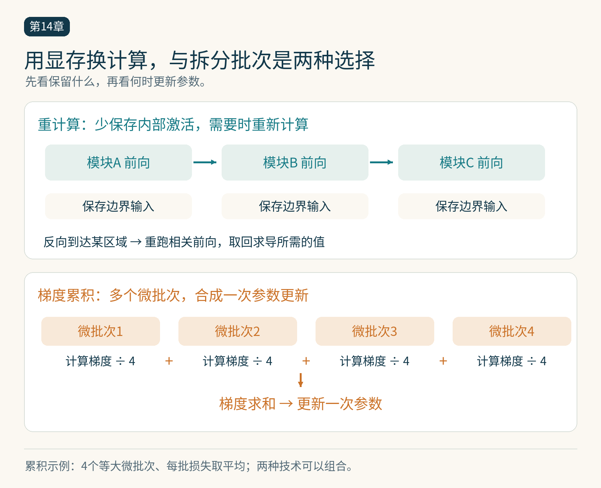

# 第14章　重计算、梯度累积与训练稳定性

同一个模型能够装进显存，不代表它能以期望的批量和序列长度训练。参数之外，前向为反向保存的激活常常占据大量空间。减少这些激活、缩小一次处理的数据量，都能改变显存峰值，却也会改变计算、通信或数值过程。学习这些技术，需要沿着一次完整迭代观察代价。

## 重计算：保存入口，重新经过中间过程

设一个网络连续经过 A、B、C 三个模块。通常反向传播需要前向产生的一些中间值。激活检查点把某些区域的内部结果省去，只保留重新运行该区域所需的信息；反向到达这里时，再执行相关前向计算，取回求导需要的数据。它也称激活重计算，和把模型写入磁盘的训练检查点是两种用途。[1]

可以把它理解为路线与沿途照片的区别：记住入口和必要状态，允许之后重走一段路，就不必一直携带所有中间照片。但这个比喻不意味着中间张量全部可以随意删除；自动求导仍要保证重新计算得到正确的求导路径。

假设四个模块各需保存 100 MB 内部激活，边界输入较小。把每个模块的内部激活改为按需恢复，可能显著降低同时存活的量。不过峰值还包括参数、梯度、临时工作区，以及正在重建的激活。不能简单断言“用了检查点就只保留一份输入”，也不能根据这个玩具例子承诺真实模型节省固定百分比。

当前 PyTorch 建议显式指定 `use_reentrant`，通常优先使用非重入实现。它支持的自动求导行为与旧实现不同，并可在所需张量恢复后提前停止重算。精确行为应随安装版本核对。[1]




*图 14-1｜原创精确图解。重计算改变中间激活的保存方式；梯度累积把多个微批次合成一次更新。下方除以4只适用于四个等大微批次且各自损失取均值的示例。*


## 重算必须重现同一段计算

如果模块包含 Dropout，重算时随机状态影响输出。框架提供随机状态处理，但跨设备移动、外部随机数源和自定义算子仍需检查。若前向还修改全局计数器、更新缓存、写文件，重算可能重复产生副作用。模型中的状态更新必须和纯张量计算分清。

一个实际选择是先对计算量大、内部激活多且边界明确的模块做实验。记录峰值显存、每步时间和梯度差异，再决定是否扩大覆盖。不同算子重新计算的代价不同；保存昂贵结果、重算便宜逐元素操作的选择性策略，可能比整段统一处理更合理。

## 梯度累积改变每次处理的数据量

假设目标有效批量是 64 个样本，单卡一次只能处理 8 个。可以连续处理 8 个微批次，每次反向把梯度加到现有梯度上，最后更新一次参数。参数在这 8 次前后向中保持不变，优化器状态也只更新一次。

当各微批次样本数相等，且损失原本是微批次样本平均值时，应让每次反向使用 `loss/8`。这样累积后对应 64 个样本的平均梯度。若最后一个微批次不足 8 个，或各批次有效 token 数不同，直接平均各批次的平均损失会赋予它们不合适的权重，需要按真实样本数或有效 token 数归一化。

以下是固定等大微批次的集成示意；完整训练程序还需处理数据迭代与最后不足一组的情况。

```python
optimizer.zero_grad(set_to_none=True)
for micro_inputs, micro_targets in eight_microbatches:
    loss = loss_fn(model(micro_inputs), micro_targets)
    (loss / 8).backward()
torch.nn.utils.clip_grad_norm_(model.parameters(), max_norm=1.0)
optimizer.step()
```

梯度裁剪放在完整累积之后，才对应对这次更新所用梯度的裁剪。如果使用 FP16 GradScaler，先对优化器的梯度取消缩放，再裁剪，最后执行更新；官方 AMP 示例展示了相应顺序。[2]

## 与大批量相似，但未必完全等价

上述等价关系依赖计算结构。BatchNorm 使用批次统计，微批次会改变其统计量；随机操作、数据增强和浮点累加顺序也可能导致差异。即使没有这些因素，较大有效批量意味着每处理相同数量样本，参数更新次数变少。学习率计划若按 step 推进，必须重新核对它对应的 token 或样本预算。

多卡梯度累积还涉及通信。每个微批次都同步梯度，可能丢失累积带来的部分效率；推迟同步又要求正确使用框架接口，并确保最后一个微批次真正触发同步。本章先把数学权重和更新时机讲清，多卡具体机制在分布式章节展开。

## 稳定性诊断先找最早的异常

损失出现 NaN 只是最后的信号。问题可能始于输入中已有非有限值，某层激活过大，归一化分母太小，梯度溢出，或优化器状态损坏。把所有现象归因于“学习率太大”，会掩盖更早的错误。

实用的观察顺序是：保存可复现的失败样本和配置，检查输入，再沿前向边界记录数值范围，随后检查梯度，最后检查更新后的参数。只记录必要的统计量，避免每层 `.item()` 或输出整张量造成频繁同步。确定异常附近后，再缩小监测区域。

梯度裁剪限制一次更新的梯度范数，但不能修复错误标签、错误 mask 或错误的损失归一化。重计算也不应改变数学目标；如果加入它之后出现系统性的梯度差异，应检查随机状态、副作用和实现，而不是直接调低学习率掩盖问题。

## 用一张表记录真实交换

为同一训练配置建立四组实验：原始基线、只重计算、只累积、两者组合。有效批量与总 token 尽量保持一致，同时分别记录微批次大小、峰值显存、更新次数、每次更新耗时和验证结果。这样可以看出显存节省来自哪里，额外计算花在哪里，以及统计过程有没有变化。

本章随附的 CPU 实验 `examples/14-accumulation.py` 使用没有随机层和批次统计的线性模型，比较一次大批量计算与等大微批次累积得到的参数梯度。它验证梯度归一化这一数学关系；不能据此证明任意大型模型的训练过程完全等价。

## 把改动放回训练预算

假设原计划训练一百万个样本，每次更新处理一百个样本，意味着一万次更新。若把有效批量改为二百，仍处理一百万样本时只更新五千次。此时保持原来按步数定义的学习率衰减，会改变样本与学习率之间的对应关系。显存方案、有效批量和调度器应一起核对，才能知道比较的究竟是系统效率，还是新的训练设置。

## 本章参考

[1] PyTorch，torch.utils.checkpoint，https://docs.pytorch.org/docs/stable/checkpoint.html 。

[2] PyTorch，Automatic Mixed Precision examples，https://docs.pytorch.org/docs/stable/notes/amp_examples.html 。资料核验：2026-10-25。
