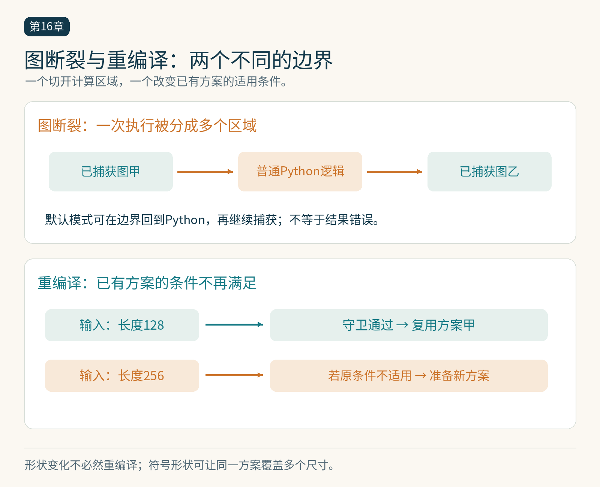

# 第16章　torch.compile、图断裂与动态形状

给模型加上 `torch.compile` 后，第一次运行可能变慢，后续可能加快，也可能没有明显收益。这些现象并不矛盾：系统需要捕获程序、检查条件、生成代码，之后才能重用结果。理解编译的过程，才能判断时间花在了准备、重复准备，还是实际计算上。

## 一次调用经历哪些阶段

在典型的 PyTorch 编译路径中，TorchDynamo 从 Python 执行过程捕获张量计算；训练场景还需要处理前向、反向及其关系；TorchInductor 等后端再为图选择或生成实现。GPU 路径可能使用 Triton 内核，也可能调用现有高性能库。不能把编译模型理解为把整份 Python 文件直接翻译成一个 CUDA 内核。[1]

第一次调用包括准备成本，通常不能与 Eager 的稳定运行时间直接比较。更完整的评估应分别报告首次可用时间、预热后的每步时间，以及一个真实任务累计多久才开始获益。假设编译额外花 20 秒，之后每步节省 2 毫秒，在没有其他差异的简化条件下，需要约一万步才能收回这部分成本。这是示意计算，不是工具的固定开销。




*图 16-1｜原创精确图解。图断裂划开一次执行的捕获区域；重编译为不满足已有条件的输入准备方案。符号形状可能让不同尺寸复用同一方案，因此形状变化并不必然重编译。*


## 图断裂意味着捕获在边界暂停

某段 Python 行为无法被当前捕获路径表示时，默认模式可能结束当前图，在普通执行中处理该段，再继续捕获后面的计算。这称为图断裂。图断裂通常不等于结果错误，但会缩小优化区域，增加调度与边界处理，也可能让相邻算子失去融合机会。[2]

常见排查对象包括日志、打印、某些标量提取，以及依赖张量值的 Python 控制流。不过具体支持范围随版本改变；例如标量提取可以受配置影响，不能记忆一份永远成立的“禁用语法表”。应以日志给出的实际原因定位。

`fullgraph=True` 适合诊断一个目标区域能否完整捕获：遇到无法处理的图断裂时让问题显式暴露，而不是默默切成多个区域。它不保证生成最快代码，也不保证程序从此不再重编译。完整捕获、缓存复用和内核质量是三个检查项。[3]

## 形状变化为什么会重编译

捕获时建立的条件通常称为守卫。输入形状、步幅、dtype、设备或 Python 状态超出条件，系统可能需要重新捕获或编译。假如训练依次遇到序列长度 128、256、384，完全静态特化可能生成多份方案。

动态形状允许部分维度以符号表示，并在一个方案中覆盖多个大小。当前默认 `dynamic=None` 会在观察到相关尺寸变化后尝试推广；`dynamic=True` 更积极使用动态维度，`dynamic=False` 则保持静态形状取向。但动态并不等于所有变化都能由同一方案处理，控制流、布局与后端约束仍然存在。[4]

对文本训练，可以把相近长度组成桶，减少无效 padding，同时控制形状组合数量。桶越细，填充浪费可能越少，编译缓存和调度复杂度却可能增加。选择不是“动态一定更先进”，而是用一段代表性数据比较总时间、有效 token 吞吐和显存。

## 一个可以逐层定位的实验

先在 Eager 中运行固定形状的简单函数，再编译它，核对结果，然后更换形状。下面的函数可以在安装兼容 PyTorch 与编译工具链的环境中使用；完整示例在 `examples/16-compile-shapes.py`。

```python
import torch

def block(x, scale, bias):
    return torch.relu(x * scale + bias)

compiled = torch.compile(block)
x = torch.randn(32, 128)
scale = torch.randn(128)
bias = torch.randn(128)
torch.testing.assert_close(block(x, scale, bias), compiled(x, scale, bias))
```

观察编译原因时，可在启动进程前设置 `TORCH_LOGS="graph_breaks,recompiles"`。日志用于解释本次环境中的行为；不同后端、版本与形状可能得到不同结果。把打印语句移到调用边界，再比较日志变化，可以直观看到计算区域和 Python 边界的关系。[2][4]

## 按前端、求导、后端分别排查

编译报错不应立刻归因于算子实现。先缩小到一个能够重现问题的函数，再按官方排查流程区分捕获、自动求导处理和代码生成阶段。某些情况下可用不同 backend 做定位：若只捕获图就失败，与后端生成内核失败的方向不同。后端名称和诊断接口属于易变细节，使用时应核对当前版本文档。[5]

正确性比较也应分层。先看前向输出，再看反向梯度，随后比较参数更新和短程训练。融合或归约顺序变化可能造成正常浮点差异，因此误差阈值应与格式、数值范围和算子特点对应；不能一律要求逐位相同，也不能用非常宽松阈值放过系统性偏差。

## 怎样报告“编译加速”

报告至少包括设备、PyTorch 版本、后端、输入形状分布、精度、编译设置、预热和计时范围。固定形状的稳态结果，与生产数据中包含新形状的总体结果，应分别列出。GPU 计时需要正确同步或使用设备事件，避免只量到提交时间。

在小 Transformer 案例中，先比较模型计算区域，再回到数据加载和完整训练迭代。若模型计算加快 30%，但原先它只占总时间的一半，整个任务不会因此加快 30%。编译器解决了一个层次的问题，其他层次的瓶颈可能随之浮现。

## 为代表性数据建立编译账本

可以准备三段输入序列：第一段固定长度，第二段在少数几个长度桶之间切换，第三段使用真实数据中的长度分布。对每段分别记录首次准备、重复调用、新形状到来和总运行时间。假如固定形状下很快，真实分布却很慢，就应先检查重编译和填充浪费，而不是立即改写底层算子。

还要保存实际运行了多少个样本。仅报告每步时间可能掩盖不同步处理量：为了形状稳定而填充到更长序列，设备每步忙得更久，却没有处理更多有效 token。有效 token 每秒、包含准备成本的总时长、峰值显存可以放在同一张实验表里。

编译缓存也不是可无限依赖的免费资源。程序运行环境、配置或输入模式变化，都可能影响方案复用。书中实验应让读者看见冷启动和稳态两种状态，并说明进程是否重新启动；不能用一次已经预热的测量代表所有部署方式。

最后保留未编译路径，便于复现、定位和比较。保存配置时记录编译开关，运行日志中标明它是否真正生效；不能在异常回退后，仍把整次运行标为成功使用了编译优化。

## 本章参考

[1] Ansel 等，PyTorch 2，2024，https://pytorch.org/assets/pytorch2-2.pdf 。

[2] PyTorch，Working with Graph Breaks，https://docs.pytorch.org/docs/main/user_guide/torch_compiler/compile/programming_model.graph_breaks_index.html 。

[3] PyTorch，torch.compile Programming Model，https://docs.pytorch.org/docs/stable/user_guide/torch_compiler/compile/programming_model.html 。

[4] PyTorch，Dynamo Core Concepts，https://docs.pytorch.org/docs/stable/user_guide/torch_compiler/compile/programming_model.dynamo_core_concepts.html 。

[5] PyTorch，Compiler Troubleshooting，https://docs.pytorch.org/docs/main/user_guide/torch_compiler/torch.compiler_troubleshooting.html 。资料核验：2026-10-25。
