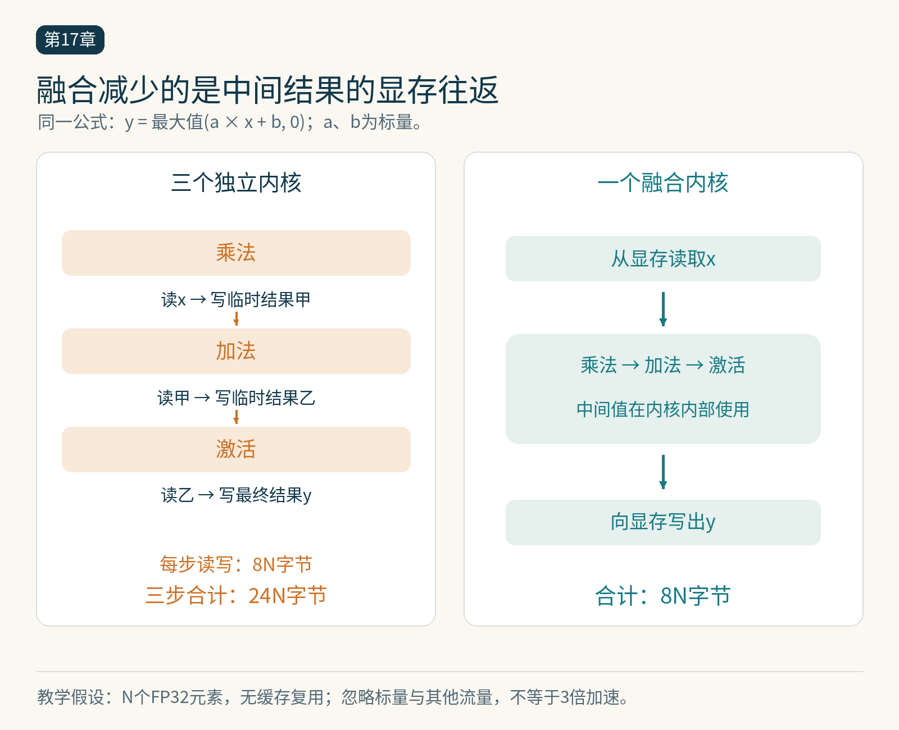

# 第17章　算子融合、布局变换与代码生成

模型中的数学公式决定需要计算什么，执行方案决定数据经过哪里、何时搬运、怎样分配工作。同一个公式可以有许多实现。算子融合和布局变换之所以重要，是因为 GPU 的时间常常花在供给数据、保存中间结果和协调工作上，而非只花在乘加本身。

## 用最简单的表达式算访存账

考虑 `y=relu(a*x+b)`，其中 a、b 为标量，x、y 有 N 个 FP32 元素。假设三步分别执行，每一步都完整写回中间结果，并忽略缓存、标量读取和其他开销：乘法读 x、写 t1，合计约 8N 字节；加法读 t1、写 t2，再约 8N；ReLU 读 t2、写 y，再约 8N，总计约 24N 字节。

若三步融合，让每个元素的中间值留在内核内部，则理想化地只需读 x、写 y，约 8N 字节。数学运算几乎没有减少，显存往返却可能减少。这是理论流量比较，真实缓存命中、向量化、启动开销和编译结果会改变测量值，不能直接据此承诺三倍加速。

融合还可以减少内核启动次数。对很小的输入，减少启动可能比减少字节更显著；对很大的输入，显存流量更值得关注。相同变换在不同规模上产生不同收益，正说明测试必须覆盖目标形状。

*图 17-1｜原创精确图解。对FP32数组的三步逐元素计算，理想化独立读写为24N字节，融合后可为8N字节。这里忽略缓存、标量与其他开销，不等于实际获得3倍加速。*

## 保持语义比合并代码更重要

融合必须处理广播、步幅、别名、精度和副作用。假如 y 与 x 共用部分存储，写入顺序就可能影响尚未读取的数据。若中间结果还要返回给调用者，或被别的分支使用，也不能总把它完全消除。

浮点计算还受舍入和运算顺序影响。把乘法与加法合成融合乘加指令，可能减少一次舍入，但结果不一定逐位等于分开的乘与加。归约重排也可能改变低位误差。验证应使用合理误差范围，并检查极值、非连续张量和边界尺寸，而不是只测一个随机输入。

## 为什么更大的融合有时更慢

一个内核负责越多工作，往往需要同时保留更多中间值。寄存器需求上升可能减少可同时驻留的工作，甚至把部分值溢出到更慢的存储。分块所需共享内存也会限制并发。于是，减少一次显存写回可能换来更严重的资源压力。

归约和矩阵乘法还有不同的工作组织需求。逐元素操作按元素独立处理，行归约需要协同，GEMM 则需要让数据块被多次复用。强行把几类操作放在一个庞大内核里，未必能同时保住各自最合适的并行布局。

一种实用折中是 epilogue 融合：在矩阵乘法产生输出块后，立即做偏置、缩放或激活，再写回。这利用了结果已经靠近计算单元的时机。具体库与框架支持什么融合，应查对应接口；不要因为一个公式看起来相邻，就假设后端一定执行了融合。[1]

## 布局决定相邻线程看见什么

一个二维张量的逻辑形状是行与列，物理存储则由步幅决定。对连续行优先矩阵，相邻列通常对应相邻地址。转置视图可以只改变索引规则而不搬运数据，但随后算子的访问模式会随之改变。

假设一个形状为 1024×1024 的 FP32 矩阵共约 4 MiB。把它真正重排为另一份同样大小的数据，单次过程至少要读原数据并写新数据，理想有效载荷约 8 MiB，还不计缓存与协议开销。如果后续只做一次便宜操作，这份成本可能不值得；若新布局被许多昂贵操作反复利用，摊销后就可能划算。

布局没有脱离消费者的绝对优劣。适合前一个算子写入的形式，可能不适合后一个算子读取；矩阵计算单元也可能要求特定块形状、对齐或内部排列。编译器需要在局部效率与跨算子转换成本之间做选择。[2]

## 从计算图到内核代码

代码生成通常经历多层决策：把高层算子分解或匹配到库；确定哪些操作合并；选择分块和循环结构；把数据映射到线程、寄存器与共享内存；再经低层编译得到机器执行代码。部分决策在编译时确定，部分候选通过自动调优比较。

编译器生成的代码并不天然快于库，也不天然慢于手写代码。标准大矩阵可能适合成熟库，特殊形状或跨算子融合可能给代码生成更多机会。判断的依据是目标输入、完整路径和真实测量。PyTorch 的编译体系把图捕获和后端实现分开，正是为了允许不同层次采用不同策略。[3]

## 回到 Transformer 的一个小片段

RMSNorm 包含平方、行内均值、加 epsilon、倒平方根、缩放等步骤。逐个算子执行容易产生中间张量，融合实现则可围绕一行或行块组织归约与写回。但归约的顺序、累加格式和行长度共同影响性能与误差。

因此优化顺序应是先写清公式和参考实现，再估计中间数据量，检查 Profiler 中的实际内核与搬运，最后决定手写、编译或调用库。不能仅从 Python 代码行数推断启动次数，也不能从一个融合内核名称推断所有中间值都留在寄存器。

本章的观察练习是给三个算子画出读写集合，标出每个中间结果是否被外部观察、被几个消费者使用、需要保存多久。只有看清存活关系，才能解释哪些字节可以消失，哪些不能。

## 不连续输入是必要的检查对象

假设参考算子允许接收切片得到的张量，优化实现却把每一行误认为紧密排列，它可能在连续随机输入上完全通过，在真实模型的视图上读错地址。验证时应有连续输入、转置视图、带间隔切片，以及不能整除分块大小的边界尺寸。若优化版本有意只支持某种布局，就在接口前检查或转换，明确转换时间是否计入性能。

一个完整算子接口的成本包含必要的布局准备、内核执行和输出整理。只计量中间最有利的那个内核，不能回答调用者最终是否获得加速。

因此，优化报告应同时给出接口允许的输入范围和测试覆盖范围。限制形状的专用实现有其价值，只要限制是明确的，调用方能够识别，比较对象也使用同样条件。

## 本章参考

[1] NVIDIA，CUTLASS Documentation，https://docs.nvidia.com/cutlass/ 。

[2] OpenXLA，XLA GPU Architecture Overview，https://openxla.org/xla/gpu_architecture 。

[3] Ansel 等，PyTorch 2，2024，https://pytorch.org/assets/pytorch2-2.pdf 。资料核验：2026-10-25。
