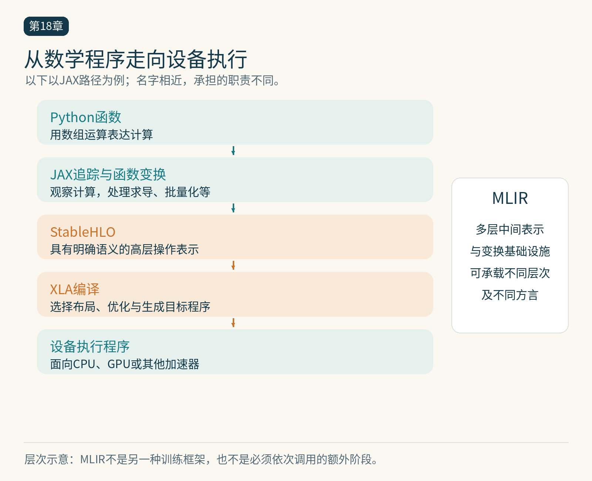

# 第18章　JAX、XLA、MLIR 与编译路线

写 GPU 程序不只有一种入口。有人从 PyTorch 模型开始，有人使用 JAX 的函数变换，有人直接编写内核语言。它们最后都需要把数学操作映射到硬件，却在何时观察程序、怎样表示状态、给用户多少控制等方面作出不同选择。理解这些差异，比记住一串框架名称更有用。

## JAX 从函数变换出发

JAX 提供类似 NumPy 的数组计算，同时把自动求导、批量化和编译表达为函数变换。`grad` 产生求导函数，`vmap` 为函数增加批量维度语义，`jit` 为适合的计算区域准备编译执行。这些变换可以组合，但组合后的程序仍必须满足相应规则。[1]

例如一个样本损失函数接受参数和一条数据；对参数求导得到单样本梯度，再用 vmap 表达批量梯度，或先对批量损失取平均再求导。这里的写法强调数学结构。是否真正保存逐样本梯度，会影响显存和计算，不能因为表达简洁就忽略中间张量规模。

JAX 倡导把状态显式传入、传出。训练参数、优化器状态和随机数键属于计算输入输出，而不是任意隐藏在可变全局变量中。这种组织有助于追踪数据依赖，也要求程序员重新审视原来依靠副作用实现的逻辑。[1]




*图 18-1｜原创精确图解。以JAX为例追踪从函数、追踪变换、StableHLO到XLA编译与设备程序的层次。MLIR是多层表示与基础设施，不是另一个训练框架。*


## 追踪看到的是抽象值

`jax.jit` 会追踪函数中的数组计算。追踪阶段通常关心形状和 dtype 等信息，不是拿到每个运行时元素后再执行任意 Python 判断。因此 `if x.sum() > 0` 这类依赖张量值的 Python 分支，和基于静态配置的分支不同，通常需要使用可被系统表达的结构化控制流。[2]

一个常见初学现象是：函数里的普通 `print` 只在追踪时出现，或打印出抽象追踪对象。这反映了 Python 阶段与设备执行阶段的分离。调试运行时值应使用框架提供的对应机制，并留意调试行为自身对执行时序的影响。

输入形状或静态参数改变时，可能需要新的编译方案。将一个经常变化的值设为静态参数，可能让编译缓存不断增加；把不适合动态表示的结构硬塞进数组，也可能让表达复杂化。边界设计仍然是编译性能的重要部分。

## XLA 是编译器，不是 JAX 的另一个名称

XLA 把高层机器学习计算转换为面向目标设备的执行程序。它可以进行融合、布局选择和其他优化，并支持 CPU、GPU 与专用加速器后端。JAX 是重要前端，但 XLA 不是只服务于 JAX；同样，JAX 也不仅仅是给 XLA 传递一张图，它还定义数组、变换及执行接口。[3]

理解一个简化路径即可：Python 函数经过 JAX 追踪形成内部表示，之后降低到 StableHLO 等表示，交给编译器进一步优化和生成目标程序。真实实现的阶段与接口会演进，不应把这个教学路径当成每次调用都重新执行全部步骤的固定流水线。

## StableHLO 与 MLIR 各自解决什么

StableHLO 是一套具有明确语义和兼容目标的高层机器学习操作集合，承担框架与编译器之间的交换层角色。它描述计算含义，不是某张 GPU 的机器指令，也不保证导出的每个程序能在所有设备上以相同速度执行。[4]

MLIR 则是一套构建多层中间表示和变换的基础设施。不同 dialect 可以表达张量操作、循环、内存与目标设备相关操作。高层保留矩阵乘法这样的结构，有利于大范围优化；逐层降低时再把布局、搬运和执行细节具体化。MLIR 本身不是用户写模型的框架，也不是自动完成所有优化的单一编译器。[5]

以矩阵乘法为例，高层知道“这是一个矩阵乘法”，可以选择适合的计算路线；更低层需要知道分成哪些块、块怎样加载、结果怎样累加。过早丢掉结构会让高层优化困难，始终停留在高层又无法安排硬件。这就是多层表示的教学意义。

## 用可运行的小例子观察边界

以下示例需要安装 JAX，可在 CPU 上运行。它展示编译函数、自动求导与稳定的计时边界；没有声称某个设备上的性能结果。

```python
import jax
import jax.numpy as jnp

@jax.jit
def loss(w, x, y):
    error = x @ w - y
    return jnp.mean(error * error)

w = jnp.ones((4,))
x = jnp.arange(32, dtype=jnp.float32).reshape(8, 4) / 32
y = jnp.ones((8,))
value = loss(w, x, y)
value.block_until_ready()
grad = jax.grad(loss)(w, x, y)
print(float(value), grad.shape)
```

JAX 通常异步提交工作。仅测量函数返回需要多久，可能主要测到提交开销；`block_until_ready()` 用于等待结果完成。首次调用还可能包含追踪与编译，因此首次时间与稳态时间要分开。[6]

## 何时需要越过高层框架

如果编译器无法为特殊归约、稀疏访问或新模型结构生成合适实现，可以进入自定义内核或外部函数接口。Pallas 是 JAX 生态的内核语言，支持 GPU 与 TPU 路径，但具体能力和后端状态应查询对应版本。它让程序员显式考虑数据块与内存层次，承担的职责不同于普通 `jnp` 表达式。[7]

选择路线时，先看现有团队、模型代码、部署环境和需要控制的层级。PyTorch 的增量编译适合从现有动态程序逐步扩大优化区域；JAX 的显式函数变换有利于围绕纯计算组织程序。这些是接口取向的比较，不是性能排名。最终仍应让同一工作负载在明确条件下接受正确性、开发成本与性能检验。

## 相同接口不等于相同执行路线

两个函数都使用矩阵乘法，并不能证明它们经过相同编译阶段；一个可能调用设备库，另一个可能在更大融合区域中生成内核。比较框架时，应把数学目标、输入布局、精度和计算范围对齐，再查看实际执行程序。否则所谓框架差异，可能只是一个启用了融合，另一个额外执行了数据复制。

同样，跨设备可移植首先意味着程序能够表达和正确执行，性能可移植还要求它在不同存储层级、矩阵单元与并行结构上组织得当。编译基础设施能复用许多工作，却不能消除硬件差异。一个在 GPU 上合适的数据块，不应原封不动地被当成 TPU 上的最佳参数。

对读者而言，最实用的入门目标是识别三个边界：Python 何时运行、数组计算何时被编译、设备何时真正完成。先把这三点实验清楚，再去读中间表示和后端优化，理解会更扎实。

学习时也可以先使用 CPU 观察这些边界。追踪与函数变换的概念不依赖购买特定显卡；只有验证目标设备性能时，才需要对应硬件、后端和分析工具。

## 本章参考

[1] JAX，How to think in JAX，https://docs.jax.dev/en/latest/notebooks/thinking_in_jax.html 。

[2] JAX，Just-in-time compilation，https://docs.jax.dev/en/latest/jit-compilation.html 。

[3] OpenXLA，XLA，https://openxla.org/xla 。

[4] OpenXLA，StableHLO，https://openxla.org/stablehlo 。

[5] LLVM，MLIR Overview，https://mlir.llvm.org/ 。

[6] JAX，Asynchronous dispatch，https://docs.jax.dev/en/latest/async_dispatch.html 。

[7] JAX，Pallas，https://docs.jax.dev/en/latest/pallas/ 。资料核验：2026-10-25。
