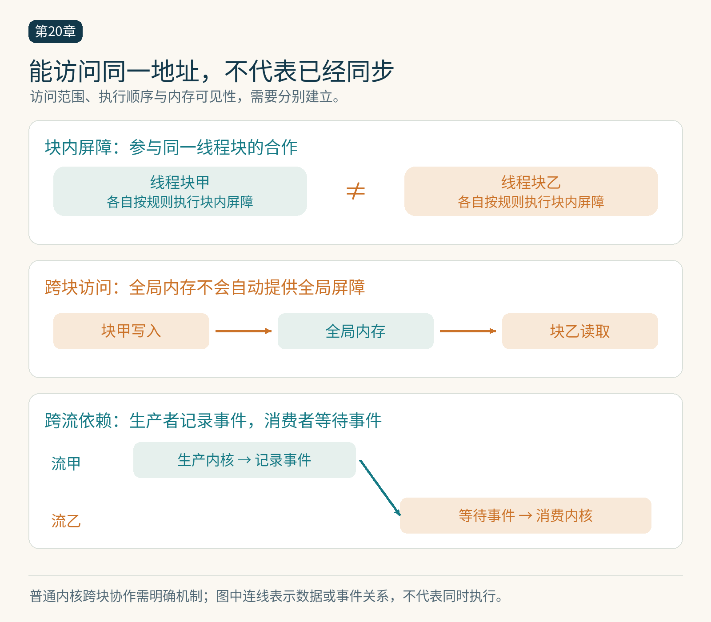

# 第20章　CUDA 与 HIP 的执行和内存模型

进入底层编程，首先要回答三个问题：一个输出归谁写，多个执行者如何交换数据，另一个执行者什么时候能够安全读取结果。CUDA 和 HIP 都让我们显式组织这些关系；熟悉函数语法并不能自动保证并发程序正确。

## 线程块是合作边界

CUDA 内核可以这样给向量元素编号。这里展示的是设备函数片段，不是可独立编译的完整程序。

```cpp
__global__ void add(const float* x, const float* y, float* z, int n) {
    int i = blockIdx.x * blockDim.x + threadIdx.x;
    if (i < n) z[i] = x[i] + y[i];
}
```

`threadIdx.x` 是块内线程编号，`blockIdx.x` 是块编号，`blockDim.x` 是块大小。启动配置决定线程块的数量及每块线程数；这与问题元素数并不总是一一对应。也可以让一个线程通过循环处理多个元素，使启动规模与可用并行资源保持合理关系。[1]

线程块中的线程可以使用共享内存协作。普通内核中，块之间应能独立调度，不能假设编号较小的块先完成。若一个块忙等另一个尚未被调度的块，而等待者占满设备资源，程序可能无法取得进展。涉及整个网格的协作需要额外的启动约束或专门机制，入门阶段最清楚的办法是拆成多个内核，在合法的执行顺序上建立依赖。




*图 20-1｜原创精确图解。地址可访问性、执行先后和内存可见性需要分别建立。普通块内屏障不能充当任意跨块全局屏障；跨流依赖可用事件表达。*


## 共同地址不等于共同进度

寄存器主要承载单线程的临时值；共享内存供同一块合作；全局内存容纳跨块可访问的大数组。名称中的“全局”表示可访问范围，不保证多个线程写同一地址会自动合并，也不保证写入立刻成为其他线程可以安全使用的信号。

设线程甲先写数据，再写“完成”标志，线程乙轮询标志后读数据。这里除了标志更新本身，还需要正确的内存顺序与作用域，建立数据写入到数据读取的先后关系。把标志声明成 `volatile` 不会自动解决这个协议。现代 CUDA 内存模型提供带作用域的原子与同步语义；它们涉及哪些线程能够观察写入，不能只理解成“禁止编译器优化”。[2]

同样，“原子加”只保证该原子操作的特定并发语义。很多线程对一个浮点地址原子累加，执行次序仍可能变化。浮点加法不满足严格结合律，所以无数据竞争的结果也可能在末位上不同。这是数值可重复性与并发正确性之间的重要区别。

## 共享内存需要两个方向的同步

以分块矩阵乘法为例，所有线程先把输入的一部分搬到共享内存，随后共同计算。第一次块级屏障确保消费前，各线程的写入已经完成。进入下一轮时，还需要防止快线程覆盖下一块数据，而慢线程仍在读取上一块；通常因此需要第二次屏障。

屏障必须被所要求的参与者一致执行。把 `__syncthreads()` 放在只有部分线程进入的条件分支中，可能导致未定义行为或等待失败。边缘块不能简单让越界线程提前返回，再让其余线程调用块级屏障。更稳妥的结构是让所有线程继续参与协作，只把越界输入填成乘加中的零，并限制最终写回。

Warp 内也不应凭“看起来锁步”省略同步。独立线程调度、编译器变换和不同指令的完成时刻都使这种假设脆弱。显式使用相应的同步或集体操作，并满足参与掩码约束，才是可以维护的程序。[1]

## 连续访问怎样变成合并事务

当相邻执行通道访问相邻、对齐的数据，硬件能够用较少的内存事务服务这些请求。若每个线程相隔很远地读一个元素，同样多的有效数据可能触发更多事务。因此，张量数学形状相同，并不代表地址模式相同。

例如行主序矩阵中，沿列索引增加通常访问相邻元素，沿行索引增加则跨越整行步长。但“连续总是更快”仍然过于笼统：缓存、向量化、访问对齐和数据复用都会改变结果。优化时应先画出一组线程实际访问的地址，再结合分析工具观察，而不是只看代码中用了几层循环。

共享内存还存在 Bank 映射。不同线程的访问若落入冲突布局，可能降低吞吐量；转置等算子因此常调整共享数组的布局或填充。这里的填充是改变物理排布，以便后续访问更顺畅，而不是改变数学数据。

## HIP 的相似性与差异

HIP 提供与 CUDA 接近的 C++ 内核和运行时接口，便于迁移现有程序。HIPIFY 可以转换许多接口名和调用形式；AMD 官方同时强调应逐部分迁移并测试。[3] 这项能力主要解决源代码接口问题，并不会把 NVIDIA 设备二进制转换成 AMD 设备二进制。

可移植性至少分成三层：源码能编译、结果满足语义、目标设备上有合适性能。第一层通过并不代表后两层通过。硬编码 Warp 为 32、直接嵌入 NVIDIA PTX、依赖特定矩阵指令或共享内存布局，都可能需要重新设计。AMD 不同架构的 Wavefront 能力也不同，应读取目标属性与文档，而不是统一写成 64。[4]

编译时必须面向实际设备架构。运行时与库、驱动以及框架的支持范围也要一起核对。若程序主要调用矩阵乘法库，迁移重点可能是库接口、数据布局和算法选择；若核心是手工汇编内核，工作量会明显不同。

## 用最小实验检查合作关系

读一段内核时，可以在纸上给每个输出标出唯一写入者，再给每个共享数组标出生产者和消费者。若找不到唯一写入者，就要确认是否使用了合理的原子或归约；若消费者可能先于生产者，就要找依赖；若某次屏障只有部分参与者能够到达，就要重写控制流。

完成这些检查后，再讨论线程块尺寸、寄存器占用与吞吐量。底层编程的价值在于能够控制数据与协作方式。控制越细，关于正确性的责任也越明确。

## 从流顺序读懂两个内核

同一流上先启动生产内核、再启动消费内核，可以用该流的顺序保证消费不会越过前面的工作。换成两个流以后，这个依赖不再由代码的书写先后自然表达；应让生产流记录事件，消费流等待该事件，再读取结果。这样等待的范围更小，也保留其他独立工作的重叠机会。把设备全局同步放在每次调用后虽然便于入门排错，却可能消除本来能够重叠的传输和计算。

## 本章资料

[1] NVIDIA，CUDA Programming Guide，Programming Model 与 Writing SIMT Kernels，核验于 2026-10-25。https://docs.nvidia.com/cuda/cuda-programming-guide/

[2] NVIDIA，CUDA C++ Memory Model，核验于 2026-10-25。https://docs.nvidia.com/cuda/cuda-programming-guide/05-appendices/cuda-cpp-memory-model.html

[3] AMD，Porting CUDA code to HIP，核验于 2026-10-25。https://rocm.docs.amd.com/projects/HIP/en/latest/how-to/hip_porting_guide.html

[4] AMD，Introduction to the HIP programming model 与 Hardware implementation，核验于 2026-10-25。https://rocm.docs.amd.com/projects/HIP/en/latest/understand/programming_model.html
