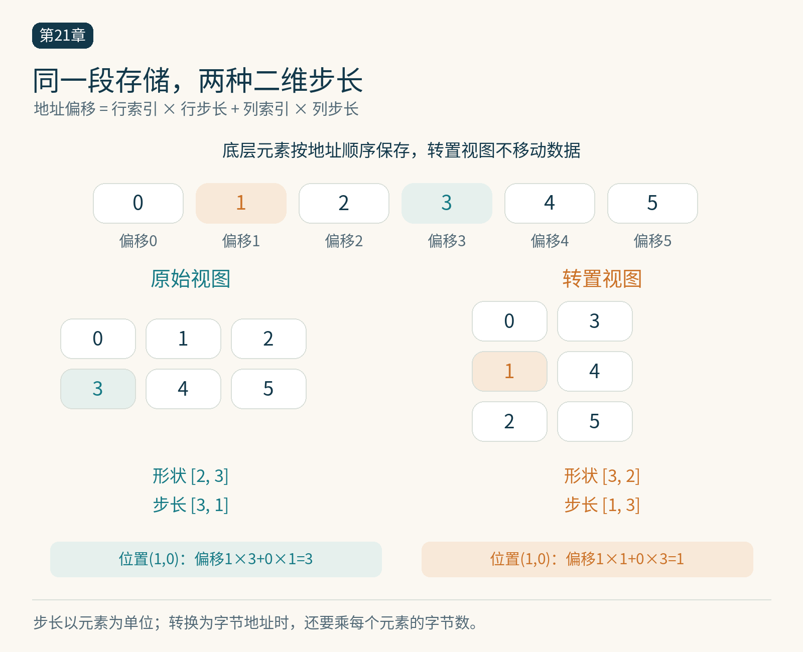

# 第21章　Triton 的块级编程

CUDA 经常要求我们从线程视角描述工作：这个线程负责哪个元素，怎样与其他线程合作。Triton 让程序员主要描述一块数据上的运算，再由编译器把这块数据映射到线程和硬件指令。它使用 Python 风格语法，但内核代码会被编译成设备程序，并不是 Python 解释器在 GPU 上逐句执行。[1]

## 程序实例持有一块逻辑数据

向量加法的核心可以写成下面这样。完整的输入检查、启动和计时见 `examples/19-vector-add-triton.py`。该接口只接受一维连续 FP32，并要求非空输出不与输入共享底层存储，避免部分重叠切片引发跨程序读写竞争。

```python
@triton.jit
def add_kernel(X, Y, Z, n, BLOCK: tl.constexpr):
    offsets = tl.program_id(0) * BLOCK + tl.arange(0, BLOCK)
    mask = offsets < n
    x = tl.load(X + offsets, mask=mask, other=0)
    y = tl.load(Y + offsets, mask=mask, other=0)
    tl.store(Z + offsets, x + y, mask=mask)
```

`program_id(0)` 选定一块工作；`arange` 创建一组逻辑索引；指针加索引得到一组地址；读取、计算、写回都作用于这组值。不要将 `BLOCK=256` 理解成必定启动 256 个线程。逻辑块大小和线程组织是不同层次，编译器与启动配置决定物理执行方式。[2]

这一视角的好处，是数学形状在代码中保持可见。一个行归约程序可以先持有整行数据，再写 `sum`；矩阵乘法可以持有一个二维结果块，再写块矩阵乘法。代价是程序员仍要决定块的大小、访问布局和并行划分。编译器不会凭空消除糟糕的数据搬运策略。




*图 21-1｜原创精确图解。同一存储分别以[2,3]/步长[3,1]和[3,2]/步长[1,3]读取。步长以元素为单位，真正计算字节地址还需乘元素大小。*


## 指针算式就是数据布局

设行主序矩阵的行步长为 `s0`、列步长为 `s1`，元素 $(r,c)$ 的地址偏移是 $r s_0+c s_1$。连续矩阵常有 $s_1=1$，但转置视图可能交换步长。把第二维硬编码为连续，就等于给输入增加了约束；包装函数应检查这个约束，或显式传入步长。

对于二维块，行索引可以扩成一列，列索引扩成一行，通过广播产生二维地址网格。这种广播只是在程序中构造索引关系，不意味着创建了完整的大矩阵。理解地址网格之后，`[:, None]` 和 `[None, :]` 就不再只是需要背诵的写法。

边界处理同样遵循数学语义：加法缺失位置填零，求最大值的缺失位置通常填负无穷，矩阵乘法中越界乘数填零。掩码读取的 `other` 值如果选错，即使没有非法访问，结果也可能错误。例如 Softmax 的填充位置若填零，真实值全部为负时，填充值就会改变行最大值与分母。

## 编译期参数与运行期参数

`tl.constexpr` 表示编译期已知的参数。块大小经常这样传入，因为它决定程序内部张量的形状。不同值可能产生不同的编译特化。普通参数则在运行时提供，适合数据指针和不需要固定展开的尺寸。

特化可以让编译器简化索引、展开循环、选择指令；过度特化则增加编译和缓存成本。如果每个稍有不同的输入都产生新的程序，稳定执行很快，也不一定适合交互场景。报告性能时，应该把“首次编译时间”和“已编译内核时间”分开。

块越大不一定越好。较大块可能提高复用、减少程序数量，却需要更多寄存器；寄存器压力上升后，设备上同时驻留的工作减少，甚至出现溢出。`num_warps` 也不是越大越快，它改变参与组织与资源分配，最佳配置依算子、形状和目标架构而变化。

## 从一维扩展到行运算

下一步可以写一个行归一化：每个程序处理一行，加载 $D$ 个值、计算归约、逐项输出。若 $D$ 不是适合块形状的长度，就扩到合适的逻辑块大小，并正确掩码。这个版本能把行内中间值留在片上，是理解融合的重要起点。

但是，整行放进一个程序也有上限。行很长时，临时值太多；行数很少时，程序数不足以利用整块 GPU。此时可能需要让多个程序合作处理一行，再用后续阶段合并局部统计量。编程模型简洁，并没有取消算法划分的重要性。

本书在第 23 章给出行 Softmax 的完整实验。建议先只比较输出，再修改块大小观察性能，避免把正确性变化和性能变化混在一起。对于很大的行，示例会主动拒绝，提醒读者这个教学实现有适用边界。

## 调优要与输入族一起进行

自动调优会在若干候选配置间选择，搜索空间可以包含块尺寸、Warp 数量等。调优键应区分会改变性能的输入条件，通常至少考虑关键维度，有时还要包括数据类型、步长或设备。若调优只针对一种连续输入，结果不能自然推广到所有转置视图。

要特别注意带状态的候选内核。若内核向已有输出原子累加，每次候选运行前都需要恢复正确状态，否则搜索过程自己就改变了问题。纯函数式、独立输出的第一批实验更容易验证。

Triton 官方目前还提供 Gluon 等更显式控制布局的学习材料。[3] 本书将它们放在进阶比较中：先掌握块、步长、掩码和归约，再理解为什么某些性能问题需要更细的控制。Triton 能降低初次写内核的门槛，却不承诺同一源码在所有后端与架构上自动获得同样的相对性能。

## 把索引错误变成可观察的问题

假设输入长度为 10，每个程序负责 4 项。三个程序的逻辑索引分别是 0—3、4—7、8—11。最后一组中 10、11 被掩掉，实际只产生两个输出。这张简短的索引账本，能同时解释为什么网格向上取整、为什么尾部仍需要掩码，以及掩码为什么要参与每次可能越界的访问。

二维情况下，建议先使用每个位置都可辨认的数，例如第 r 行第 c 列填成一百乘 r 再加 c。转置、步长和广播写错时，这样的数据比纯随机数组更容易看出规律。之后再加入随机数据与不同尺度，避免规则数据恰好掩盖错误。检查还应包括写出区域外的保护值，帮助发现输出越界；正式设备测试则结合内存检查工具。

还要区分“选择结果”与“阻止读取”。先执行一次无掩码读取，再用条件选择丢掉越界项，不能撤销已经发生的非法访问。安全条件应放在读取本身的掩码参数上。学会阅读这种局部依赖，能够避免把张量表达式误当成带有短路求值的普通 Python 条件语句。

当编译器报出形状或资源错误时，先缩小逻辑块、检查广播维度和编译期常量，再讨论更复杂的调优。这样可以把语义问题与设备资源上限分别定位。

## 本章资料

[1] Triton，Documentation 与 Tutorials，核验于 2026-10-25。https://triton-lang.org/main/index.html

[2] Triton，triton.language API，核验于 2026-10-25。https://triton-lang.org/main/python-api/triton.language.html

[3] Triton，Gluon Tutorials，核验于 2026-10-25。https://triton-lang.org/main/getting-started/tutorials/gluon/index.html
