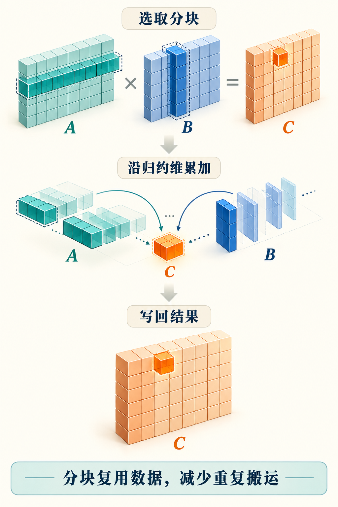

# 第22章　GEMM：从朴素实现到分块计算

Transformer 中的投影、前馈层与许多反向计算，都可以归结为矩阵乘法。GEMM 是通用矩阵乘法的简称，其常见数学形式为 $C=\alpha AB+\beta C$。本章先固定 $\alpha=1$、$\beta=0$，研究 $A_{M\times K}B_{K\times N}=C_{M\times N}$。它的关键不在于背下三重循环，而在于理解同一个数怎样被重复使用。

## 一项输出的算法很简单

每个输出满足 $C_{ij}=\sum_{k=0}^{K-1}A_{ik}B_{kj}$。若每个线程负责一个输出，就能沿 $k$ 循环累加。这样的实现清楚、便于验证，但相邻输出需要相同的输入：计算同一行的不同列，会重复读取 $A$；计算同一列的不同行，会重复读取 $B$。

对大矩阵，通常把一次乘法与一次加法记为两次浮点运算，所以总量约为 $2MNK$。这是性能报告中的约定，而不是说硬件一定分两条指令执行。对于非方阵、批量矩阵乘法或融合后处理，应该明确实际采用的运算量定义。




*图 22-1｜AI 教学示意。A的行方向区域和B的列方向区域共同生成C的输出块，沿归约维分段累加后再写回。方格是概念块，不按本章代码尺寸逐格绘制。*


## 分块就是有组织地复用

让一个合作单元计算 $B_M\times B_N$ 的输出块。沿 $K$ 维分段，每次读取 $B_M\times B_K$ 的 A 块，以及 $B_K\times B_N$ 的 B 块，更新同一块累加器。A 块中的每个值参与多个输出列，B 块中的每个值参与多个输出行。输入在较近存储中反复使用，远端流量因此减少。[1]

看一个理想化例子：输出块为 $64\times64$，K 分块为 32。一次分段加载 $64\times32+32\times64=4096$ 个输入元素，完成 $2\times64\times64\times32=262144$ 次浮点运算。若输入都是 2 字节，则只按这次输入读取计算，运算强度为 32 FLOP/byte。这里没有计入最终输出、缓存失效、填充和指令开销，不能把它直接当成实测 Roofline 位置。

块的三个维度承担不同任务。增大 $B_M$、$B_N$ 往往增强复用，也扩大累加器；增大 $B_K$ 改变搬运与流水线粒度，却不保证最终输出块有更多可复用空间。选块尺寸是在计算量、寄存器、共享内存、并行块数之间取平衡。

## 用 CPU 看清切块过程

`examples/22-tiled-gemm-numpy.py` 实现了可在 CPU 上运行的分块矩阵乘法，并与 NumPy 的 `@` 对照。它刻意使用 37、29、41 这样的非整齐尺寸，让最后一块的边界处理暴露出来。

```python
# 教学核心，完整的形状检查与验证在随书示例中。
for i in range(0, M, BM):
    for j in range(0, N, BN):
        for k in range(0, K, BK):
            C[i:i+BM, j:j+BN] += (
                A[i:i+BM, k:k+BK] @ B[k:k+BK, j:j+BN]
            )
```

这份 CPU 代码解释数学分解，不模拟 GPU 性能。切片背后的 NumPy 运算本身还会调用优化库，所以不能拿它的 Python 循环耗时推断 GPU 分块优劣。教学模型与硬件实现分别回答“为什么正确”和“怎样高效执行”。

## 片上布局决定矩阵指令能否顺利工作

真正的高性能内核还要安排：由哪些线程搬运，数据存入共享内存时采用什么布局，矩阵计算单元读取什么片段，乘积以什么类型累加。现代矩阵单元对形状、对齐和数据格式有特定要求；“用了半精度输入”并不自动保证发出了目标矩阵指令。

Triton 的 `tl.dot` 表达块矩阵乘法，编译器再面向目标硬件生成指令。[2] 更细控制可以通过其他 DSL 或较底层机制完成。读者应该学会从编译输出、分析器与资源报告确认行为，而不是用源代码里某个函数名判断性能。

矩阵布局也会影响读取连续性。B 逻辑上是 $K\times N$，不意味着必须在每一步转置它；若已经有合适步长，内核可以按对应地址读取。若为了某个矩阵内核先产生一份连续副本，复制时间和额外显存也属于系统成本。

完整 GPU 教学版本见 `examples/22-gemm-triton.py`。它以二维网格选择输出块，传入 A、B 的实际步长，以 FP16 输入和 FP32 累加演示 `tl.dot`，并检查非整齐尺寸和转置 B 的视图。当前版本没有自动调优、专用异步流水线和分组调度，不应将它当作生产矩阵库的替代品；本书制作环境也未执行其 GPU 验证。

## 尾块、精度与特殊形状

矩阵维度不是分块倍数时，应把越界输入视作零，并限制输出写回。若 K 尾块没有清零，累加器就可能吸收不存在的元素。只测 $1024^3$ 这样的整齐尺寸，会遗漏很多真实模型中的边界问题。

低精度输入通常配合较高精度累加，但总误差还依赖 K 长度、输入尺度、指令和求和次序。两个数学等价实现未必逐位相同，应使用与工作负载相符的绝对误差和相对误差条件。接近零的参考值尤其不能只看相对误差。涉及训练时，还应观察后续梯度和损失，而不只测一张矩阵。

矩阵太小，启动与调度可能占大头；M 很小、N 和 K 很大时，数据复用与并行度会不同；多个大小各异的小矩阵，可能适合分组执行。MoE 专家计算就经常带来不均匀形状。因此“某个 GEMM 内核最快”必须接上具体的形状族。

## 把后处理接在输出旁边

线性层经常在矩阵乘法后接偏置和激活。若乘积已经在累加器里，可以在写回前完成部分后处理，避免先写出再读回。这一段通常称为 Epilogue，即输出阶段。[1] 它解释了自定义 GEMM 的实际价值：针对业务需要改写数据流。

融合仍有取舍。后处理过重会扩大寄存器需求，难以共享的中间结果也可能让其他消费者重复计算。比较自写内核时，既要与库的裸 GEMM 比，也要与实际的“GEMM＋后处理”基线比。只有两边做同样的工作，速度比较才有意义。

## 让一个输出块走完全过程

用一个 5×7 的 A 矩阵乘以 7×6 的 B 矩阵，结果是 5×6。若输出块取 4×4，网格需要两行两列共四个块。右侧块只有两列有效，底部块只有一行有效；右下角只有两个真实输出。若 K 分块取 4，第一次累加处理 k 为 0—3，第二次处理 k 为 4—6，并把缺失的第四项当作零。

特别要注意：输出块在两次 K 迭代中保持同一身份。第一次得到的是部分和，不能直接当作完成结果；第二次应继续累加，再统一写回。若每次迭代都从零初始化累加器，就只留下最后一段；若每段都向全局输出普通相加，又可能引入额外读写，甚至在拆分 K 并行时产生数据竞争。

这种把 K 维拆给多个合作单元的做法称为 Split-K，可增加某些形状下的并行度，但需要合并部分和。它与单个输出块内部顺序遍历 K 不是一回事。额外中间存储、归约和求和次序都会带来成本，因此应针对并行度不足的形状评估，不能作为所有 GEMM 的固定步骤。

最后，比较大方阵与实际线性层形状。对于单步生成，M 可能很小；训练把很多 token 合并成矩阵，M 会更大。同一模型的权重矩阵没有改变，输入组织却足以改变优化重点。这是从算子形状理解工作负载的一种直接方法。

## 本章资料

[1] NVIDIA，CUTLASS Documentation，GEMM 与高效矩阵乘法，核验于 2026-10-25。https://docs.nvidia.com/cutlass/

[2] Triton，Matrix Multiplication，核验于 2026-10-25。https://triton-lang.org/main/getting-started/tutorials/03-matrix-multiplication.html

[3] Triton，triton.language.dot，核验于 2026-10-25。https://triton-lang.org/main/python-api/triton.language.html
