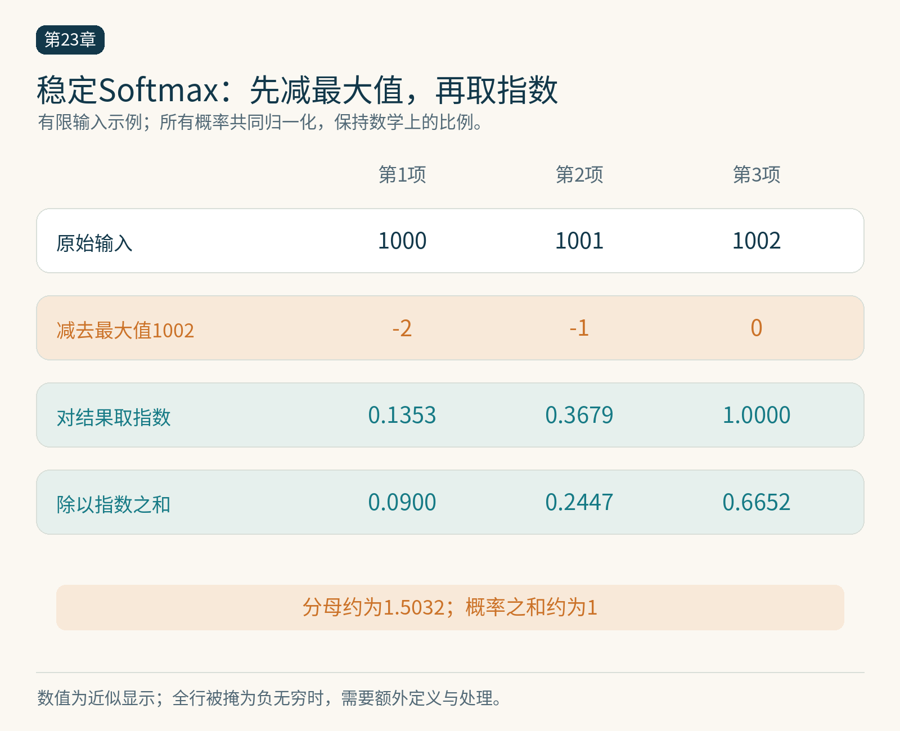

# 第23章　Reduction、Softmax 与 RMSNorm

矩阵乘法通过复用输入积累大量计算。归约类算子则面临另一种困难：很多输入必须共同决定少量输出。求和、求最大值和统计均值都属于归约。Softmax 与 RMSNorm 在 Transformer 中频繁出现，正好能展示“先汇总、再逐项处理”的数据流。

## 归约先改变合作方式

对一行 $D$ 个数求和，串行算法从左到右累加；并行算法可以先分成若干组，各组求局部和，再合并。分层之后，很多加法可以同时进行。但输入从哪里读、局部结果放哪里、谁等待谁，都会影响实际速度。

树形归约有较短的依赖深度，却改变了浮点求和顺序。假设 FP32 中存在很大的正负数和很小的增量，小数可能在某种顺序下被舍入掉，在另一种顺序下保留下来。所以数学表达式一样，输出末位也不一定相同。高精度参考、合理容差与极端输入都应进入验证。

数据太长时，可以先让多个程序输出局部统计量，再用第二个内核合并。原子累加也能合并部分结果，但有竞争、数值次序和初始化要求。把所有线程都送到同一地址，通常不是适合任意规模的解决办法。

*图 23-1｜原创精确图解。整行减去同一个最大值，再指数化并除以总和，保持Softmax比例。这里仅演示有限输入；全行被屏蔽等情况需按接口语义另行处理。*

## Softmax 为什么先减最大值

Softmax 把一行实数变成非负、总和为 1 的权重：

$$
p_i=\frac{\exp(x_i)}{\sum_j\exp(x_j)}.
$$

直接求指数容易溢出。利用指数的比例关系，可以先令 $m=\max_jx_j$，再计算 $\exp(x_i-m)$。分子与分母同时乘了相同因子，实数数学中的结果不变，数值范围却更容易处理。[1]

输入为 $[1000,1001,1002]$ 时，直接指数可能超出浮点范围；减去最大值后得到 $[-2,-1,0]$。这个例子说明稳定公式的意义。它没有保证所有特殊输入都有合理输出：如果整行都被掩成负无穷，`负无穷减负无穷` 会产生 NaN。全屏蔽行应由接口定义行为，再显式处理，不能让实现偶然决定。

一般拆分实现可能分别求最大值、做减法、求指数、求和、做除法，临时结果多次进出显存。融合内核则尽可能让一行数据和中间值留在片上，完成后只写最终输出。收益来自减少搬运与启动，并非改变了 Softmax 的数学定义。[1]

## 整行融合也有边界

本书的 `examples/23-row-softmax-triton.py` 让一个程序处理一行，逻辑块扩展到不小于列数的适当长度。越界读填负无穷，归约后这些位置的指数为零，最终写回只保留真实列。示例针对有限值、连续 FP32 二维输入，并给出行宽限制。

若行宽从几千增长到几十万，整行驻留会产生严重资源压力；若矩阵只有一两行，程序数又可能不足。长行要考虑分块统计，再合并；行数与行宽同时变化时，最优策略也会变化。不能因为短行融合成功，就把同一个配置推广到所有张量。

用 FP32 两次读遍输入、一次写出输出，逻辑流量为每元素 12 字节；若实现能只读一次并在片上保留，理想值是 8 字节。真实内核可能因溢出、缓存和额外统计量产生不同流量。必须区分算法估算与设备测量。

## RMSNorm：归约如何影响每个元素

设一行输入为 $x$，可学习权重为 $w$，RMSNorm 可写成

$$
r=\left(\frac1D\sum_jx_j^2+\epsilon\right)^{-1/2},\qquad y_i=x_i r w_i.
$$

它按均方根缩放，不像 LayerNorm 那样先减去均值。[2] $\epsilon$ 位于平方根内部，其位置属于算子定义，不能为“近似优化”随意改动。平方与求和通常需要更高精度的中间计算，特别是低精度输入或较大幅值时。

RMSNorm 的前向要先得到一个全行尺度，再逐项输出；反向则要考虑这个尺度依赖整行输入。记上游梯度为 $g_i$，有

$$
\frac{\partial L}{\partial x_i}
=r g_iw_i-\frac{x_ir^3}{D}\sum_jg_jw_jx_j.
$$

第一项是当前元素直接影响输出，第二项是当前元素改变全行尺度的间接影响。若反向只写成 `g*w*r`，就遗漏了归约带来的依赖。权重梯度则需要跨批次和行汇总，不能把每行结果当成最终权重梯度。

## 用数学验证推动实现

`examples/23-reductions-numpy.py` 包含稳定 Softmax、RMSNorm、Softmax 向量—雅可比积以及 RMSNorm 输入梯度的 CPU 参考。它用有限差分检查解析梯度，并验证 Softmax 对有限常数平移的不变性。这些检查验证教学公式，不宣称 GPU 实现已有相同性能或精度。

有限差分用微小扰动近似导数，步长过大会有截断误差，过小又会被舍入噪声淹没，因此使用 FP64 小输入更合适。测试值应远离不可微点，并包含不整齐长度。梯度正确以后，再检查数据类型转换、布局、边界掩码和并行合并是否保留这些语义。

回到训练，归一化、偏置与激活的单次耗时可能很小，但每层反复出现，且容易被启动和显存流量支配。它们值得优化的原因，是在完整模型中出现频繁；是否值得手写，仍应由分析结果决定。

## Softmax 的反向也能避免巨大中间矩阵

一行有 D 个输入时，完整雅可比矩阵有 D² 项，但训练通常只需要上游梯度与这个矩阵的乘积。设上游梯度为 g，输出概率为 p，则输入梯度为 pᵢ乘以括号中的“gᵢ减去整行 g 与 p 的点积”。因此只需求一个行归约，再逐项输出，不必真的生成 D×D 的雅可比矩阵。

这个推导带来两个实践判断。首先，前向输出 p 可以为反向提供信息，但保存它会占用显存；重新计算则增加前向统计与指数运算。其次，数值验证不能只检查梯度形状一致，还要对比向量—雅可比积。随书参考脚本正是选择随机上游梯度，将所有输出加权成一个标量损失，再用有限差分比较每个输入的影响。

## 从一行追踪到整个批次

RMSNorm 通常沿隐藏维归约。若输入形状为批次、序列、隐藏维，可以把前两维合成行，得到很多独立归一化任务。权重则沿隐藏维共享：每一行使用同一组权重，因此权重梯度必须汇总所有行。输入梯度是行内计算，权重梯度是跨行归约，两者的并行划分未必相同。

先画清归约轴，再决定程序网格，能避免一个常见错误：数学公式写得正确，实现却沿错了维度。验证数据也应让不同行具有不同尺度，否则按行和按列错误归约可能不易察觉。

归约的输出越少，越需要留意并行度是否随问题规模一起增长。输入变大不总意味着设备利用率自然提高，合适的分阶段算法往往比单纯增大块更有效。

## 本章资料

[1] Triton，Fused Softmax，核验于 2026-10-25。https://triton-lang.org/main/getting-started/tutorials/02-fused-softmax.html

[2] Zhang、Sennrich，Root Mean Square Layer Normalization，2019。https://arxiv.org/abs/1910.07467

[3] Triton，Reduction Ops，核验于 2026-10-25。https://triton-lang.org/main/python-api/triton.language.html

[4] PyTorch，Automatic differentiation package，核验于 2026-10-25。https://docs.pytorch.org/docs/stable/autograd.html
