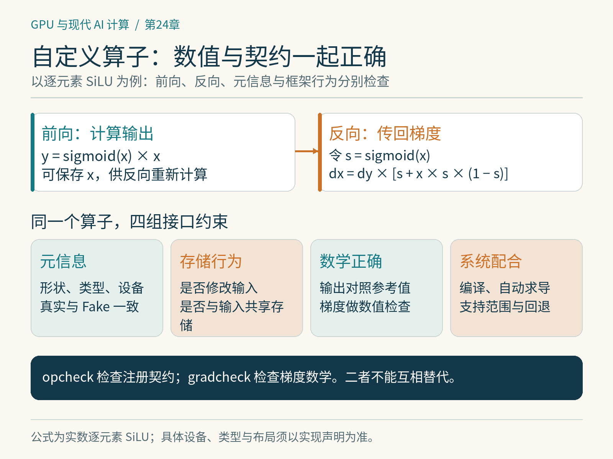

# 第24章　融合算子、反向算子与框架集成

一个自写内核输出正确，还不能直接证明它适合训练。训练框架需要知道输出怎样依赖输入、反向如何计算、输出的形状与类型是什么，以及函数是否偷偷修改了输入。编译、自动求导和混合精度会从不同角度使用这些信息。集成工作的目标，是让内核成为整个系统可以理解的计算。

## 先决定是否需要自定义算子

如果一个函数能用现有 PyTorch 运算表达，先保留这种表达，测量 `torch.compile` 等机制能否满足需求。普通组合天然暴露了计算关系，框架有机会融合与优化。只有需要调用框架看不懂的外部实现，或需要明确的算子边界与子系统行为时，再考虑注册接口。[1]

直接在受支持的编译路径中使用 Triton 内核，与建立一个具备完整框架语义的自定义算子，也不是同一件事。`torch.library.triton_op` 为一个或多个 Triton 内核提供结构化集成；`torch.library.custom_op` 常用于将外部计算定义为算子。具体路径按目标 PyTorch 版本核对，不要机械地给每个 Python 函数套注册装饰器。[2]

*图 24-1｜原创精确图解。自定义算子既要检查数值与梯度，也要让类型、形状、存储和系统接口保持一致。opcheck与gradcheck承担不同验证任务。*

## 一个小融合例子的账本

研究 $y=\sigma(x)\odot x$，即 SiLU，其中 $\sigma$ 为 Sigmoid。若拆开执行，要产生 Sigmoid 中间结果，再与原输入相乘。融合内核可以在读取一个元素后完成两步，再写出结果；若框架编译器已经完成了这个融合，手写版本就没有这部分额外收益。

反向也能逐项计算：

$$
\frac{\partial y}{\partial x}
=\sigma(x)+x\sigma(x)(1-\sigma(x)).
$$

可以保存前向的 $x$，反向重新计算 Sigmoid；也可以保存更多中间值，减少计算但增加显存。选择取决于张量大小、算子频率、前后向耗时，以及这些张量还会被谁使用。第 14 章讨论的重计算思想，在一个小算子中同样成立。

融合更复杂的块，例如 `RMSNorm→线性层`，则要处理行归约与矩阵乘法的不同合作方式。两个相邻运算数学上可组合，不代表同一内核里就容易高效合作。输入复用、并行划分、累加器规模以及其他消费者都会影响决策。

## 反向需要可追踪的实现

对于注册算子，现代 PyTorch 提供 `register_autograd` 定义反向，并通过上下文保存必要信息。[3] 保存什么由前向决定，返回的梯度则必须对应输入。不要保存所有能拿到的张量；每一个保留下来的引用，都可能延长显存的生命周期。

反向本身应该由框架理解的运算或已正确注册的其他算子构成。如果反向调用另一个外部内核，它也需要合适的接口定义与语义。前向支持自动求导，不意味着二阶导数、前向模式求导或向量化自动全部可用；这些能力需要分别设计和验证。

本书提供 `examples/24-custom-op-pytorch.py`，用 CPU／CUDA 都可表达的 Sigmoid 乘积演示注册、Fake 实现与反向接口。示例限定 CPU／CUDA 上连续、strided 布局的 FP32／FP64 实数张量；真实实现与 Fake 实现共享同一份元信息校验，拒绝整数、布尔、复数和其他未声明的类型。该示例主要解释集成协议，不包含手写 GPU 内核，因此也不宣称它比原生表达式更快。实际开发时，再用受控的底层实现替换计算部分。

## Fake 实现为什么不计算数值

编译器经常需要提前知道输出形状、数据类型和设备，却没有真实输入数据。Fake 实现负责提供这些元信息；它应从输入属性推导输出，不能读取数据值或把张量复制到 CPU 查看。[1]

例如本书受限浮点接口中的逐元素 SiLU，输出与输入同形、同类型、同设备，并保持连续，因而容易描述。不能将这个描述直接推广到整数输入：真实 Sigmoid 会进行类型提升，而 `empty_like` 会保留整数类型，两条路径便不一致。输出长度取决于输入数值的算子更复杂，需要专门支持动态输出形状。把这种输出长度硬编码为某个测试样本的值，会让追踪成功却在实际输入上失效。

别名与原地修改同样必须真实声明。若接口承诺返回独立输出，实际却返回输入本身或共享其存储，框架可能错误地重排读写。若内核修改了输入但注册成纯函数，编译后的错误可能远离最初修改发生的位置。接口契约属于正确性的一部分。

## 两类检查回答不同问题

`opcheck` 检查注册契约以及与相关框架机制的配合；`gradcheck` 用数值方法检查梯度的数学正确性。[4] 前者通过，不能证明反向公式正确；后者通过，也不能证明 Fake 实现、别名声明或编译集成没有问题。两者应与输入覆盖共同使用。

数学检查通常先用 FP64 小张量，并让输入远离不可微点。扩展为生产实现后，再逐项增加并验证训练真正需要的 FP16／BF16 输入、非连续布局、不同尺寸以及梯度累积；随书注册示例目前只声明连续 FP32／FP64。若实现只支持连续输入，就明确拒绝其他输入，或在包装层产生连续副本并把复制成本计入实际比较。

`examples/24-silu-gradient-numpy.py` 仅依赖 NumPy，以有限差分验证本章公式。PyTorch 注册示例已在 PyTorch 2.14.1+cpu 上实际通过 CPU 契约检查、opcheck、FP64 gradcheck 与编译前后向对照；CUDA 分支尚未执行。CPU 集成通过不代表 GPU 内核或 GPU 性能已验证，具体条件见实验索引。

## 最后回到完整训练

内核集成后，应先跑一个短训练任务，比较输出、梯度和若干步损失，再检查显存与时间。随机数、不同求和顺序和低精度可能使轨迹不逐位相同，因此需要事先定义可接受的比较方式，不能看到损失略有不同就断言错误，也不能只因损失下降就断言正确。

性能还需要重测端到端。自定义边界可能阻碍跨边界融合；保存更多张量可能使批次变小；某种内核特化可能增加冷启动。最后应报告优化了哪些输入、在什么模式下获得收益、又在哪些条件下回退。算子开发做到这一步，才从一个局部程序变成可维护的训练系统组成部分。

## 给实现写一张能力表

交付自定义算子时，可以记录它支持的设备、数据类型、连续性、空输入、原地修改、自动求导、编译、混合精度及高阶求导。暂不支持的组合应在入口拒绝或回退到正确基线。这样模型更换批次、启用检查点或切换设备时，错误不会悄悄藏进内核。

能力表还应区分“公式支持”与“实现验证”。例如某个梯度公式适用于任意行宽，不代表整行驻留的内核适用于任意行宽；FP32 验证通过，也不代表转成 BF16 后仍满足同样容差。把这些条件做成公开约束，能够让未来优化有明确的比较对象。

对训练代码而言，失败时回退通常比返回一个看似正常的错误张量更容易维护。回退也要计量：如果某些批次频繁触发复制、重编译或原生路径，最终速度取决于这些批次的实际分布，不能只报告最理想的一种输入。

## 本章资料

[1] PyTorch，Custom Python Operators，核验于 2026-10-25。https://docs.pytorch.org/tutorials/advanced/python_custom_ops.html

[2] PyTorch，Using User-Defined Triton Kernels with torch.compile，核验于 2026-10-25。https://docs.pytorch.org/tutorials/recipes/torch_compile_user_defined_triton_kernel_tutorial.html

[3] PyTorch，Adding Training and Other Registrations to Python Custom Operators，核验于 2026-10-25。https://docs.pytorch.org/tutorials/advanced/python_custom_ops_registrations.html

[4] PyTorch，torch.library，opcheck 与 register_autograd，核验于 2026-10-25。https://docs.pytorch.org/docs/stable/library.html
