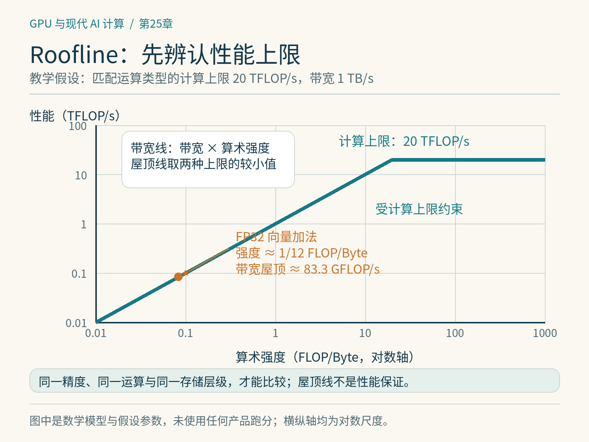

# 第25章　Roofline、Profiler 与瓶颈定位

训练吞吐量下降时，最直观的反应是查看 GPU 利用率。但“利用率很高”只说明采样时间内有工作在运行，并不等于矩阵计算单元、显存带宽和整机都得到了充分利用。一个不断等待显存的内核也能让设备长时间处于忙碌状态。性能分析的起点是把“慢”变成可以验证的解释。

## 25.1 先画整次迭代的时间线

回到本书的小型 Transformer：一次迭代包含取数据、搬运、前向、反向、梯度同步和优化器更新。假设一次迭代需要100毫秒，其中数据准备40毫秒、GPU计算50毫秒、无法重叠的其他操作10毫秒。这是教学假设。即使把所有GPU内核加速一倍，总时间也只是降到75毫秒，加速约1.33倍。单个算子的成绩必须回到整条关键路径上判断。

先使用框架Profiler或系统级工具观察CPU线程、GPU流、内核与通信的时间关系，再进入内核级工具。PyTorch Profiler用于关联算子、形状、调用栈和设备活动；Nsight Systems适合观察整机时间线；Nsight Compute则分析选定内核的硬件行为。[1][2] AMD平台有自己的跟踪和计数工具，指标名称不能直接照搬NVIDIA。不要一开始就为整段训练采集所有硬件计数器：采集可能显著改变运行时间，报告也会淹没真正的问题。

*图 25-1｜原创精确图解。以匹配运算类型的计算上限20 TFLOP/s、带宽1 TB/s作假设。向量加法按FP32两读一写，强度为1/12 FLOP/Byte；标注只是理论带宽屋顶，不是实测。*

## 25.2 Roofline：给优化建立上限

Roofline，即“屋顶线模型”，把运算量与数据搬运联系起来。算术强度I等于浮点运算次数除以某一存储层级搬运的字节数，单位是FLOP/Byte。若计算吞吐上限为C、该层级带宽为B，则可达到的性能上限可粗略写成：

$$P \leq \min(C, B I).$$

低算术强度时，斜线BI限制性能；强度足够高后，计算上限C成为横向屋顶。这是性能估算模型，并不是每个内核都能碰到屋顶的保证。Nsight Compute也提供分层Roofline，帮助区分不同存储层级的限制。[2]

考虑FP32向量加法。每个元素读取两个4字节输入、写回一个4字节输出，完成一次加法。忽略缓存与额外开销，算术强度约为1/12 FLOP/Byte。假设某设备可用显存带宽是1 TB/s，则对应的带宽屋顶只有约83.3 GFLOP/s。拿它与数百TFLOP/s的低精度矩阵峰值比较，会得出完全错误的“利用率”。两者的运算类型和精度根本不同。

矩阵乘法则能反复使用输入分块，提高算术强度。但复用不是免费的：分块要占共享内存和寄存器，过大的分块也可能让并发工作变少。因此，屋顶线告诉我们值得追求什么，具体资源分配决定能否接近目标。

## 25.3 哪些字节和哪些FLOP

做估算时首先约定统计口径。矩阵乘法常把一次乘加计为两个FLOP；稀疏峰值不能套在普通稠密输入上；BF16矩阵峰值不能充当FP32通用指令的上限。计算HBM算术强度时，要统计实际到达HBM的流量，而不是只按源代码数组大小计算。缓存命中、重复读取和写回都会改变结果。

有效带宽是按算法所需字节除以时间推算出的指标，硬件实测带宽则来自计数器。一个内核反复读取同一数据，按理想字节数算出的“有效带宽”可能很低；若数据从缓存读取，按数组大小计算又可能高于标称HBM带宽。两种现象都不必然意味着硬件或计时错误，而是口径不同。报告必须说明字节来自模型估算还是设备计数。

## 25.4 读报告时建立因果链

一个有用的分析顺序是：先确定耗时占比，再判断计算、访存、启动还是同步限制，最后尝试能改变该限制的修改。若时间线显示大量短内核与明显间隙，减少启动次数和图重放可能比提高单内核占用率更有效。若出现过量HBM流量，可以检查融合和复用。若内存吞吐不高、计算吞吐也不高，则需要继续检查依赖链、访存延迟、分支、同步以及工作规模。

占用率表示驻留工作与硬件容量的关系。它能帮助隐藏延迟，却不是优化目标本身。使用更多寄存器的内核可能降低占用率，同时减少溢出与重复加载，最终更快。相反，削减寄存器后得到更漂亮的占用率，也可能因本地内存访问增加而变慢。指标应支持解释，而不应变成需要刷高的分数。

## 25.5 一次可复现的优化记录

把待优化的RMSNorm固定在一组输入上，例如batch、序列长度、隐藏维度、数据类型和步长全部记录。先验证输出与梯度，再预热，排除首次编译和分配。单内核可以使用设备事件测量；端到端实验则以明确同步边界计时。多次重复并报告中位数与离散程度，留意设备温度、频率和其他进程。[1][2]

随后只改一个关键因素，例如把读取加归一化融合，记录实际延迟、显存流量和资源占用是否按预期变化。若小输入变快而大输入变慢，保留这一边界。最终重新测整次训练迭代，确认收益没有被布局转换、额外拷贝或图断裂吃掉。工程包的 `examples/25-roofline_estimator.py` 用纯Python展示屋顶线与Amdahl估算，输出都是理论计算，不能当作设备跑分。

本章最重要的习惯是提出可被推翻的假设：“这里慢，因为每步重复读取某个中间张量。”下一次测量应直接检验这句话。只有形成这条证据链，性能优化才不会变成随机改参数。

## 25.6 从算子指标回到训练质量

训练报告还常见模型FLOP利用率，简称MFU。它按约定的模型有效计算量与硬件峰值比较，侧重有用模型工作。激活重计算会让设备实际执行更多指令，却不应因此被算成更多有效模型训练工作。因此，设备执行吞吐上升与MFU改善不是同一个结论。比较报告之前应确认是否计入重计算、Attention细节，以及峰值是否采用相同精度和稀疏口径。

同样，tokens/s必须说明token的含义。把填充位置也算进去，可能让低效的数据组织显得更快；改变序列长度或全局batch，又可能改变收敛行为。可以同时记录有效token吞吐、迭代时间、峰值显存与损失曲线。若目标是达到某个验证集质量，最终还要比较达到目标需要多少训练步。

读者可以给每次优化写一张简短记录：输入是什么，原先认为哪里受限，修改怎样改变数据或执行，测量是否支持假设，哪些形状退化。保存失败实验也有意义，因为它能告诉后来者资源冲突发生在哪里。对没有设备计数器权限的环境，仍可先利用时间线、规模变化和算法字节估算缩小问题范围，但应把推断与硬件证据分开。

## 本章参考

[1] PyTorch，*PyTorch Profiler*：https://docs.pytorch.org/docs/stable/profiler.html 。

[2] NVIDIA，*Nsight Compute Profiling Guide*：https://docs.nvidia.com/nsight-compute/ProfilingGuide/ 。

[3] Samuel Williams等，*Roofline: An Insightful Visual Performance Model for Multicore Architectures*，2009：https://doi.org/10.1145/1498765.1498785 。资料核验：2026-10-25。
