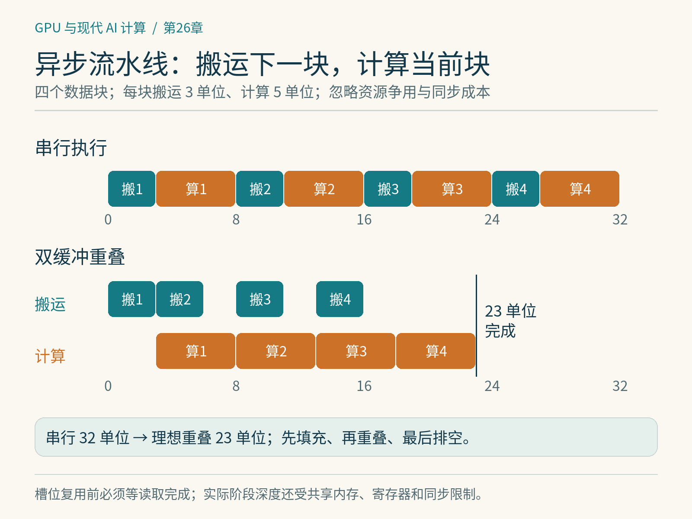

# 第26章　异步搬运、流水线与 Warp Specialization

在第22章的分块矩阵乘法中，每次需要把一块A与B搬到片上，再完成乘加。最直接的程序按照“搬完、算完、再搬下一块”循环。它很容易理解，却让搬运期间的计算资源与计算期间的搬运资源轮流闲置。现代高性能内核经常把同一个循环改造成生产者与消费者协作的流水线。

## 26.1 重叠的是不同阶段

设每个分块的搬运需要3个时间单位，计算需要5个时间单位，处理4块。这是忽略资源争用的教学模型。串行执行需要4×(3+5)=32个单位。若可以在计算当前块时搬运下一块，理想总时间变为3+4×5=23。这里仍然有第一块的填充成本和最后一块的排空成本，流水线也不能让单块计算从5变成2。

重叠需要真实的独立工作：下一块的目标缓冲区不能覆盖当前计算仍在使用的数据；消费者不能读取尚未完成搬运的数据；循环最后也不能在尚有操作未完成时退出。现代异步指令把“发出操作”与“操作完成”分开，程序因而必须显式管理生命周期。

主机侧也存在异步：CPU发起设备拷贝后可以做别的事。然而主机到设备拷贝、同一GPU内部从全局内存到共享内存的搬运，以及矩阵指令的异步执行，是不同层级的机制。某个API名字包含async，并不自动说明它与其他工作发生了有效重叠。




*图 26-1｜原创精确图解。四块数据每块搬运3单位、计算5单位，在理想独立资源下串行32单位、重叠23单位。时间轴为教学模型，未计启动、竞争与同步成本。*


## 26.2 双缓冲是一种所有权协议

双缓冲准备两个片上缓冲区。消费者读取缓冲区0时，生产者填充缓冲区1；下一轮双方交换角色。可靠实现需要表达两个条件：“这一槽位已有新数据”和“上一批数据已不再被使用”。多阶段流水线把两个槽位扩展为更多槽位，仍然遵守同一规则。

可以把每个槽位理解为有代次的对象。第0次使用槽位0与第2次重新使用槽位0，虽然地址相同，却是不同批次。若同步只检查地址、不区分代次，迟到的完成信号就可能被错误解释。底层屏障及其phase管理正是为了帮助表达这种交接。读懂流水线时，先追踪每一块数据何时能读、何时能覆盖，再看指令细节。

以下仅是教学伪代码，不对应任一语言的可直接运行API：

```text
为前几个分块发出异步搬运
对每个待计算分块：
    等待它的缓冲槽位就绪
    使用该分块计算
    确认本次计算不再读取该槽位
    释放槽位，允许搬入后续分块
等待全部异步结果完成，再写回输出
```

真实实现往往还把计算拆成多个阶段，因此“计算完成”的含义也需要逐层确认。

## 26.3 从异步拷贝到专用搬运引擎

不同架构提供的能力不同。Ampere的重要变化之一是支持从全局内存到共享内存的异步拷贝路径；Hopper引入Tensor Memory Accelerator，简称TMA，面向多维张量搬运及相关同步机制。CUTLASS的Hopper设计利用TMA与生产者—消费者流水线组织GEMM。[1][2]

TMA能减少搬运时部分地址处理与线程参与成本，但不是普通读取的通用替代品。它有描述符、对齐、布局和同步要求；数据块很小、形状不合适或初始化成本难以摊薄时，使用它未必有益。Blackwell又增加了新的矩阵与存储机制，不能把面向某个SM目标的示例直接理解成所有Blackwell产品都具备相同能力。移植时应核查具体计算能力与文档。

## 26.4 Warp Specialization：让不同组承担不同任务

Warp Specialization可译为Warp分工。让部分Warp负责搬运，其他Warp负责矩阵计算，可能还有专门处理归一化、修正或写回的组。各组在时间上协作，不要求每组执行完全相同的工作。CUTLASS的现代GEMM示例展示了这类分工。[2][3]

其价值来自资源需求的差异：搬运、矩阵计算与收尾处理不一定需要同样多的线程和寄存器。通过分工，可以减少重复控制工作，让专用硬件持续获得输入。不过，专门负责搬运的Warp同样占用线程与其他资源；若计算量太少，分工的成本会超过收益。分工越复杂，同步错误与调试成本也越高。

需要区分这种显式分工与普通分支。若一个Warp内部线程在不同分支上走不同路径，可能发生执行分歧；若完整Warp或Warp组承担预定角色，设计意图则是资源协作。两者都使用条件判断，却不是同一种性能现象。

## 26.5 阶段越多为什么可能越慢

增加流水线深度，可以提前发出更多搬运，覆盖较长延迟。但每增加一层，常常需要更多共享内存缓冲，有时也需要更多寄存器与屏障状态。假设一个分块占48 KiB，双缓冲需要96 KiB，三缓冲就需要144 KiB；这是单纯容量估算，实际还要加上其他共享数据。若设备每个SM的资源有限，增加阶段后可能从驻留两个线程块变成一个，整体性能反而降低。

另一方面，问题只有一两块时，流水线还未进入稳定阶段就结束了。尾块、掩码与不同形状也会破坏理想重叠。因此调参要同时观察阶段数量、分块大小、驻留工作数和实际工作规模。

## 26.6 怎样阅读现代内核

面对CuTe DSL或CUTLASS代码，不必一开始就掌握所有模板与装饰器。先画出“HBM中的块→片上缓冲→矩阵累加结果→输出”的数据生命周期，标出每个角色和屏障。然后确认是否允许覆盖、计算是否完成、输出何时可见。最后再把时间线与Profiler对应。

若修改流水线，正确性实验应覆盖多于缓冲槽位的循环次数、不能整除的尾部，以及重复调用。只测一个分块很容易漏掉槽位复用错误。本书未在Hopper或Blackwell设备上实测此章底层示例；实际开发应从匹配硬件与版本的官方样例出发，逐步修改，而不是照搬一段脱离上下文的异步代码。

## 26.7 用时间线检查流水线

可以在纸上给每个缓冲槽位画三种状态：空闲、正在填充、可消费。消费者开始读取后，槽位还不能立即变回空闲，必须等它真正完成最后一次读取。特别是矩阵操作本身异步时，发出矩阵指令不等于输入可以覆盖。这一差别正是很多“偶尔出现错误”的来源。

再检查开头与结尾。开头尚没有可消费数据，需要填充；结尾不再有后续搬运，却仍可能有未完成计算。稳定循环正确，不保证这两个边界正确。若问题长度小于流水线深度，程序还必须避免等待一个永远不会发生的生产事件。

最后考虑资源竞争。理想模型把搬运与计算视作完全独立，但它们可能共享存储带宽、发射资源和缓冲区。Profiler里看到两段重叠，只说明时间上同时存在，不保证重叠后总工作更快。比较相同输入下的串行版、双缓冲版和多阶段版，才能判断流水线获得的收益是否覆盖新增开销。程序越贴近硬件，越需要把所有权、完成条件与测量同时写清楚。

## 本章参考

[1] NVIDIA，*CUDA Programming Guide*：https://docs.nvidia.com/cuda/cuda-programming-guide/ 。

[2] NVIDIA，*Efficient GEMM in CUDA*：https://docs.nvidia.com/cutlass/latest/media/docs/cpp/efficient_gemm.html 。

[3] NVIDIA CUTLASS，*Blackwell CuTe DSL GEMM Tutorial*：https://github.com/NVIDIA/cutlass/tree/main/examples/python/CuTeDSL/cute/blackwell/tutorial/tutorial_gemm 。资料核验：2026-10-25。
