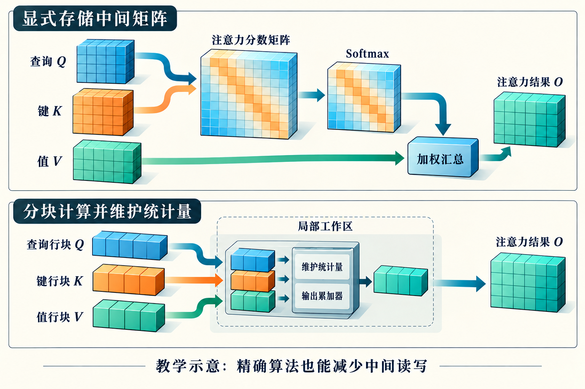

# 第27章　Attention 与 FlashAttention

Attention把“每个位置应该从哪些位置取信息”变成可学习的计算。它也提供了一个重要的系统案例：数学公式相同，数据流却可以非常不同。FlashAttention的意义不只在于某个内核更快，而在于算法组织、存储层次和硬件流水线可以共同设计。

## 27.1 先看一次普通Attention

单个注意力头的输入包含查询Q、键K和值V。若序列长度为N、头维度为d，可以把Q和K看成N×d矩阵。首先计算分数S=QKᵀ/√d，再沿每行做Softmax，得到概率P，最后计算输出O=PV。因果模型还要屏蔽当前位置之后的分数，使模型不能读取未来信息。

最直观的实现把S与P都写到显存，分别启动矩阵乘法、屏蔽、Softmax和第二次矩阵乘法。公式非常清楚，但N×N中间张量会迅速长大。以N=8192为例，单头有67,108,864个分数；若按2字节存储，单个分数矩阵约128 MiB。32头仅这一个中间张量就约4 GiB，尚未包括其他激活、梯度和临时区。这是形状估算，不是某个框架的实测峰值。

*图 27-1｜AI 教学示意。Q与K形成分数，Softmax后与V加权得到输出。下方分块处理仍计算同一数学目标，局部工作区维护行统计量和输出累加器，不保存完整中间矩阵。*

## 27.2 分块后怎样保持正确的Softmax

矩阵乘法天然可以分块，Softmax却需要知道整行的归一化分母。如果对每个小块单独归一化再拼起来，得到的结果就不等于整行Softmax。

解决办法是维护能够合并的统计量。对已经处理的一段分数，保存最大值m、指数和l，以及用相同缩放基准表示的加权值向量o。得到下一块后，先求新最大值m′，把旧统计量乘以exp(m−m′)，再累加新块按m′缩放的结果。最后用o/l得到输出。减去最大值不会改变Softmax比例，却能降低指数溢出的风险。更新过程只需要局部块与行统计量，不必保存完整概率矩阵。[1]

这不是跳过一部分连接的稀疏近似。FlashAttention计算的是同一个精确Attention数学表达式，但浮点舍入次序改变，结果通常不会与朴素实现逐位相同。“精确”描述算法目标，不等于所有后端都具有逐位一致性。

## 27.3 为什么反向有时主动重算

训练需要计算Q、K、V的梯度。如果为了反向而保留完整P，显存节省会大幅缩水。FlashAttention采用保留必要统计量、反向重新计算局部分数或概率的思路，以额外计算换取更少的存储与HBM访问。[1] 这与第14章的激活重计算有亲缘关系，但重算粒度和实现边界不同。

本章工程示例 `examples/27-online_softmax.py` 用标准Python演示在线合并，比较它与直接Softmax加权和的输出。这能验证数学不变量，不模拟GPU并行效率，也没有覆盖实际训练中的Dropout与反向实现。

## 27.4 从FA1到现代Attention内核

最初的FlashAttention把减少HBM读写作为核心切入点。FlashAttention-2进一步调整工作划分与并行策略，让设备得到更多有效工作，减少部分非矩阵运算与片上协作开销。[1][2] 这说明即使已经不保存N×N矩阵，线程组织仍然可能限制速度。

FlashAttention-3针对Hopper，利用异步执行与Warp分工组织矩阵、搬运和Softmax阶段，并研究低精度路径。[3] 这些优化依赖架构特性，不能由版本号推导“所有GPU上都更快”。

到面向Blackwell的FlashAttention-4，官方说明强调另一种变化：矩阵算力增长快于指数运算和共享内存带宽。此时矩阵乘法越来越快，Softmax及反向的数据流反而更加突出。其设计围绕这些不对称资源安排流水线，并使用CuTe DSL实现。[4] 本书不把官方特定形状下的最高吞吐当作普遍成绩；读者应关注它怎样识别并处理新瓶颈。

## 27.5 实际使用要核对什么

在PyTorch中，scaled dot product attention接口会根据输入、配置和后端能力选择实现。应用层调用同一个接口，并不保证每次使用同一条FlashAttention路径。[5] 头维度、数据类型、掩码形式、Dropout、布局和硬件都可能影响支持与派发。

检查时先记录输入形状与实际后端，再比较输出和梯度。因果掩码、填充掩码以及变长批次必须维持一致语义。有的优化能避免对填充位置做大量无用工作，但这也要求准确保留样本边界。把无效token误当成有效token，得到的“加速”已经改变了问题。

训练与推理也不同。长序列训练有较大矩阵，推理Decode常只有少量新查询，却要访问长历史KV。后者可能更受KV读取和并行工作不足影响。单看Attention家族名称，不能判断具体工作负载的瓶颈。

## 27.6 读者应该做的对照

选一个可控输入，分别比较朴素实现与框架优化接口的输出、峰值显存和延迟。先用小尺寸验证，再增加序列长度；分别记录前向与前后向。若没有GPU，仍可通过N²中间张量大小与在线Softmax示例理解主要数据流。若有GPU，不要把首次编译时间、缓存分配和正常稳态时间混在一起。

这条案例的长期价值在于一种设计方法：先辨认真正昂贵的中间结果，再寻找保持数学语义的流式组织；当硬件变化后，重新检查瓶颈，而不是重复上一代设备的最佳安排。

## 27.7 一个两块合并的手算

设一行只有两个分数0和ln2，对应标量值10和20。直接Softmax的权重为1/3与2/3，输出为50/3。若先处理第一块，得到m=0、l=1、o=10；第二块到来后，新最大值m′=ln2。旧统计量乘exp(−ln2)=1/2，第二块贡献l增加1、o增加20，最终l=1.5、o=25，输出仍为25/1.5=50/3。虽然每次只看见一块，归一化基准却一直保持一致。

若忘记把旧o也按新最大值缩放，只更新l，结果就会错误。这也是把流程画成逐步图的原因：最大值、分母与输出累加器必须一同演进。因果掩码则可以把不允许参与的位置排除在统计量之外；如果某一行全部被屏蔽，还需要按接口语义特别处理，不能直接进行零分母除法。

还要区分显存复杂度与计算复杂度。对标准稠密Attention，避免物化N×N中间结果，并没有消除所有查询与键之间的配对计算。序列翻倍，主要矩阵计算仍会按其二次关系增长。稀疏、滑动窗口和线性Attention改变了连接模式或数学结构，应放到相邻技术中讨论，不能把它们与FlashAttention视为同一种优化。

计算图中的Attention也可能被替换为窗口、分组查询或其他变体。分组查询Attention共享部分键和值头，主要改变KV的组织与存储需求，并不意味着每个查询头的Softmax统计量可以直接共用。读案例时，应分别追踪查询头与KV头的数量、序列维度和掩码规则。这样才能判断一张显存估算表是在计算普通多头注意力，还是某种更节省KV的结构。

## 本章参考

[1] Tri Dao等，*FlashAttention: Fast and Memory-Efficient Exact Attention with IO-Awareness*，2022：https://arxiv.org/abs/2205.14135 。

[2] Tri Dao，*FlashAttention-2: Faster Attention with Better Parallelism and Work Partitioning*，2023：https://arxiv.org/abs/2307.08691 。

[3] Jay Shah等，*FlashAttention-3: Fast and Accurate Attention with Asynchrony and Low-precision*，2024：https://arxiv.org/abs/2407.08608 。

[4] Tri Dao，*FlashAttention-4: Algorithm and Kernel Pipelining Co-Design for Asymmetric Hardware Scaling*，2026：https://tridao.me/blog/2026/flash4/ 。

[5] PyTorch，*scaled_dot_product_attention*：https://docs.pytorch.org/docs/stable/generated/torch.nn.functional.scaled_dot_product_attention.html 。资料核验：2026-10-25。
