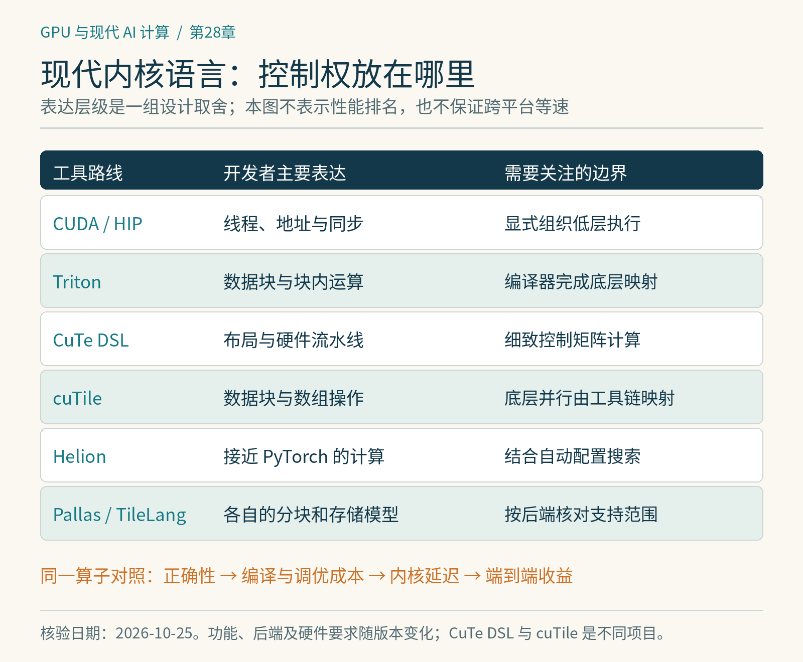

# 第28章　现代 Kernel DSL、自动调优与 AI 辅助优化

学会CUDA之后，读者会发现，高性能内核里有许多工作与数学公式无关：地址映射、分块、同步、流水线和硬件指令选择。领域专用语言，简称DSL，尝试把其中一些规律交给编译器，让程序员在更合适的层级表达计算。现代GPU编程正在形成多种抽象方式，而不是只有“Python很慢、CUDA很快”这一条轴线。

## 28.1 比较的是控制权放在哪里

设计一个矩阵乘法，可以逐线程描述每个元素如何移动，也可以描述线程块处理的矩阵分块，还可以把数据块视为整体，让编译器决定更低层的映射。抽象越高，通常越容易开始；但能否表达特殊布局、同步与硬件指令，也决定它适合哪些问题。

“Triton程序写在Python里”不意味着它在Python解释器里逐元素运行。宿主语言负责组织和编译，设备内核仍由编译器生成。CuTe DSL、cuTile、Helion、Pallas和TileLang也各自提供专用语义；它们不能被当作只换了语法的同一种语言。比较时应问：谁决定布局，谁安排搬运，谁建立流水线，哪些假设能被编译期使用。

*图 28-1｜原创精确图解。不同语言把线程、布局和数据块的控制权放在不同位置。此表用于理解表达层次，不表示性能排名，也不保证跨平台等速。*

## 28.2 几条值得掌握的现代路线

| 路线 | 适合观察的重点 | 开发前需要核对 |
|---|---|---|
| Triton | 块级表达、布局与自动代码生成 | 后端、算子支持与具体硬件表现 |
| CuTe DSL | 布局代数、矩阵计算与细致硬件控制 | 目标SM、工具链及所用硬件指令 |
| cuTile | 以数据块表达并行计算，编译器承担更多底层映射 | CUDA Tile工具链、支持设备与当前限制 |
| Helion | 接近PyTorch的算子表达及自动调优 | 已安装版本的后端成熟度与调优成本 |
| Pallas | JAX程序中的自定义GPU／TPU内核 | 平台后端、内存空间与API变化 |
| TileLang | 显式分块、布局和流水线组织 | 后端实现与架构相关特性的覆盖 |

CuTe DSL从CUTLASS生态发展而来，提供Python形式的高性能内核开发方式，适合深入布局与流水线。[1] cuTile则基于CUDA Tile编程模型，面向分块操作与编译器处理的底层并行映射；它与CuTe DSL名称接近，却不是同一个项目。[2] 二者都不能被推导为跨所有厂商的通用后端。

Helion提高表达层级，并把配置搜索作为重要组成。[3] Pallas是JAX的内核语言，连接JAX程序与GPU、TPU等平台的细粒度计算控制。[4] TileLang也围绕分块内核及其组织提供工具。[5] 这些项目迭代较快，书中的比较说明编程思路，不承诺某个实验后端已经具有全面生产支持。

## 28.3 用同一问题比较语言

公平的入门对照可以选RMSNorm：固定输入形状、精度、布局和误差标准，实现同一公式。先数每个版本真正读取、写回的数据，再检查是否融合、有没有额外转置、是否需要特殊预处理。代码行数只能衡量一部分表达成本，不能替代性能与维护性。

进一步选择具有不规则尾部、不同步长与小批次的输入。一个只为隐藏维度4096设计的内核，可能在维度4103时需要完全不同的边界处理。也要比较编译时间和首次调优时间：离线训练能摊销的成本，在线短任务未必能接受。成熟库在标准问题上常有长期积累，自定义DSL最有价值的地方可能是新算子、特殊融合或标准库不擅长的形状。

## 28.4 自动调优是一项有预算的实验

分块大小、Warp数量、流水线阶段、布局与任务划分可以形成很大的组合空间。自动调优器会生成候选，编译，验证，再计时筛选。它无法让错误实现变正确，也不能保证每次都找到全局最优。

设一次候选编译与测试共需2秒，搜索300个候选就是约10分钟；如果每次调用只省1微秒，需要约6亿次调用才能单纯摊销这600秒。这是教学计算，没有计入并行搜索、缓存和部署复用，但足以说明调优预算应服从实际使用频率。Helion的部署文档也把调优、缓存与复用作为独立问题讨论。[3]

调优键应该包含影响性能或正确性的条件，如形状、步长、数据类型、设备架构和必要的算法选项。仅按张量元素个数缓存配置，可能混淆完全不同的布局。最终候选也应在独立重复测量中确认，防止一次偶然的高频或缓存状态决定“冠军”。

## 28.5 AI生成内核后，验证器才是中心

AI可以阅读参考实现、提出融合方式、生成候选、解释编译错误并参与搜索。但生成的代码可能硬编码答案、遗漏边界、改变累加精度，或者仅在给定输入上偶然正确。应把参考实现、候选代码、正确性与性能评估分开。

评估需要覆盖随机形状、尾部、非连续布局、极值与梯度；视算子语义检查NaN、无穷、别名与原地更新。计时应排除偷偷转到CPU、返回缓存结果以及未完成异步工作等情况。若模型能修改测试或读取参考输出，得到的分数便无法证明内核能力。AI的角色是提出可检验方案，验证器控制接受标准。

## 28.6 给学习者的路线

先用Triton建立“输入块—局部计算—输出块”的思维，再用CUDA／HIP理解线程与内存细节。需要控制现代NVIDIA矩阵流水线时深入CuTe DSL；希望探索较高层表达与自动搜索时研究Helion、cuTile或TileLang；使用JAX与TPU时进入Pallas。具体选择应服从任务与硬件，不必依次把所有语言学完。

写技术笔记时记录工具版本、后端、计算能力、编译选项、输入与误差阈值。同样一段简洁源码，在不同后端可能生成不同程序。跨平台可编译、语义可移植与性能可移植是三个层次，应分别验证。

## 28.7 把可维护性也纳入成绩

假设两个内核在当前设备上分别耗时10微秒和9微秒。后一实现使用特定布局和新硬件指令，增加了大量分支、专用测试与版本限制。是否采用它，取决于调用频率、端到端占比以及团队维护能力。如果它占总训练时间的百分之一，单独节省百分之十只改善约千分之一的总时间；若它是服务关键路径，意义又可能不同。这是成本判断，不能只由排行榜决定。

一个可以长期使用的算子包应保存参考数学实现、输入约束、误差范围、测试集与回退路径。高层框架派发时，需要在不支持的硬件或形状上退回经过验证的实现。错误地扩大“支持范围”，比局部性能不够好更难排查。

同一DSL也可能提供多个后端。后端是否能编译某种控制流，是否支持对应低精度格式，以及性能是否稳定，是三份不同的证据。写跨平台案例时，最好把硬件、编译器版本、支持的功能与实际测量并列记录。没有进行移植实验，就只能介绍设计目标和公开支持，不能把预期写成实测的性能可移植性。

## 本章参考

[1] NVIDIA，*CuTe DSL Introduction*：https://docs.nvidia.com/cutlass/latest/media/docs/pythonDSL/cute_dsl_general/dsl_introduction.html 。

[2] NVIDIA，*Writing Tile Kernels*：https://docs.nvidia.com/cuda/cuda-programming-guide/02-basics/writing-tile-kernels.html 。

[3] Helion，*Deployment and Autotuning*：https://helionlang.com/deployment_autotuning.html 。

[4] JAX，*Pallas*：https://docs.jax.dev/en/latest/pallas/ 。

[5] TileLang，官方文档与代码：https://tilelang.com/ ；https://github.com/tile-ai/tilelang 。资料核验：2026-10-25。
