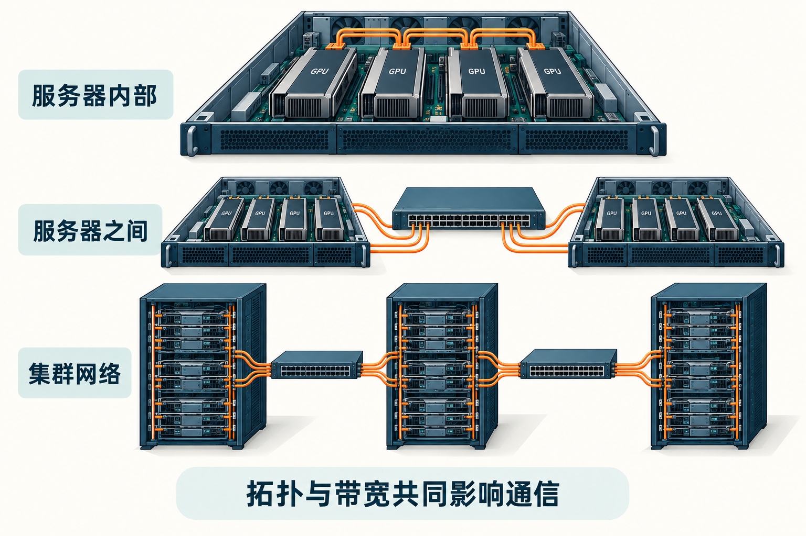

# 第29章　集合通信与网络拓扑

单卡训练主要考虑计算与显存；多卡训练还必须回答“哪些数据在什么时候需要到达哪张卡”。增加设备不会自动解决等待。若每一步都要等最慢的一条链路，计算资源再多也可能大部分时间闲置。集合通信把常见的多方数据交换组织成一组有明确语义的操作。

## 29.1 Rank是参与者编号

Rank是通信组内的参与者编号。在常见的一进程一卡训练中，一个Rank管理一张GPU，但Rank并不等于机器编号，也不天然等于某个固定的设备编号。同一训练可以建立多个通信组，让不同组分别负责数据、张量或专家并行。

理解一个通信操作，先确定参与组、输入形状、数据类型、归约方式和输出分布。各参与者必须遵守匹配的调用约定。有人走到下一次AllReduce，有人仍在上一次AllGather，可能导致挂起，而不是出现普通函数返回值错误。NCCL文档明确强调集合通信调用的参与与匹配要求。[1]

*图 29-1｜AI 教学示意。服务器内部、服务器之间和集群网络属于不同连接尺度。图中连线只表达层级，不能据此推断真实集群的环形、树形或其他拓扑。*

## 29.2 五种操作怎样改变数据

假设有4个Rank，每个保存一个4元素向量。AllReduce先逐元素求和等归约，再让每个Rank得到相同结果。ReduceScatter也先归约，但将结果分成4段，每个Rank只留下其中一段。AllGather把各Rank保存的片段按约定顺序拼起来，让所有参与者获得完整拼接结果。[1]

Broadcast从指定根Rank复制数据给所有人；AllToAll则让每个Rank把不同片段分别发给不同目标，常用于专家路由等重新分布场景。它不是简单地把所有输入复制给所有人。

| 操作 | 输入的直观状态 | 输出的直观状态 | 常见用途 |
|---|---|---|---|
| AllReduce | 各卡有局部贡献 | 每卡有完整归约结果 | 数据并行梯度同步 |
| ReduceScatter | 各卡有局部贡献 | 每卡只保留一片归约结果 | 分片梯度 |
| AllGather | 各卡各有一片 | 每卡拿到拼接后的完整数据 | 组装计算所需参数 |
| Broadcast | 根Rank有数据 | 大家得到副本 | 初始化或元数据分发 |
| AllToAll | 各卡有多个目标的分片 | 按目的地重新分布 | MoE token交换 |

在匹配布局与归约语义下，ReduceScatter再接AllGather可以实现AllReduce。这个关系有助于理解分片训练：如果下一步只需要归约结果的一部分，就不必立即把完整结果重新复制给所有人。

## 29.3 延迟与带宽是两种成本

通信时间常用α+S/B做粗略模型：α表示启动与固定延迟，S表示传输字节，B表示有效带宽。小消息更容易被延迟控制，大消息更容易被带宽控制。实际还涉及拓扑、协议、分块、拥塞与重叠，这个模型只帮助判断量级。

理想环形AllReduce可拆成ReduceScatter与AllGather。若有p个Rank、每个输入S字节，简化估算中每Rank发送约2(p−1)S/p字节，并有多轮启动成本。以8个Rank、1 GB输入为例，每Rank发送量约1.75 GB。若单向有效带宽为50 GB/s，仅该发送路径的理想时间就约35毫秒；这是教学下界估算，不是某个网络的实测AllReduce延迟。

通信库可能根据消息大小、设备与网络选择环、树或其他路径。不能把环形公式当成所有集合操作的真实实现。NCCL及AMD平台的RCCL承担了相关底层组织，但软件无法消除物理链路和拓扑的限制。[1][2]

## 29.4 机器里的“近”和“远”

同一服务器内，两张GPU可能通过专用互连、交换芯片或PCIe路径连接；跨服务器则可能需要经过网络适配器与交换网络。CPU插槽、NUMA节点、GPU和网卡的邻近关系会影响路径。两台都写着“8卡”的服务器，通信表现未必相同。

拓扑图应标出设备、链路与共享瓶颈。某条链路的额定带宽不是任意两张卡都能独占获得的带宽；多路并发也可能争用同一个交换上行。直接访问机制可以减少中间拷贝，但仍要求平台、驱动与网络配置支持，不能仅凭网卡型号推断已经启用。

在训练前记录设备与网卡映射，先测点对点与集合通信，再比较训练表现。若单节点良好、跨节点突然下降，优先核对网络路径、进程放置与消息规模，而不是立刻修改模型算子。

## 29.5 计算通信重叠需要提前量

假设一个梯度分桶已经就绪，框架可以在后续层继续反向时发起它的归约。只有后续计算足够长、设备与网络资源允许并行，而且消费者不立即等待结果时，通信才可能被隐藏。

分桶太小会产生许多启动，太大则推迟首个可发送时刻，留下无法隐藏的尾部。重叠也可能争用显存带宽或执行资源，使计算变慢。最终要比较完整迭代，而不是只看通信是否出现在另一条时间线上。同步依赖、CPU提交速度和最慢Rank都会影响关键路径。

## 29.6 扩展实验要固定问题

强扩展固定总工作量，增加设备后每卡任务变小，更容易暴露通信与启动开销。弱扩展保持每卡工作量近似不变，总任务随设备数增加，更适合观察系统能否维持每卡效率。报告“8卡接近8倍”时必须说明采用哪一种。

以单卡吞吐T₁和p卡吞吐Tₚ定义吞吐扩展效率Tₚ/(pT₁)，还要确保batch、序列长度、精度和训练语义可比较。扩大global batch可能改变收敛，吞吐更高不保证达到相同质量的时间更短。通信章节最终要服务的指标，是完成既定训练目标需要多少时间与资源。

## 29.7 一条异常时间线怎样排查

假设八个Rank中七个早已进入AllReduce，只有一个还在加载数据。其他Rank的通信时间会变长，但根因在较慢Rank的输入流水线。若仅调整集合通信算法，可能毫无帮助。另一种情况是每个Rank都及时到达，只有跨节点交换持续很慢，这才更支持网络路径或带宽不足的解释。

因此，应同时保存各Rank的事件时间，区分进入通信前的等待与通信本身。比较不同消息尺寸也有帮助：小消息都差，可能是启动、调度或往返延迟；大消息吞吐差，更值得检查有效链路与争用。若只有某一对设备异常，应检查它们共享的路径。

通信基准还会同时报告算法带宽和总线带宽等指标。前者通常从逻辑消息量与时间计算，后者会按算法传输量做换算；它们不是无需解释即可与端口额定速率比较的同一种量。记录工具版本、Rank布局、消息尺寸和计量口径，比孤立地保存一个“GB/s”数字更有价值。

## 本章参考

[1] NVIDIA，*NCCL Collective Operations*：https://docs.nvidia.com/deeplearning/nccl/user-guide/docs/usage/collectives.html 。

[2] AMD，*RCCL*：https://rocm.docs.amd.com/projects/rccl/en/latest/ 。

[3] PyTorch，*Distributed Communication Package*：https://docs.pytorch.org/docs/stable/distributed.html 。资料核验：2026-10-25。
