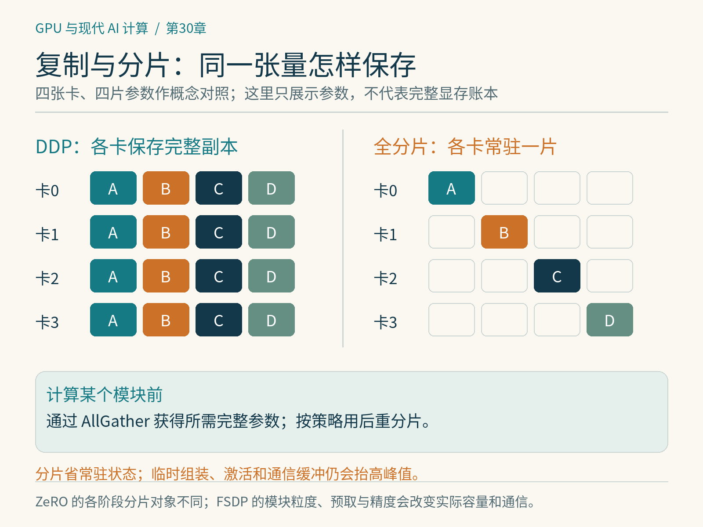

# 第30章　DDP、ZeRO 与 FSDP

给训练程序增加GPU，最容易想到的办法是每张卡放一份模型，各处理一部分样本，再合并梯度。这就是数据并行的基本思路。问题是模型、梯度与优化器状态也跟着重复。DDP、ZeRO与FSDP围绕这个矛盾，提供不同的状态保存和通信组织方式。

## 30.1 DDP保留副本，合并贡献

DistributedDataParallel，简称DDP，在常见配置中让每个Rank拥有完整模型与优化器状态。每卡处理本地batch，反向传播时按桶同步梯度，让模型副本使用一致的更新。[1] 输入数据如何分片仍需应用处理，DDP并不会自动把同一份DataLoader拆成不同样本。

假设每卡处理16个样本，有8卡，不使用梯度累积，则global batch为128。这个关系成立的前提是每卡样本数与损失归一化方式一致。若最后一个batch大小不同，或者各卡有效token数量不同，简单地平均各卡的平均损失对应梯度，未必等于按所有样本或token统一平均。分布式训练的数值语义必须先于性能参数确定。

DDP不把模型切成8份，因此模型原本在单卡装不下时，多加7张卡通常仍不能解决容量问题。它适合单卡能容纳模型状态、希望提高吞吐的场景。

*图 30-1｜原创精确图解。图中只画参数的常态分片，不代表整个训练峰值。全分片执行模块时通常需要获取所需参数；激活、通信缓冲、预取和版本策略也会影响峰值。*

## 30.2 ZeRO逐层消除冗余

ZeRO将优化器状态、梯度和参数等模型状态在数据并行参与者之间分片。通常所说的Stage 1分片优化器状态，Stage 2再分片梯度，Stage 3进一步分片参数。[2] 计算时需要完整参数的部分，必须通过通信准备，使用后再按策略释放或重新分片。

可以用一个简化账本理解差别。假设每参数需要2字节参数、2字节梯度、4字节FP32主权重和8字节Adam一阶二阶状态，共16字节。这是某一种混合精度配方的模型，不是所有框架固定开销。对10亿参数、8卡，在忽略激活与临时区的理想情况下：

| 策略 | 每卡模型状态估算 |
|---|---:|
| 完整复制 | 16 GB |
| Stage 1 | 2+2+12/8=5.5 GB |
| Stage 2 | 2+(2+12)/8=3.75 GB |
| Stage 3 | 16/8=2 GB |

这里使用十进制GB。Stage 3的2 GB只是分片常驻状态估算，计算时的参数组装、通信缓冲和激活会让峰值高得多。FP32主权重是否存在、梯度与通信精度如何安排，也会改变账本。

## 30.3 FSDP怎样在使用前组装参数

Fully Sharded Data Parallel，即全分片数据并行，在训练过程中按需要组装参数、执行计算并同步分片梯度。可以把某个Transformer块看成一个调度单元：执行前AllGather该单元参数，计算前向；按策略重新分片；反向时再次获得所需参数，最后通过ReduceScatter等操作形成分片梯度。[3]

这里的核心关系是“保存一片，临时获得计算所需的完整部分”。因此调度边界很重要。如果整模型只有一个大单元，每次组装会产生很高的瞬时显存；若每个微小层都是独立单元，则通信启动过多。按Transformer块划分常是可理解的起点，但真正的粒度要结合层大小、网络和重叠策略实验。

FSDP与ZeRO-3有相近的状态分片目标，却不是可互换的接口名称。优化器处理、参数表示、混合精度、预取与检查点集成等实现差异，会影响程序行为和性能。

## 30.4 现代PyTorch以FSDP2为重点

当前PyTorch文档建议新代码优先使用 `torch.distributed.fsdp.fully_shard`，即FSDP2。[3][4] 与较早的FSDP1相比，FSDP2采用不同的参数分片表示与组合方式。读取旧教程时，不能把旧包装类的参数直接复制到新API。

FSDP2通常对需要形成通信边界的子模块以及根模块应用 `fully_shard`。它使用DTensor表达分片，通信边界由所分片的模块组织决定，不能把DDP的分桶参数照搬过来。[3] DeviceMesh描述设备如何分组，为进一步组合其他并行方式提供基础。

本章重在解释调度过程，不给出脱离版本的通用启动脚本。实践时应从官方FSDP2教程固定一个版本，先验证两卡小模型的损失、梯度和恢复，再扩展规模。环境能导入API，并不代表完整训练组合已经经过验证。

## 30.5 节约显存的代价在哪里

参数分片减少常驻内存，却增加参数获得与梯度分发的通信需求。若互连很慢，计算规模又小，完全分片可能比DDP明显更慢。预取未来模块参数能够减少等待，但让更多参数同时驻留，抬高峰值；关闭预取可能省内存，却暴露通信时间。这是同一组资源在时间与空间上的交换。

CPU或NVMe Offload把部分状态迁出显存，扩大可训练模型范围，同时引入主机内存、PCIe、存储与调度瓶颈。它不是免费显存。若CPU内存不足、页面调度或带宽不合适，程序可能能启动却无法维持可接受的速度。选择策略要根据容量、吞吐和成本共同判断。

## 30.6 检查点必须能继续训练

保存分片参数不等于保存了完整可恢复训练。优化器状态、学习率调度、随机数状态、步数与数据进度都可能影响恢复。FSDP2原生状态涉及DTensor，整合与重分布应使用相应API或分布式检查点工具，而不是每个Rank同时往同一文件写一个普通state dict。[3]

一个有意义的验收实验是：连续训练若干步；在中间保存并退出；恢复后继续相同步数，比较损失和参数。若要改变卡数恢复，需要专门验证重分片路径，不能只证明相同卡数能加载。

最终选择也不必从最复杂方案开始。模型能装下且网络足够时，DDP更容易建立正确基线；优化器状态占主导时考虑部分分片；参数本身成为容量障碍时再考虑全分片，并测量计算通信重叠。先知道显存花在哪里，才能选对分片对象。

## 30.7 梯度累积与分片怎样相遇

梯度累积把多个微批次的贡献合到一次优化器更新。如果每个微批次都进行完整梯度同步，通信频率可能较高；若暂缓同步，程序又要保留足够的本地梯度状态。具体框架与分片策略决定这种状态采用完整还是分片形式，不能只凭“开启累积”就估算显存一定下降。

以每卡微批次2、八卡、累积四次为例，完整更新覆盖64个样本。损失缩放要与累积及分布式平均语义一致。把损失除以累积次数是一种常见等批次设置，但变长样本或不同有效token数量时，仍需重新检查全局归一化。性能代码正确执行，不足以证明它在训练同一个目标。

建议先建立三张账表：哪些状态常驻、哪些状态临时组装、哪些通信发生在关键路径。把模块粒度、预取和Offload的变化逐项填进去，就能解释为什么某种设置省显存却变慢，或吞吐提高却突然OOM。完成这种分析后再组合更多并行方式，调试空间会小得多。

## 本章参考

[1] PyTorch，*Distributed Data Parallel*：https://docs.pytorch.org/docs/stable/notes/ddp.html 。

[2] DeepSpeed，*Zero Redundancy Optimizer*：https://www.deepspeed.ai/tutorials/zero/ 。

[3] PyTorch，*torch.distributed.fsdp.fully_shard*：https://docs.pytorch.org/docs/stable/distributed.fsdp.fully_shard.html 。

[4] PyTorch，*Getting Started with Fully Sharded Data Parallel (FSDP2)*：https://docs.pytorch.org/tutorials/intermediate/FSDP_tutorial.html 。资料核验：2026-10-25。
