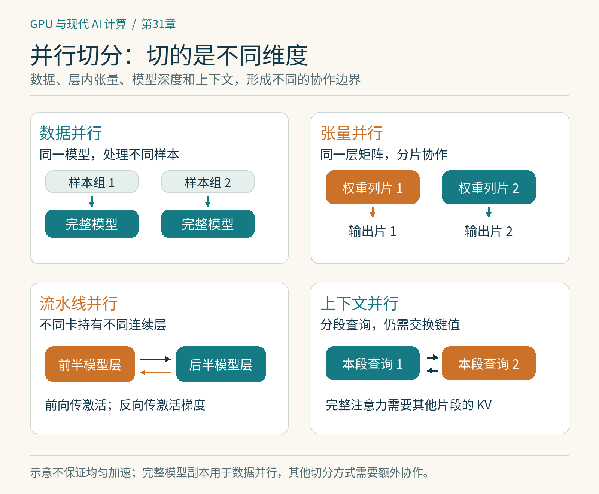

# 第31章　张量、流水线与上下文并行

把 GPU 从一张增加到八张，有两种完全不同的愿望：同样的模型处理更多数据，或者让单卡根本装不下的任务能够运行。数据并行主要解决前者。模型内部的张量、层与序列如何分布，则决定后者能否成立。本章沿用一个 Transformer：输入是若干条 token 序列，每层先做注意力，再做前馈网络。我们顺着它的结构寻找切分位置。

## 切开一层：张量并行

设线性层写成 `Y = XW`，其中 `X` 的形状是 `[token数, 输入维度]`，`W` 的形状是 `[输入维度, 输出维度]`。如果沿输出维度把 `W` 分成左右两半，两张卡各自持有一半权重、计算一半输出，便形成列切分。两份局部输出在逻辑上拼起来，才是完整的 `Y`。这解释了张量并行：卡之间合作完成同一个层中的同一个运算。[1]

若下一层立即需要完整 `Y`，就要先进行 All-Gather；若下一层能直接消费局部分片，便可能把这次聚合推迟。反过来，沿输入维度切分 `W` 时，每张卡得到的是输出的部分和，最终需要相加。设计张量并行的关键不只是把一个大矩阵切小，而是让相邻算子的切分互相配合，少制造必须恢复完整张量的边界。

例如前馈网络先把隐藏维度 `d` 扩展到 `4d`，经过逐元素激活后再投影回 `d`。第一层可沿输出切分，激活函数直接处理局部分片；第二层按对应输入切分，各卡最后归约部分和。局部计算随卡数减少，但同步并未消失。因此张量并行通常偏爱延迟低、带宽高的互连。把它随意跨到慢速网络，可能让每层的通信成本超过计算收益。

注意力头也提供了切分机会，但并非所有模型都能简单按头均分。查询头与键值头数量可能不同；分组查询注意力的键值头甚至少于张量并行卡数。此时实现可能复制部分数据，或采用其他布局，不能只凭“八个头、八张卡”推断显存恰好减为八分之一。

*图 31-1｜原创精确图解。数据并行切样本，张量并行切层内维度，流水线并行切连续层，上下文并行切序列。不同切分同时改变数据布局与通信边界。*

## 切开深度：流水线并行

另一条路是把连续层分到不同 GPU：第1张运行前几层，第2张接着运行后几层。前向传播把激活传给下一阶段，反向传播把激活梯度传回上一阶段。每张卡只持有自己负责的层，模型权重与对应优化器状态因此分散。[2]

如果一次只送一个批次，后面的卡必须等待前面的卡，前面的卡完成后又会等待反向传播，这条流水线很空。于是把全局批次拆成多个微批次。第1个微批次进入阶段2时，阶段1便处理第2个。流水线逐渐被填满，结束时再逐渐排空。

可以做一个理想化估算：假设有 `p` 个同速阶段、`m` 个微批次，没有通信开销，使用简单的先全前向再全反向调度，气泡占比约为 `(p-1)/(m+p-1)`。四个阶段、八个微批次时约为 `3/11≈27%`；增加到三十二个微批次，约为 `3/35≈8.6%`。这只是调度模型，不是实测性能。更细的交错与一前一反调度会改变时间线、内存需求和气泡形状。[2]

微批次也不能无限缩小。矩阵变小后 GPU 可能吃不满；微批次数量增加会影响梯度累积与同步安排。阶段划分还要考虑计算不均衡：嵌入层、输出词表投影和不同类型的层成本不同。把相同数量的层平均分配，不一定得到同样长的阶段。

## 切开序列：序列并行与上下文并行

一条长序列本身可能让激活显存超出容量。此时按序列维度切分，比继续切权重更直接。这里有两个常被混用的名称。

Megatron 语境中的序列并行，主要与张量并行配合，让 LayerNorm、Dropout 等区域的激活沿序列分片，减少冗余存储。它不是把整个注意力层变成互不联系的几段。上下文并行则更全面地把长序列分散到设备上；每张卡只持有本段查询等局部数据，但完整注意力仍需访问其他片段的键和值。[1][3]

因此，“每卡处理一段上下文”不能解释为“每卡只看自己的文本”。系统可能循环交换 KV 分块、使用 All-Gather，或按注意力模式采用其他通信调度。因果注意力还有三角形计算区域：序列前端可见的历史较少，后端可见的较多，朴素连续切分可能导致负载不均。切分方式、块顺序与通信重叠必须共同设计。

| 方法 | 主要切分对象 | 主要减轻什么 | 新增的关键成本 |
|---|---|---|---|
| 数据并行 | 不同训练样本 | 扩大吞吐 | 梯度同步 |
| 张量并行 | 层内矩阵、注意力头等 | 单层权重与计算 | 层内频繁通信 |
| 流水线并行 | 模型深度 | 每卡层数及状态 | 阶段间传输、气泡 |
| 上下文并行 | 序列维度 | 长序列激活 | 注意力相关数据交换 |

## 组合并行首先是布局问题

假设用十六张卡，选择张量并行2、流水线并行2、上下文并行2，剩余数据并行度为2；这些维度的乘积是十六。这个算式只能说明资源数量吻合，不能证明方案高效。还要定义哪些卡属于同一个通信组、组内连接快不快，以及张量跨层时如何改变布局。现代训练平台把这些布局显式表示出来，方便组合，而不是让用户手写所有通信。[4]

一个合理的实验顺序是：先固定模型、精度和有效全局批次，记录单卡或最小可运行配置；随后只改变一种并行维度，测每步时间、峰值显存、通信占比和损失趋势。扩卡时要区分强扩展与弱扩展：前者保持总工作量不变，后者让工作量随卡数增长。两者的“加速比”不能放在同一列比较。

本章的观察练习不需要集群。拿纸写出 `X[8,4]` 和 `W[4,6]`，分别沿 `W` 的两条轴切成两份。追踪每张卡需要哪些输入、产生什么输出、最后做拼接还是求和。能把这个例子解释清楚，就已经抓住了张量并行的大部分逻辑。

## 从八卡开始做一次纸上规划

假设模型权重已经能放进单卡，但长序列让激活装不下，先增加张量并行可能减轻部分激活，却也会增加每层同步；上下文并行直接针对序列存储，更值得纳入比较。若单个巨大线性层本身装不下，单纯把不同层放在不同流水线阶段又无法解决这一层的容量问题。选择并行方式要先定位哪个张量超限，再决定沿哪条轴切开。不要从卡数出发，反过来要求模型适应一个任意乘积。

## 本章资料

资料核验：2026-10-25。本文为机制讲解，数值例子均为明确假设下的计算，未声称集群实测。

[1] NVIDIA，Megatron Core Parallelism Strategies Guide：https://docs.nvidia.com/megatron-core/developer-guide/latest/user-guide/parallelism-guide.html  
[2] Narayanan 等，Efficient Large-Scale Language Model Training on GPU Clusters Using Megatron-LM：https://arxiv.org/abs/2104.04473  
[3] NVIDIA，Context Parallelism：https://github.com/NVIDIA/Megatron-LM/blob/main/docs/user-guide/features/context_parallel.md  
[4] PyTorch，TorchTitan：https://github.com/pytorch/torchtitan
