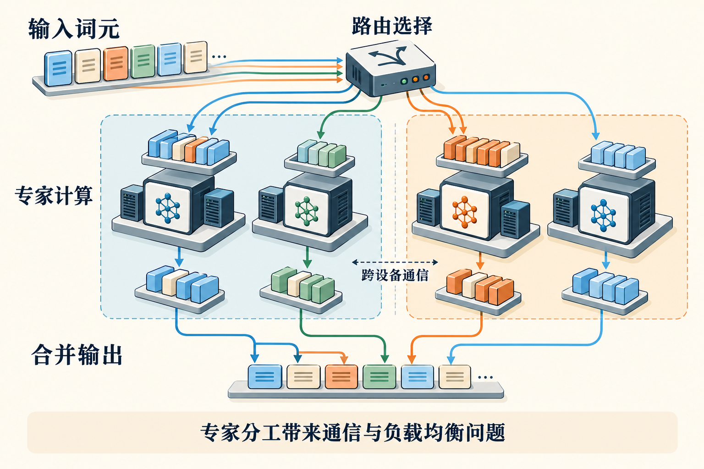

# 第32章　MoE 与专家并行

稠密 Transformer 中，某层的每个 token 通常经过同一组前馈网络权重。混合专家模型（Mixture of Experts，MoE）把部分前馈层替换为多组专家，再由路由器为每个 token 选择少数专家。模型因此可以保存大量参数，却只在一次 token 处理时使用其中一部分。它改变的不只是数学结构，也改变了 GPU 集群里数据移动的方式。

## 总参数和激活参数回答不同问题

设某个 MoE 层有八个同尺寸专家，每个 token 选择两个。忽略路由器、共享专家与其他层，单 token 的专家计算约对应两个专家，而保存全部专家权重仍需八份空间。这里“激活两个专家”没有让其余六份参数消失。在训练中，这些专家还各有梯度与优化器状态，只是一次路由不一定访问它们。[1]

所以评估 MoE 要同时看总参数、每 token 激活参数和共享部分。总参数关系到存储与部署，激活参数有助于理解计算量，两者都不能直接推导真实速度。注意力、路由、排序、通信以及小矩阵效率仍要付费。一个激活参数较少的 MoE，在低批量或互连较弱的机器上，可能比规模相近的稠密模型更难跑好。

*图 32-1｜AI 教学示意。词元经路由进入所选专家，再按原逻辑位置合并。路由线展示选择性派发；队列长度与设备边界提示负载和跨设备通信，具体Top-k与权重见正文。*

## 一个 token 的往返旅程

先看前向传播。路由器依据 token 的隐藏向量产生专家分数，选择 Top-k，并给选中的输出分配混合权重。接着系统按专家重新排列 token，把它们送到拥有相应专家的 GPU。专家完成前馈计算后，结果需要返回原 token 所属位置，按路由权重合并。常见实现把这两个方向称为 dispatch 和 combine。[2]

专家并行（Expert Parallelism，EP）指把不同专家放到不同设备。与数据并行不同，设备处理的 token 数可能不一致；与张量并行不同，一张卡可以持有完整的若干专家，而不是每个专家的一小块权重。模型也能进一步给每个专家使用张量并行，形成组合布局。

举一个四卡例子：每卡放两个专家，共八个。某批次有1024个 token，Top-2 产生2048次专家指派。若完全均衡，每个专家收到256个 token，每卡收到512次指派。但路由器不会自动保证这个数字。实际分布可能是热门专家收到600个，其余只有几十个。同步训练仍要等最忙的卡做完，空闲卡的算力无法自动替它处理私有专家。

这也说明不能把“token数量”与“专家计算行数”混为一谈。Top-2可能让同一个 token 的隐藏向量发往两个目的地；若两个专家恰好在同一设备，实现还可能复用或合并部分搬运。正确的通信估算要看数据布局与分发算法。

## 不均衡需要付出什么代价

常见训练方法加入负载均衡相关约束，鼓励更多专家得到有效工作。它们需要兼顾模型学习与硬件效率：强行平均不一定符合模型最好的路由选择，放任倾斜又会浪费集群。共享专家可以承接共同模式，但并不能自动解决所有负载问题。[1][3]

另一种工程控制是容量限制。若设专家容量因子为1.25，在上述均匀期望256行的例子中，每个专家允许约320行。超过容量后，具体算法可能丢弃、重路由或采用其他处理；必须在训练语义中说明。无丢弃（dropless）路径保留所有指派，却需要支持变长计算、动态缓冲区和不均衡的调度。Megatron Core 提供多种路由与派发策略，不能把其中一种开关当成所有 MoE 的共同定义。[3]

为了把不同专家的小矩阵一起高效执行，系统会使用分组矩阵乘法（Grouped GEMM）。它让一次或少量内核启动承担多组形状不同的矩阵计算。收益来自减少启动与调度开销，并改善资源组织；若每个专家仅收到极少 token，矩阵本身仍然可能太小，不能保证达到大 GEMM 的效率。

## 专家通信为什么特别难

假设隐藏维度为4096，以BF16存储，每次指派需传送 `4096×2=8192` 字节的激活。2048次指派对应约16 MiB的逻辑数据，combine返回同尺寸结果又约16 MiB；这还没计入路由元数据、反向、复制、局部保留与协议开销。它是一项用于理解量级的上层估算，不等于网卡上的实测流量。

传统 All-to-All 描述了每个设备向多个设备发送不同数据的集合模式。现实 GPU 拓扑却不均匀：机内互连与机间网络的带宽、延迟不同。路由可以限制每个 token 跨越的设备组或节点数，通信库也可以分别优化机内和跨节点的数据路径。DeepEP 这样的专用库正是围绕专家派发与合并设计，但其硬件条件、接口和版本要与具体训练框架一起核对。[4]

训练与推理对派发的要求还不同。大批次训练希望吞吐高、能够与计算重叠；逐 token 解码的小批量请求更在乎延迟。为了吞吐而积累更多工作，可能让交互响应变慢。因此“同一个 MoE”可以需要不同通信路径，不能只用一张峰值带宽表判断。

## 怎样判断瓶颈究竟在哪

观察 MoE 至少记录四组量：各专家收到的token数及最大/平均比；派发和合并的时间；专家GEMM的尺寸与执行时间；整步中真正被隐藏的通信比例。平均吞吐看起来正常时，最长尾的专家或节点仍可能拖慢整个训练。

优化顺序应该保留模型语义。先排除错误的布局、重复复制与同步，再检查专家分布、Grouped GEMM和通信重叠，最后才评估改变路由约束或容量策略。这些最后的改动会影响学习过程，必须同时比较收敛与质量，不能只看一步快了多少。

读者可以把八个专家画成八个盒子，为十六个 token 手动指定两个目的地，再数每个盒子的任务数。随后把盒子两两放进四张卡，重数跨卡的边。这个小练习能直观看到：计算稀疏不等于通信稀疏，而模型结构、放置和拓扑实际上是一道联合设计题。

## 专家不等于可读的人格分工

“专家”这个名字容易让人联想到一个负责数学、另一个负责写作。实际专家是可训练网络模块，它们的分工由数据和目标形成，路由与专业领域之间未必存在简单的一一对应。不要根据名称先画出语言、代码、图像三个角色，再把它当成模型内部事实。教学图应该先表达token被怎样分组、运输和合并，再以真实分析证据讨论是否出现了特定分工。

## 本章资料

资料核验：2026-10-25。通信量例子为理论估算，未进行多卡测量。

[1] Fedus 等，Switch Transformers：https://arxiv.org/abs/2101.03961  
[2] NVIDIA，MoE Token Dispatcher API：https://docs.nvidia.com/megatron-core/developer-guide/latest/apidocs/core/core.transformer.moe.token_dispatcher.html  
[3] NVIDIA，Megatron Core Mixture of Experts：https://docs.nvidia.com/megatron-core/developer-guide/0.17.0/user-guide/features/moe.html  
[4] DeepSeek，DeepEP：https://github.com/deepseek-ai/DeepEP  
[5] Liu 等，MoE Parallel Folding：https://arxiv.org/abs/2504.14960
