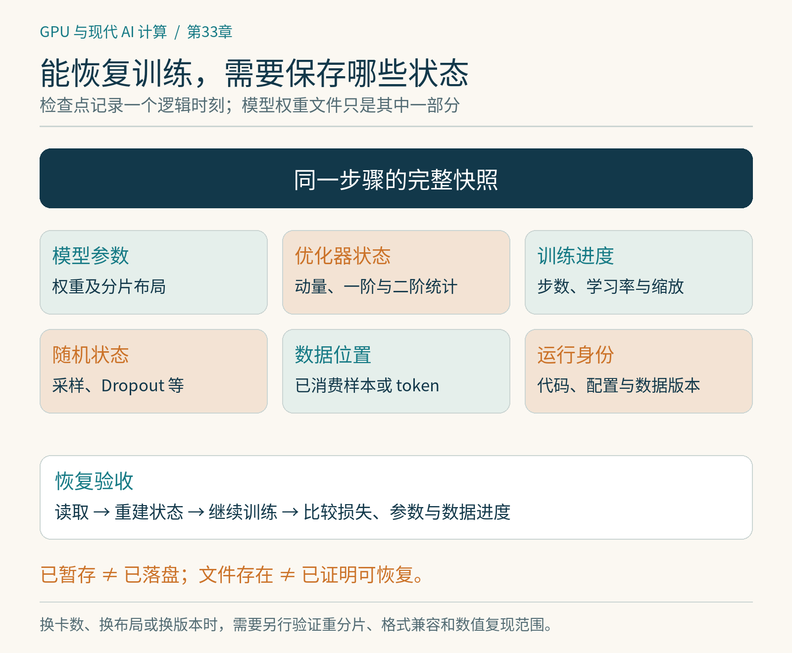

# 第33章　训练工程、检查点与故障恢复

一次训练跑得快，并不保证一个月后能得到预期模型。节点可能重启，存储可能卡顿，程序可能在第几万步遇到从未出现的输入。训练工程的目标是让已经付出的计算尽量保留下来，并让恢复后的工作仍然有清楚的身份。检查点（checkpoint）正是连接计算、存储与恢复语义的核心。

## 保存权重不等于保存训练

若只保存模型参数，之后可以加载它进行推理，却未必能继续同一条训练轨迹。Adam类优化器还包含动量与二阶统计量；学习率调度器需要知道训练进度；混合精度可能有损失缩放状态；数据迭代器需要记住已经消费到哪里；随机数生成器影响Dropout、采样与数据增强。[1]

在分布式环境中，参数和优化器状态还可能分片。一个rank上的文件，只是全局状态的一部分。检查点需要记录布局、张量名称、形状及必要元数据，确保恢复端知道如何重建。PyTorch Distributed Checkpoint（DCP）提供面向分布式状态的保存与加载机制，支持把状态从源分片布局转换到目标布局，但具体重分片能力仍由并行方式、状态描述和实现决定。[2]

因此最好区分三种产物：供推理使用的模型权重；用于恢复训练的完整检查点；包含代码、配置、词表和数据说明的实验记录。它们可以相关联，却不能互相代替。尤其是模型文件成功写出时，训练任务所需的其他状态可能尚未持久化。

*图 33-1｜原创精确图解。同一训练时刻的完整快照通常超出权重文件：还包括优化器、进度、随机状态、数据位置与运行身份。恢复后需要继续计算并比较，而不只确认文件存在。*

## 异步保存把等待移动到了哪里

同步保存会暂停训练：各rank准备状态、写入存储，确认完成后再继续。异步保存希望先把需要保存的状态复制到安全的暂存区，再让后台写入。训练恢复运行后，原始GPU张量可以继续更新，而后台处理的是那个逻辑时刻的快照。[3]

这并不是“免费保存”。GPU到主机的搬运可能占用总线，暂存数据占用CPU内存，后台写入消耗存储带宽。若没有等前一个异步任务完成就不断创建新任务，积压可能把主机内存吃完。使用DCP的异步接口时，还必须明确何时完成暂存、何时落盘、何时可以把检查点视为可恢复；这些概念及接口随版本变化，不能只看到future对象就认定文件已经安全。[3]

考虑一个假设：完整检查点200 GB，有效写带宽5 GB/s，纯写入下界约40秒。如果每十分钟保存一次，光同步写入就占大约6.7%的时间；压缩、汇聚、元数据与存储抖动会进一步改变结果。若做异步保存，前台暂停可能缩短，但总字节数和存储工作量仍然存在。

## 多久保存一次才合适

保存太频繁浪费时间，太少又可能丢失大量计算。可以用一个简单模型理解折中：设一次保存耗时为 `C`，任务平均无故障运行时间为 `M`，每隔 `T` 保存一次。忽略恢复成本与其他因素，保存损耗约为 `C/T`；故障时平均丢失半个间隔，损耗约为 `T/(2M)`。两项相加，在 `T≈sqrt(2CM)` 附近最小。[4]

例如 `C=60秒`、`M=24小时`，模型给出约54分钟。它是教学估算，不是生产配置建议：真实故障并不总是独立均匀，任务可能抢占，写带宽会变化，恢复也有成本。更有用的做法是测量自己的保存时间和故障情况，再用这个模型检查数量级。临近计划停机时主动保存，则比固定周期更直接。

为了避免半写文件被误认为有效版本，可以把数据先写到独立的新目录，完成校验后再发布完成标记或更新索引。具体存储系统的重命名与一致性语义不同，不能假设本地文件系统的操作在对象存储上完全一样。清理旧检查点时，还要保证至少有一个已确认可恢复的版本。

## 恢复需要接受一次真实演练

“文件存在”是最弱的检查。有效演练至少包括：从目标存储读取；恢复模型与优化器；恢复步数和数据位置；继续若干步；对比损失与样本消费情况。单机恢复成功不能证明换卡数后也能重分片，读取速度足够也不能证明数值状态完整。

比特级复现与统计一致也要分开。并行归约顺序、内核选择、异步调度或硬件变化，都可能让浮点结果发生微小差异。若要求严格复现，需要限制非确定性并固定更多环境，可能付出性能代价。对很多训练任务，更实用的是明确允许的数值误差、损失连续性和最终质量范围，而不是暗示所有恢复都能逐位相同。[1]

PyTorch DCP文档还提醒，保存格式与状态字典不能假设跨所有版本都有兼容保证。长期保存时，应保留生成检查点所用的框架版本与转换路径，必要时额外导出可独立加载的推理权重。[2]

## 观测系统应该先回答什么

训练日志要把吞吐下降拆开：数据等待、GPU计算、通信、保存和评估分别用了多久；loss、梯度范数、学习率与异常值何时变化；哪一个rank首先报告错误。统一的step编号、样本数或token数能把这些信息对齐。只留下每秒一个GPU利用率数字，很难解释凌晨发生了什么。

长任务还应记录配置与代码提交、数据版本、tokenizer、精度配方、有效全局批次和随机种子。调整并行布局或更换数据后，应把变化当成实验事件写入记录。性能优化也需要可追溯：一次快了5%的改动，如果悄悄减少了有效训练token，就没有完成同样的工作。

本章可执行的练习是给一个短CPU训练脚本加保存与恢复：保存第十步，重新启动继续训练，检查步数、优化器状态和数据顺序。之后故意省略优化器状态再比较。这个练习几乎不需要硬件，却能建立比“定期存个文件”更准确的恢复观念。

## 运行一个完整的恢复小实验

工程中的 `examples/33-resume-demo.py` 只依赖Python标准库，用带动量的梯度下降拟合直线。运行 `python3 examples/33-resume-demo.py`，程序先连续训练四十步，再在第十五步保存JSON、重载并继续。完整状态与连续路径一致；如果故意清空动量，最终参数会不同。示例保留步数、随机采样状态与优化器动量，且明确只保证当前CPU程序的比较，不把它扩大为分布式复现承诺。

## 本章资料

资料核验：2026-10-25。容量与间隔例子为假设计算，未声称存储系统实测。

[1] PyTorch，Reproducibility：https://docs.pytorch.org/docs/stable/notes/randomness.html  
[2] PyTorch，Distributed Checkpoint：https://docs.pytorch.org/docs/2.14/distributed.checkpoint  
[3] PyTorch，Asynchronous Saving with Distributed Checkpoint：https://docs.pytorch.org/tutorials/recipes/distributed_async_checkpoint_recipe.html  
[4] Young，A First Order Approximation to the Optimum Checkpoint Interval：https://doi.org/10.1145/361147.361115
