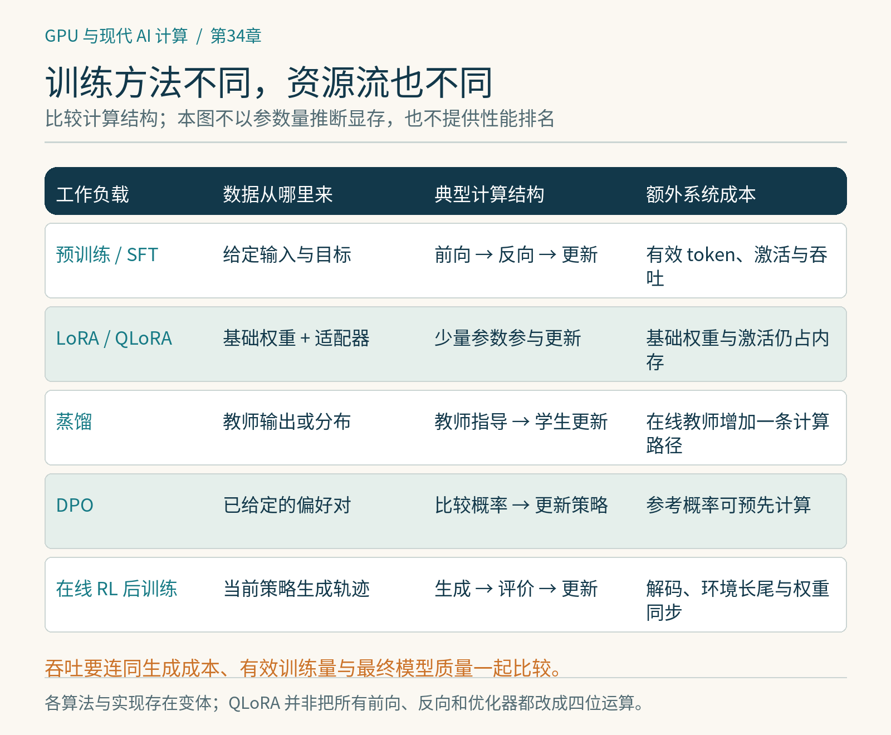

# 第34章　预训练、微调、蒸馏与强化学习后训练

“训练大模型”不是一种固定负载。同样的模型，预训练时可能连续处理大量规则批次，做强化学习后训练时却需要先生成答案、等待环境返回结果，再进行更新。仅比较参数规模，无法解释需要多少显存、GPU为何空闲以及算子应该怎样优化。我们应该先画出数据和权重如何流动。

## 预训练：长时间重复的计算骨架

以自回归语言模型为例，预训练让模型根据前文预测下一个token。一次前向可以同时计算序列中许多位置的预测，因为训练时这些位置的真实上下文已经给定；通过因果掩码限制可见范围即可。之后计算损失、反向传播、更新权重。它与推理时逐个生成token的计算节奏不同。

足够大规模的预训练通常希望保持稳定的数据供给与计算布局。序列打包能减少padding，较规则的形状有利于编译和算子复用。但打包必须维护样本边界、位置编码与注意力可见性；把两篇不相关文档直接当成连续文本，可能改变目标。记录“每秒token数”时还要分清是否计入padding与被掩码、不参与损失的token。

不同模态会改变骨架。视觉训练有图像解码、增强和卷积或视觉Transformer；扩散模型训练把噪声强度、时间步与图像/视频潜变量纳入输入，推理时又可能多次调用去噪网络。视频的时空维度会显著放大激活。不能把语言模型中的序列长度和KV Cache公式机械搬到所有模型上。[1]

*图 34-1｜原创精确图解。预训练、适配、蒸馏、偏好优化和在线RL的数据来源与计算结构不同。此图用于区分工作负载，不把每项训练方法归为单一固定实现。*

## 微调：改多少参数，计算哪些梯度

监督微调（SFT）用示范数据调整模型行为，基本上仍是给定输入和目标输出的前后向计算。对对话数据，经常只让回答部分参与损失；这并不意味着前面的提示词可以不计算，它仍然影响回答的隐藏状态。输入格式、聊天模板和损失掩码都是训练语义的一部分。[2]

全参数微调更新全部权重；LoRA则冻结原权重，在选定矩阵旁增加低秩可训练分支。设权重为 `[4096,4096]`，原矩阵有约1678万个参数。秩为16的两块LoRA矩阵共有 `4096×16+16×4096=131072` 个参数，约为原矩阵的0.78%。这减少该层的可训练参数和优化器状态，但不是整模型显存降到0.78%：基础权重、激活以及计算图仍要存在。[3]

QLoRA进一步以低比特形式保存冻结的基础权重，同时训练适配器。它不等于把所有前向、反向、优化器都换成4位运算。实际计算通常涉及解量化和较高精度的累加；依赖的量化库、硬件与后端支持也必须核对。[4]

因此微调成本要分别估计：基础权重的存储、需要更新的参数状态、训练序列激活、临时工作区。对长上下文微调，激活可能重新成为主项。只看“训练参数很少”，容易低估显存需求。

## 蒸馏：教师也占一条计算路径

蒸馏让学生从教师的输出、概率分布或中间表示中学习。若教师提前生成固定答案，这些答案变成离线数据，学生训练看起来像SFT，但教师生成成本应计入整个项目。若在线蒸馏，每个批次可能同时运行教师与学生，教师虽然通常不反向，也需要权重显存、推理计算和数据交换。[5]

输出文本蒸馏与全词表概率蒸馏还不同。后者的logits形状包含词表维度，长序列与大词表可能带来很大的中间张量。只取部分位置、对词表概率做Top-k截断，或采用未经校正的抽样损失，可能改变训练目标，需要说明遗漏部分如何处理。另一类优化只是把同一全量损失分块计算：只要正确处理归一化与汇总，就可以保留原目标，同时降低峰值显存，差异主要来自浮点运算次序。TRL的蒸馏实现便以完整的下一token分布为目标，通过分块计算损失避免一次物化完整分布。[5] 目标近似与执行重排应分开比较，不能混为一谈。

还有一个值得区分的轴：教师回答固定数据，还是对学生当前策略生成的轨迹提供指导。后者的数据分布随学生变化，更接近在线过程，系统需要更频繁地协调生成与更新。现代训练库已经提供不同蒸馏路径，但接口和实验状态需要随版本记录。[5]

## 偏好优化不全是在线强化学习

DPO使用偏好对，例如同一提示词下一个被偏好的回答和一个不被偏好的回答，形成训练目标。它通常不要求每一步都进行在线环境交互，但会涉及当前模型与参考策略的对数概率；参考结果是否预先计算，会改变运行成本。[6]

PPO、GRPO等在线强化学习后训练则包含更明显的阶段：策略模型生成轨迹，奖励模型或可验证规则评价，系统构造训练信号，再进行若干更新。具体算法是否需要价值模型、参考模型、以及每个提示生成多少回答不同，不能以一个框架的配置代表全部方法。TRL提供SFT、DPO、GRPO等训练器，适合作为对照入口。[2][6][7]

假设一批128个提示，每个生成8个候选、平均输出1024个token，光回答就约有一百万token需要解码。如果部分回答长到上限，生成阶段还会出现长尾。此时训练GPU看似“没在反向”，不代表系统没有工作；它可能正在等待自回归生成、外部工具或环境验证。

## 训练和生成的布局可能不同

大批量训练偏爱适合反向与优化器分片的布局，生成阶段则关心KV Cache、连续批处理和低延迟。把权重从训练布局转换到推理布局，需要重分片与同步。生成与更新共用GPU可以节约设备，但两种状态需要切换；分离部署可以同时工作，却增加权重传输和资源调度。[8]

异步训练把生成与更新解耦，还会引入策略滞后：某些轨迹由旧权重生成，后来才被训练使用。系统吞吐提高并不自动说明学习效率提高，必须记录样本对应的策略版本及算法允许的偏离。Agent任务尤其如此，沙箱启动、工具调用和验证耗时也属于训练数据生产流水线。

评估这些任务时，应同时看每秒处理的有效token、单位时间有效更新、数据生成成本以及最终质量。不同方法的“每步”含义不同：一次SFT step与一次包含多轮生成和更新的RL迭代不能直接比较。真正可以比较的是在清晰资源预算下，方法完成了什么任务、得到怎样的模型。

## 本章资料

资料核验：2026-10-25。LoRA参数和生成量例子为数学计算，未运行大模型训练。

[1] Hugging Face Diffusers，Training：https://huggingface.co/docs/diffusers/training/overview  
[2] Hugging Face TRL，SFT Trainer：https://huggingface.co/docs/trl/sft_trainer  
[3] Hu 等，LoRA：https://arxiv.org/abs/2106.09685  
[4] Hugging Face PEFT，Quantization：https://huggingface.co/docs/peft/developer_guides/quantization  
[5] Hugging Face TRL，Distillation Trainer：https://huggingface.co/docs/trl/distillation_trainer  
[6] Hugging Face TRL，DPO Trainer：https://huggingface.co/docs/trl/dpo_trainer  
[7] Hugging Face TRL，GRPO Trainer：https://huggingface.co/docs/trl/grpo_trainer  
[8] verl，HybridFlow Programming Guide：https://verl.readthedocs.io/en/latest/hybrid_flow.html
