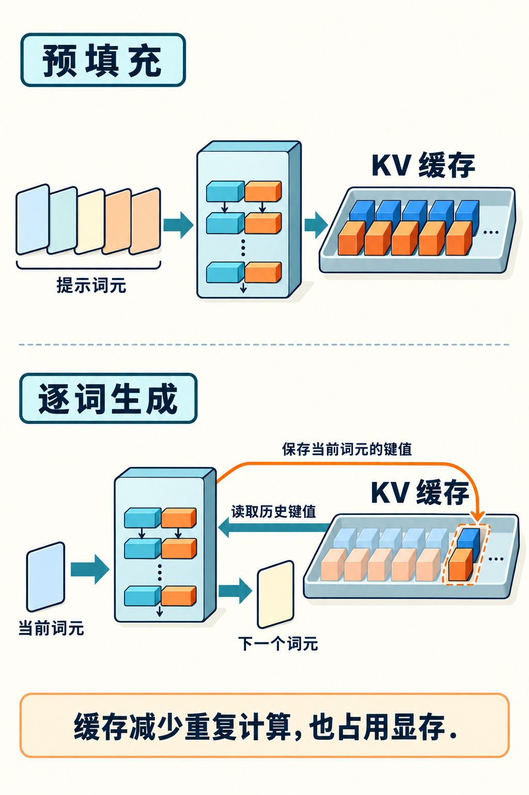

# 第35章　推理中的 Prefill、Decode 与 KV Cache

训练结束后，模型仍需要一个计算系统才能为用户回答问题。语言模型服务中最重要的区分，是先处理已经给定的提示词，再逐个生成新token。这两个阶段分别称为预填充（prefill）与解码（decode）。同一块GPU面对它们时，矩阵形状、数据复用和资源瓶颈都可能不同。

## 一次处理提示词，与一次生成一个词

输入有一千个token时，prefill可以为这些位置一起计算隐藏状态，并在因果约束下完成注意力。它往往提供较大的矩阵乘法，能复用权重，比较容易获得高计算吞吐。结束后模型得到下一个token的分布，采样或选择出一个新token。

下一轮decode只需要计算新增位置，但它要读取过去上下文的信息。生成第100个token必须知道前99个生成结果，所以单条自回归请求存在串行依赖。增加GPU数量能分散权重和计算，却不能任意把还不存在的未来token同时精确算出来。推测解码等方法尝试先提出候选再验证，收益依赖接受率、草稿成本和批量安排，并非取消了这个依赖。[1]

小批量decode中，每次只给少量token计算，读取巨大权重的成本很突出，常表现为带宽受限。增加同时服务的请求可以让权重被更多token复用；批量足够大后，计算、通信或注意力读取也可能成为主瓶颈。因此“prefill算力受限、decode带宽受限”是有条件的常见现象，而不是适用于所有规模与硬件的定律。

*图 35-1｜AI 教学示意。预填充批量处理提示词元并保存键值；逐词步骤读取历史KV，把当前输入位置的KV追加到缓存，同时预测下一个词元。新采样的下一词元尚未被当前步骤计算成KV。*

## 为什么缓存键和值

标准Transformer每一层都会为token生成查询Q、键K和值V。后续token做注意力时，过去位置的K、V可以复用，不必每轮重新从头计算整段序列。这些按层存储的历史状态称为KV Cache。[2]

对于普通全注意力、固定长度且不做压缩的情况，可以用下式估算逻辑存储：

`KV字节数 = 2 × 层数 × 批量 × 序列长度 × KV头数 × 头维度 × 每元素字节数`

前面的2代表K和V。假设32层、8个KV头、头维度128、BF16每元素2字节，单个token的KV约为 `2×32×8×128×2=131072` 字节，即128 KiB。单条8192-token上下文约需1 GiB；十六条同长请求约需16 GiB。这个估算没有计入块管理、对齐、临时张量与其他状态，也没有考虑跨卡分片。

分组查询注意力（GQA）让多个查询头共享较少的KV头，因此上述公式使用KV头数而非查询头数。滑动窗口、潜变量注意力、混合状态空间模型的缓存结构不同，不能套同一公式。权重量化与KV量化也是两件独立的事：把模型权重变成4位，并不会自动让KV缩小到4位。

## 分页管理解决的是空间组织

请求的长度各不相同，有的继续生成，有的提前结束。若为每条请求预留最大长度的连续缓存，显存会被尚未使用的空间占据，还容易出现碎片。PagedAttention及相关分页缓存设计把逻辑序列映射到多个物理块，按需分配与回收，并支持特定条件下的共享。[2]

分页并没有让必要的KV元素凭空消失。它主要减少预留浪费、改善动态管理；块大小、查表与内核组织也会带来成本。理解这一点，才能区分“同样显存服务更多请求”和“同一条请求的注意力计算量下降”。两种收益都可能重要，但来源不同。

前缀缓存则复用不同请求中相同前缀已经计算出的状态。例如反复针对同一份文档提问，文档部分的prefill可能命中缓存，之后只计算新增内容。缓存键必须包含影响结果的上下文与配置，不能只比较肉眼看到的文本。它主要省去可复用前缀的计算，不能承诺每个新生成token都因此更快。[3]

## 调度决定请求如何相遇

传统批处理可能等整批最慢的请求结束后才接纳新请求。连续批处理则在执行过程中让完成请求离开、等待请求加入，改善资源利用。但用户感知不只是总吞吐：首token延迟（TTFT）关系到开始等待多久，后续token间隔关系到回答是否流畅，总完成时间还受输出长度影响。[4]

长prefill会占用执行窗口，让已经在decode的请求等待。分块prefill把长提示处理拆成较小单元，与decode交错调度，可改善延迟干扰；块太小又可能降低吞吐并增加调度开销。合理的配置需要用真实输入/输出长度分布测试，不能只用一条短提示进行benchmark。[4]

进一步的prefill/decode分离，把两阶段交给不同资源池。prefill完成后必须把相关KV状态传给decode端。对于很长提示，传输量本身可能很大；服务需要考虑网络、缓存、故障和负载分配。vLLM官方目前仍把部分分离式prefill能力标为实验性，部署时要以具体版本及连接器为准。[5]

## 一张有用的推理测量表

| 条件或指标 | 必须说明的内容 |
|---|---|
| 工作负载 | 输入/输出长度分布、并发或请求到达率 |
| 模型与精度 | 权重格式、KV格式、上下文限制 |
| 用户体验 | TTFT、每token延迟、P50/P95/P99、超时率 |
| 系统效率 | 有效输出token吞吐、显存、功耗或资源成本 |
| 缓存状态 | 冷启动、热身、前缀命中率 |

一个服务可以通过让更多请求排队提高总吞吐，却同时把首token延迟变差。只报告最高tokens/s，无法判断它是否适合交互。比较两个系统时，还要确认输出长度、质量约束、采样设置与失败请求是否一致；否则最快的一方可能只是提前结束得更多。

读者可以运行配套的纯Python KV账本，改变层数、KV头数、精度和上下文，观察哪项按比例增长。再思考两个问题：长提示但短回答的文档问答，和短提示但长回答的代码生成，应该如何分配资源？同一组GPU，答案可以完全不同，因为等待它完成的工作不同。

## 用账本检查一个部署说法

在工程根目录执行 `python3 examples/35-kv-budget.py`，得到上述1 GiB结果；加上 `--batch 16` 则是16 GiB。随后把 `--kv-heads` 改为32，观察缓存增至四倍。这个账本不分配GPU内存，它的用途是先检查容量说法是否自洽。如果某服务宣称可以承载很多长上下文请求，应继续追问它是否使用GQA、KV量化、分片、前缀共享或不同注意力结构，而不是马上假设公式出了问题。

## 本章资料

资料核验：2026-10-25。KV数值为公式估算，不是某一模型的部署承诺。

[1] Leviathan 等，Fast Inference from Transformers via Speculative Decoding：https://arxiv.org/abs/2211.17192  
[2] Kwon 等，Efficient Memory Management for Large Language Model Serving with PagedAttention：https://arxiv.org/abs/2309.06180  
[3] vLLM，Automatic Prefix Caching：https://docs.vllm.ai/en/v0.9.1/design/automatic_prefix_caching.html  
[4] vLLM，Inside vLLM: Anatomy of a High-Throughput LLM Inference System：https://vllm-project.github.io/2025/09/05/anatomy-of-vllm.html  
[5] vLLM，Disaggregated Prefilling（实验性）：https://docs.vllm.ai/en/v0.20.0/features/disagg_prefill/
