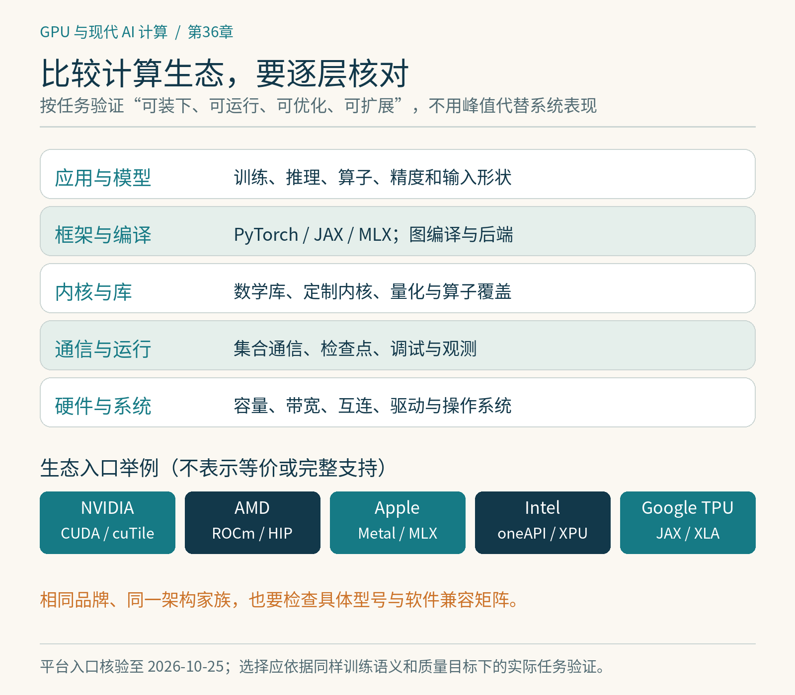

# 第36章　GPU 与专用加速器的系统比较

学完前面的硬件、训练与算子，可以重新看“应该选什么设备”。这不应从一张按峰值算力排序的表开始，而应从工作负载、内存、软件与扩展需求开始。能装下模型、能运行代码、能达到目标吞吐，是三个不同层级的条件。我们先用相同的问题检查不同生态，再理解它们各自擅长的系统形态。

## NVIDIA：从芯片到训练软件的连接

NVIDIA的计算生态包括CUDA编译与运行时、数学库、通信库、分析工具，以及上层训练和推理集成。已有CUDA定制算子的项目通常可以沿现有路径继续优化；CuTe DSL、cuTile等新表达方式又提供不同层次的硬件控制。这里的优势来自工具和实现能连接起来，而不只是某种芯片参数。[1]

购买或租用时仍需看具体型号。相同架构家族下，数据中心与消费GPU的显存、互连、低精度能力、可靠性特性并不相同。模型能在一张消费卡上运行，不代表换成多张就能获得机架级互连；一段依赖特定矩阵指令或异步机制的算子，也不能因品牌相同就假设可用。驱动、编译目标和库版本需要一起满足条件。

*图 36-1｜原创精确图解。从任务到框架、内核、通信与硬件逐层核对。生态入口只是例子，不表示各软件栈完全等价，也不代表任意型号都支持相同功能。*

## AMD：开放软件栈也需要完整核对

AMD ROCm包含HIP、编译器、运行时、数学与通信库、分析工具，以及面向框架的集成。把CUDA源码迁移为HIP是其中一条路径，但二进制不能直接通用，硬件布局与指令也不同。对于性能敏感算子，源代码能编译只是第一步，wavefront组织、矩阵指令、寄存器与共享存储策略仍要重新验证。[2]

CDNA面向数据中心计算，RDNA服务于不同的产品与场景；不能用“AMD GPU”四个字抹平差异。ROCm的支持范围还依赖GPU、系统、驱动和框架组合。尤其是Windows：官方已有特定硬件上的原生PyTorch支持与相应ROCm组件，但兼容矩阵明确区分组件，不能据此宣称整个Linux训练软件栈在Windows完全等价。WSL也有自己的支持路径。[3]

因此跨厂商测试要先列依赖：框架算子、Triton或HIP内核、通信后端、量化库、检查点与部署插件。只要其中一个核心扩展依赖PTX或CUDA私有接口，迁移成本就可能集中在那里。相反，如果任务主要使用已有高效库算子，移植工作可能小得多。结论应该来自实际工作负载。

## Apple：统一内存改变了容量与搬运关系

Apple silicon让CPU与GPU访问共享的物理内存体系，MLX围绕统一内存、惰性求值和函数变换组织数组计算。对于个人设备，大容量内存可让某些原本放不进独立显卡显存的模型在本机运行；CPU与GPU之间的数组使用也有不同于显式复制的体验。[4]

但“统一”不代表无穷带宽或所有访问都免费。内存由系统和其他进程共享，实际可供GPU使用的容量受到运行环境约束；CPU和GPU的工作仍需要正确同步。MLX采用惰性求值，计时前还要确保计算真正执行，不能只测构建表达式的时间。[5]

训练能力还要分任务讨论。单机推理、适配器微调、小模型研究与大规模预训练，需要的矩阵吞吐、互连和软件支持不同。不能因为内存更大便推导训练更快，也不能用单卡CUDA数据中心实验的结果估算Mac上的实际速度。比较时应运行相同语义的任务，说明算子实现、量化格式与质量差异。

## Intel、TPU与其他专用加速器

PyTorch已经提供原生XPU后端用于支持的Intel GPU，官方文档分别说明Linux、Windows、驱动与设备要求。底层生态还包含oneAPI、SYCL及相关库。面对历史资料时要检查日期，避免一律要求安装旧的额外扩展；当前原生路径和特定扩展的适用范围不同。[6]

Google TPU以矩阵乘法单元和脉动阵列为重要结构，并把芯片互连、编译器与大规模切分紧密结合。JAX/XLA与相关工具是常见入口。它仍包含标量、向量和控制能力，不是只能执行一项固定矩阵操作的黑盒；GPU也早已有专用矩阵单元，两者的区别不能简化为“一个通用、一个只会矩阵”。[7]

其他NPU或训练加速器也应按同样层次理解：支持哪些数据类型和运算，内存与网络怎样组织，编译器怎样处理动态形状，自定义算子能否开发，框架和调试工具是否覆盖目标任务。PyTorch官方额外平台页面可作为入口，但某个设备后端存在，不代表所有上游扩展和模型都已可用。[8]

## 用同一份工作负载做决定

| 观察维度 | 应该提出的问题 |
|---|---|
| 容量 | 权重、激活、优化器或KV能否同时放下？ |
| 运算 | 目标精度是否有硬件与内核支持？ |
| 数据搬运 | 显存带宽、主机连接、卡间与机间连接是否够用？ |
| 软件 | 核心算子、编译、通信与调试能否走通？ |
| 运行 | 长任务的恢复、可观测性和环境维护是否可靠？ |
| 成本 | 完成同样质量任务所需总时间与资源是多少？ |

一项可复现的比较可以分三步。首先运行参考实现验证结果，包括前向、梯度和精度；然后固定模型、输入形状与有效批次，测端到端耗时和显存；最后针对各平台做合理优化，并同时公开这些调整。直接拿一边的成熟定制内核对比另一边的朴素实现，得到的是实现差异，不足以概括所有硬件。

本书不把快速变化的型号与价格固定成长期排名。参数表适合附带日期独立更新，正文更应保留判断方法。现代AI计算真正连接的是模型、算法、数值格式、编译器、内核、存储与网络。理解这些边界，才有能力判断新发布的芯片和工具究竟解决了哪一段问题，以及剩下的系统是否已经跟上。

## 把不确定性留在正确的位置

型号与软件支持会变，判断方法可以保持稳定。对新发布的平台，可以先分别标记文档宣称、公开代码可用、自己成功运行与自己完成性能验证四种证据。没有跑通某个算子，只能说明当前路径存在缺口；跑通一个小样例，也不能证明长期大训练已经可靠。这样写记录既不贬低新生态，也不提前替它担保，后续更新时还能够明确看出证据增加在哪一层。

## 本章资料

资料核验：2026-10-25。本文是生态与判断方法介绍，不提供设备采购价格或未经测量的性能排名。

[1] NVIDIA，CUDA Toolkit：https://developer.nvidia.com/cuda/toolkit  
[2] AMD，ROCm：https://rocm.docs.amd.com/  
[3] AMD，Windows support matrices：https://rocm.docs.amd.com/projects/radeon-ryzen/en/latest/docs/compatibility/compatibilityrad/windows/windows_compatibility.html  
[4] MLX，Unified Memory：https://ml-explore.github.io/mlx/build/html/usage/unified_memory.html  
[5] MLX，Lazy Evaluation：https://ml-explore.github.io/mlx/build/html/usage/lazy_evaluation.html  
[6] PyTorch，Getting Started on Intel GPU：https://docs.pytorch.org/docs/main/notes/get_start_xpu.html  
[7] Google Cloud，TPU architecture：https://docs.cloud.google.com/tpu/docs/system-architecture-tpu-vm  
[8] PyTorch，Additional Platforms：https://pytorch.org/get-started/additional-platforms/
